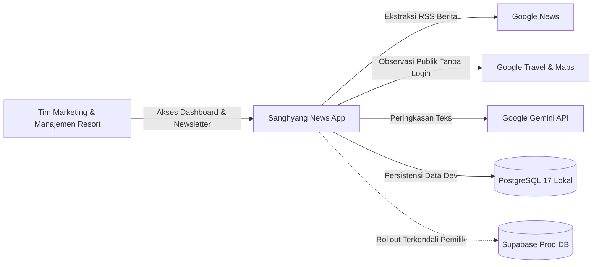

# Arsitektur sistem: Sanghyang Analytics

<!-- agents:inception -->
<!-- Penanda di atas mengaktifkan gerbang inisiasi: selama register ADR belum memuat keputusan berstatus Berlaku dan
     peta fase belum punya fase Berjalan, hook menolak perubahan di luar docs/ dan konfigurasi agen. -->

Dibuat 2026-11-13. Disetujui pemilik lewat prompt swarm 13 Nov 2026. Setiap keputusan yang mengubah bentuk sistem masuk ke **Register ADR** (§9) sebelum kodenya ditulis.

## 1. Ringkasan arsitektur

- **Arketipe proyek**: Aplikasi web full-stack analitik pasar perhotelan & manajemen konten internal (Next.js 16 App Router) terintegrasi dengan pipeline data ekstraksi web (FastAPI/Crawl4AI + Node.js scraper) dan basis data relasional PostgreSQL 17 (Prisma ORM).
- **Gaya arsitektur terpilih dan alasannya**: Monolit modular Next.js dengan App Router, pemisahan rute antarmuka pengguna berbasis AppShell terpadu, lapisan akses data tersentralisasi dengan pengaman tulis lingkungan, serta layanan perayapan lokal yang terisolasi. Pendekatan ini meminimalkan latensi antar-komponen, menghilangkan kompleksitas orkestrasi microservice yang tidak dibutuhkan, dan menjaga pemakaian memori tetap dalam batas aman RAM 14 GiB.

### 1.1 Prioritas atribut kualitas (urutan keputusan bila terjadi untung rugi)

1. **Kebenaran data dan provenans (Zero Mock)**: Setiap metrik, angka, ulasan, tarif, dan promo wajib bersumber dari observasi riil berwaktu, masukan terverifikasi pemilik, atau rumus transparan. Data fiktif dilarang tanpa toleransi.
2. **Isolasi lingkungan dan integritas operasional**: Database produksi Supabase tidak boleh disentuh selama pengembangan; seluruh pengujian dan eksekusi lokal memakai kontainer PostgreSQL 17 lokal.
3. **Kinerja dan efisiensi sumber daya**: Waktu muat halaman cepat (p95 API < 1,5 detik), hemat RAM pada mesin 14 GiB, dan tidak ada kebocoran proses latar belakang.
4. **Kesederhanaan dan pengalaman pengguna**: Antarmuka mudah dipahami tim pemasaran non-teknis, navigasi konsisten di semua rute, tanpa emoji sebagai ikon pengganti komponen grafis.
5. **Kepatuhan hukum dan etika perayapan**: Taat pada robots.txt, tidak menembus batas otentikasi/CAPTCHA platform pihak ketiga, dan patuh UU Pelindungan Data Pribadi (UU PDP).

### 1.2 Keputusan terkunci

- Penggunaan kontainer Docker PostgreSQL 17 mandiri di port 55432 untuk seluruh aktivitas dev dan tes lokal.
- Pengaman tulis produksi aktif di `lib/db.ts` untuk memblokir mutasi tidak disengaja ke basis data produksi.
- Seluruh dokumen dan teks antarmuka ditulis dalam Bahasa Indonesia baku yang lugas.
- Peniadaan data tiruan (Zero Mock) di seluruh codebase.

### 1.3 Batasan anggaran dan kuota

| Kemampuan | Layanan dan paket | Kuota | Puncak terukur | Garis peringatan 70% | Cara memantau |
| :--- | :--- | :--- | :--- | :--- | :--- |
| Peringkasan Berita | Google Gemini API | ~500 req/hari (shared) | ~200 req/hari | 350 req/hari | Log audit kuota harian |
| Basis Data Produksi | Supabase PostgreSQL 17 | Sesuai paket Free/Pro | Terbaca 13 Nov 2026 | Batas ukuran koneksi | Metrik Supabase dashboard |
| Basis Data Lokal | Docker Postgres 17 | RAM 768 MiB, 1 CPU | Mandiri di mesin lokal | 600 MiB RAM | `docker stats` |
| Eksekusi Berat Lokal | Runner Skrip / Node / Py | RAM 14 GiB total | Max 1 heavy job | 10 GiB sistem | `resource_guard.py` |

## 2. Konteks sistem (C4 level 1)

## 3. Kontainer (C4 level 2)

| Kontainer | Teknologi | Tanggung jawab | Hosting |
| :--- | :--- | :--- | :--- |
| Web Application | Next.js 16, React 19, Tailwind v4 | UI Dashboard, AppShell, Newsletter, API Route | Node.js (Dev: systemd 3001 / Prod: Vercel) |
| Local Database | Docker `postgres:17` | Penyimpanan data dev lokal (snapshot produksi) | Docker Container `127.0.0.1:55432` |
| Crawler & Ingestion | Node.js TS / FastAPI Crawl4AI | Scraping berita, ulasan publik, tarif kamar | Lokal background runner / cron |
| PDF Renderer | Puppeteer + Chromium | Pembuatan dokumen PDF Rapat Senin & Newsletter | Node.js lokal headless |

## 4. Komponen (C4 level 3)

- **`AppShell` (`components/layout/AppShell.tsx`)**: Navigasi seragam, header informasi outlet, dan wrapper layout tunggal.
- **`Database Guard` (`lib/db.ts`)**: Prisma Client wrapper dengan deteksi URL produksi dan proteksi operasi mutasi.
- **`Provenance Audit Engine` (`lib/market/provenance.ts`)**: Validator asal-usul metrik dan kalkulator formula transparan.
- **`Single Registry Repository` (`lib/market/competitor-registry.ts`)**: Akses tunggal data pesaing terverifikasi Anyer–Carita.
- **`Crawl Scheduler & Logger` (`lib/market/scrape-logger.ts`)**: Pencatatan terstruktur `ScrapeRun` dan `ScrapeError` untuk setiap job scraping.

## 5. Alur kunci

1. **Alur Observasi Data Pasar**:
   `Crawler Runner` -> `Robots/Policy Check` -> `Fetch Observasi Publik` -> `Validasi Skema & URL Asli` -> `Catat ScrapeRun` -> `Simpan ke DB Lokal`.
2. **Alur Penyajian Metrik Dashboard**:
   `Client Component` -> `Server API Endpoint` -> `Filter Periode & Registry DB` -> `Kalkulasi Formula Provenans` -> `Render Metrik Berlabel`.
3. **Alur Newsletter & PDF**:
   `Google News Ingest` -> `Gemini Summarizer (Terkontrol)` -> `Review Staf` -> `Puppeteer HTML-to-PDF` -> `Unduh Dokumen`.

## 6. Model data

Model utama Prisma mencakup:
- `Competitor`: Registri tunggal pesaing (kelompok hotel/fnb/venue, koordinat, mapsUrl, jarak, status aktif).
- `CompetitorPriceSnapshot` & `SanghyangPriceSnapshot`: Observasi tarif kamar harian dengan tanggal dan sumber.
- `CompetitorReview`: Ulasan tamu publik dengan sentimen berbasis kata kunci, tanggal observasi, dan URL bukti.
- `CompetitorPromotion`: Promo dan acara pesaing berbasis tanggal berlaku riil (status aktif/kedaluwarsa otomatis).
- `Article` & `MarketItem`: Berita pasar terkurasi dengan klasifikasi domain Anyer-Carita dan skor relevansi terhitung.
- `ScrapeRun` & `ScrapeError`: Riwayat eksekusi seluruh job scraping untuk transparansi operasional.
- `OutletMonthlyRevenue` & `OutletMonthlySnapshot`: Data performa outlet riil hasil impor pemilik dengan proteksi penyamaran.

## 7. Keamanan, privasi, dan rahasia

- **Lokasi kredensial**: `.env.development.local` untuk konfigurasi lokal (tidak pernah di-commit); `.env.example` sebagai referensi aman tanpa secret.
- **Data pribadi**: Tidak mengumpulkan atau menyimpan data pribadi tamu; ulasan publik dianonimkan sesuai data publik Google Maps.
- **Keamanan sesi**: Token sesi berbasis HMAC SHA-256 dengan rahasia lingkungan mandiri (`SESSION_SECRET`), waktu kedaluwarsa terukur, dan pembatas laju percobaan login (rate limiter) pada `/api/login`.
- **Pengamanan URL**: Semua permintaan web keluar sisi server wajib melalui utilitas validasi `fetchAman` guna mencegah SSRF.

## 8. Observabilitas dan operasi

- **Log & Metrik**: Pencatatan eksekusi scraping ke tabel `ScrapeRun`, endpoint `/api/health?ready` dengan pelaporan status target database (`lokal` atau `produksi`).
- **Strategi Rilis**: Pengembangan lokal 100% terisolasi -> Verifikasi 10 gerbang mutu -> Penyusunan `docs/plans/ROLLOUT_PRODUKSI.md` -> Penerapan manual terverifikasi oleh pemilik.

## 9. Register ADR

Status yang disetujui pemilik lewat prompt swarm 13 Nov 2026: **Berlaku**.

| ADR | Keputusan | Status | Lokasi kode |
| :---: | :--- | :--- | :--- |
| 001 | Lingkungan pengembangan terpisah (Postgres 17 Docker lokal & pengaman tulis) | Berlaku | `lib/db.ts`, `.env.development.local` |
| 002 | Registri pembanding tunggal di basis data | Berlaku | `prisma/schema.prisma`, `lib/market/competitor-registry.ts` |
| 003 | Provenans data dan eliminasi data karangan (Zero Mock) | Berlaku | `lib/market/`, `app/` |
| 004 | Perayapan patuh, pemisahan komentar sosmed publik tanpa login vs OAuth akun sendiri | Berlaku | `crawler/`, `lib/market/scrape-social-buzz.ts`, `lib/market/social-sources.ts` |
| 005 | Satu AppShell terpadu dan token desain Tailwind v4 | Berlaku | `app/layout.tsx`, `components/layout/` |
| 006 | Pengujian berlapis mandiri tanpa ketergantungan luar | Berlaku | `tests/`, `package.json` |
| 007 | Lapisan pengetahuan terstruktur (dokumen, fase, graf, memori) | Berlaku | `docs/`, `.agents/` |
| 008 | Aturan pembanding (sejenis, ≤ 25 km, penginapan ≥ bintang 4 di minimal satu sumber besar) dan peran inti atau acuan | Berlaku | `lib/market/compset.ts`, `lib/market/compset-audit.ts` |
| 009 | Knowledge Graph dan PDF Rapat Senin dari data bersumber | Berlaku | `lib/knowledge-graph/`, `lib/meeting-report/`, `lib/market/competitor-facts.ts` |
| 010 | Promo dan event dipisah AI, isi paket disalin dari sumber, tanggal kalender WIB | Berlaku | `lib/market/promo-extractor.ts`, `lib/market/website-promos.ts`, `lib/market/promo-kind.ts` |
| 011 | Berita dibaca isinya di situs penerbit lalu dinilai: terkait outlet, lokasi dalam radius 25 km, acara paling lambat sebulan sesudah periode | Berlaku | `lib/market/news-reader.ts`, `lib/market/news-relevance.ts`, `app/api/market-intelligence/summary/route.ts` |
| 012 | Sinkronisasi media sosial (Instagram & TikTok) via Ekstensi Chrome Staf MV3 unpacked tanpa biaya server ($0), jeda manusia pada login/CAPTCHA, anonimisasi komentar | Berlaku | `extension/sanghyang-social-sync/`, `lib/market/browser-social-sync.ts`, `app/api/marketing-sosmed/browser-sync/route.ts` |
| 013 | DB produksi disamakan dengan DB kerja lokal setiap push ke cabang produksi: registri dan kurasi mengikuti lokal, pengamatan digabung dua arah, urutan tampilan deterministik | Digantikan ADR-014 | `scripts/ops/sync-production-data.ts` |
| 014 | Konsolidasi aplikasi tunggal Next.js 16.4.6 `sanghyang-analytics` (`Opsi A`), satu schema PostgreSQL `public` (31 migrasi bersih tanpa warisan VOLA ber-RLS/`REVOKE` di Supabase baru `omuqbpxierdlfjascngz`), domain akun `@sanghyang-analytics.local`, caching native Data Cache (`unstable_cache` + `invalidateTags`), jembatan Knowledge Graph internal VHP tanpa kebocoran rupiah, penghapusan nama lama `VRP`/`sanghyang-news`, dan pemutusan hook pre-push lama | Berlaku | `src/`, `supabase/migrations/`, `src/lib/cache/`, `src/lib/analytics/internal-signals.ts`, `src/lib/knowledge-graph/` |

### ADR-001 · Lingkungan pengembangan terpisah

- **Konteks:** `.env.local` menunjuk database Supabase produksi secara langsung, sehingga pengujian lokal rentan merusak data produksi.
- **Opsi yang dibandingkan:**
  1. Tetap memakai Supabase produksi dengan branch terpisah: Memerlukan kuota tambahan dan risiko kebocoran konfigurasi.
  2. Menjalankan Docker PostgreSQL 17 lokal port 55432 mandiri dengan data awal dari snapshot baca-saja: Terisolasi sempurna, aman dari mutasi data produksi, dan hemat biaya.
- **Keputusan:** Opsi 2 dipilih. Kontainer Docker PostgreSQL 17 lokal di port 55432, dilengkapi pengaman tulis di `lib/db.ts`.
- **Konsekuensi:** Perlu konfigurasi Docker lokal dan prosedur pembaruan snapshot berkala; data produksi aman terlindungi.
- **Disetujui pemilik:** 2026-11-13 (disetujui pemilik lewat prompt swarm 13 Nov 2026).

### ADR-002 · Registri pembanding tunggal di basis data

- **Konteks:** Daftar kompetitor tersebar di 6 file kode dan JSON berbeda dengan nama tidak seragam dan data duplikat.
- **Opsi yang dibandingkan:**
  1. Sinkronisasi berkas JSON statis antar modul.
  2. Registri tunggal di tabel database relasional `Competitor` dengan migrasi Prisma dan seed berprovenans.
- **Keputusan:** Opsi 2 dipilih. Seluruh modul membaca daftar kompetitor dari repositori database tunggal.
- **Konsekuensi:** Memerlukan migrasi skema lokal dan penyesuaian semua pemanggil modul compset.
- **Disetujui pemilik:** 2026-11-13 (disetujui pemilik lewat prompt swarm 13 Nov 2026).

### ADR-003 · Provenans data dan eliminasi data karangan (Zero Mock)

- **Konteks:** Terdapat angka omset fiktif, pangsa pasar karangan, peringkat buatan, dan sumber bukti palsu di codebase.
- **Opsi yang dibandingkan:**
  1. Mempertahankan angka estimasi keras sebagai nilai bawaan fallback.
  2. Menghapus total data karangan; setiap metrik wajib bersumber dari observasi riil, input pemilik, atau rumus berlabel "Perkiraan kasar".
- **Keputusan:** Opsi 2 dipilih sesuai Konstitusi Inti Pasal I Invarian Zero Mock.
- **Konsekuensi:** Bila data belum tersedia, antarmuka wajib menampilkan "Belum ada data" secara jujur.
- **Disetujui pemilik:** 2026-11-13 (disetujui pemilik lewat prompt swarm 13 Nov 2026).
- **Pembaruan 18 Nov 2026 (permintaan pemakai):**
  - Langkah 2 hanya menampilkan butir bersumber (fakta situs resmi, rating, ulasan, harga). Alasan "data yang belum ada", catatan perbandingan lama yang tidak bersumber per butir, dan kartu tanpa butir bersumber tidak dikirim lagi (`groundedComparisons`).
  - Ulasan bertanda "di Google" yang dibaca dari tab ulasan Google Travel berlabel **Google Maps**, karena itu ulasan yang sama dengan listing Google Maps tempatnya (Sanghyang: 4,4 · 3.047 ulasan di keduanya). Halaman bacanya tetap tersimpan di `sourceUrl`.
  - Ulasan di Insight Pasar disaring menurut tanggal ulasan di periode terpilih.
  - Fixture contoh buatan `google-travel-sample.html` diganti kartu asli 18 Nov 2026.

### ADR-004 · Perayapan patuh, teramati, dan pemisahan data sosial publik tanpa login

- **Konteks:** Perayapan Instagram dan TikTok terbentur login, rencana lama hendak menginjeksi cookie, job scraping tidak tercatat, dan sempat terjadi penyamarataan bahwa seluruh modul "Komentar sosmed" harus menunggu login/koneksi akun resmi Sanghyang.
- **Opsi yang dibandingkan:**
  1. Injeksi cookie sesi atau mode siluman untuk menembus login/WAF Instagram, Facebook, dan TikTok (dilarang keras konstitusi & aturan kepatuhan).
  2. Menghentikan seluruh pengumpulan komentar sosial sampai pemilik menghubungkan akun resmi Sanghyang (menghambat komentar publik yang sah diambil tanpa login).
  3. Penghentian scraping berlogin/WAF ilegal sambil memisahkan **jalur komentar publik tanpa login akun Sanghyang** (`YouTube Data API v3` via `YOUTUBE_API_KEY` server dengan anonimisasi PII & pangkas otomatis retensi ≤ 30 hari, serta `Instagram Business Discovery` via token akun bisnis mana pun & `TikTok oEmbed` tanpa kunci) dari **koneksi akun Sanghyang sendiri (OAuth)** yang hanya dibutuhkan untuk analitik konten internal, iklan media sosial, dan komentar IG/FB berizin pemilik (`instagram_manage_comments`); seluruh eksekusi tercatat ke `ScrapeRun`.
- **Keputusan:** Opsi 3 dipilih (memperbarui Keputusan Opsi 2 13 Nov 2026 atas arahan pemilik 17 Nov 2026). Kepatuhan `robots.txt`/WAF tetap mutlak, sedangkan data sosial publik yang tersedia tanpa login Sanghyang dikumpulkan otomatis.
- **Konsekuensi:** Modul media sosial langsung menampilkan komentar publik YouTube yang dianonimkan (retensi maksimal 30 hari per kebijakan YouTube III.E.4) segera setelah `YOUTUBE_API_KEY` terisi tanpa menunggu login akun Sanghyang, sementara batas platform Meta (`robots.txt Disallow: /`) dan TikTok (`SlardarWAF`) tetap dijelaskan apa adanya di UI.
- **Disetujui pemilik:** 2026-11-13 (disetujui pemilik lewat prompt swarm 13 Nov 2026; pemisahan jalur publik tanpa login diperbarui 2026-11-17 atas arahan pemilik).
- **Pembaruan 18 Nov 2026:** jalur komentar publik YouTube (YouTube Data API, `YOUTUBE_API_KEY`) dihapus atas permintaan pemakai, termasuk item video YouTube di hasil RSS Google News. Sumber sosmed tanpa login akun Sanghyang tinggal Instagram Business Discovery dan TikTok oEmbed; kanal Media Sosial di Langkah 1 menjelaskan kekosongannya dari status kedua sumber itu.

### ADR-005 · Satu AppShell terpadu dan token desain Tailwind v4

- **Konteks:** Terdapat 5 sidebar dan navigasi berbeda di berbagai halaman, ukuran halaman ribuan baris, dan 1.500+ kode warna hex tertanam.
- **Opsi yang dibandingkan:**
  1. Menjaga layout per rute secara independen.
  2. Membangun AppShell tunggal di route group `layout.tsx`, memecah komponen halaman raksasa, mengadopsi token Tailwind v4 di `@theme`, dan mengganti emoji ikon dengan Lucide icons.
- **Keputusan:** Opsi 2 dipilih untuk keseragaman antarmuka dan kemudahan pemeliharaan.
- **Konsekuensi:** Perlu refaktorisasi layout di seluruh rute aplikasi Next.js.
- **Disetujui pemilik:** 2026-11-13 (disetujui pemilik lewat prompt swarm 13 Nov 2026).

### ADR-006 · Pengujian berlapis mandiri tanpa ketergantungan luar

- **Konteks:** Pengujian sebelumnya bergantung pada 62 skrip ad-hoc yang memanggil database produksi dan jaringan luar.
- **Opsi yang dibandingkan:**
  1. Menjalankan skrip ad-hoc secara manual.
  2. Menerapkan suite tes Vitest standar dengan pembagian pengujian unit, integrasi DB lokal, dan pengujian parser berbasis fixture rekaman asli.
- **Keputusan:** Opsi 2 dipilih. Perintah `npm test` wajib berjalan aman tanpa internet, tanpa Gemini, dan tanpa koneksi produksi.
- **Konsekuensi:** Pembersihan dan reorganisasi folder `scripts/` dan penyusunan fixture uji statis.
- **Disetujui pemilik:** 2026-11-13 (disetujui pemilik lewat prompt swarm 13 Nov 2026).

### ADR-007 · Lapisan pengetahuan terstruktur

- **Konteks:** Dokumentasi lama berserakan di akar proyek dengan enkripsi rusak, TODO.md hilang, dan memori graf belum memadai.
- **Opsi yang dibandingkan:**
  1. Membiarkan file dokumentasi di akar repositori.
  2. Mengonsolidasikan dokumentasi ke hierarki standar `docs/` (plans, architecture, phase, design, compliance, guides, research), sinkronisasi memori Hermes dan Graphify.
- **Keputusan:** Opsi 2 dipilih untuk memastikan keterlacakan pengetahuan dan kemudahan serah terima lintas agen.
- **Konsekuensi:** Struktur direktori `docs/` dirawat aktif sejalan dengan eksekusi fase.
- **Disetujui pemilik:** 2026-11-13 (disetujui pemilik lewat prompt swarm 13 Nov 2026).

### ADR-008 · Aturan pembanding dan peran inti atau acuan

- **Konteks:** Daftar pembanding lama memuat tempat yang tidak setara (Allisa bintang 2, Mutiara Carita 34 km) dan nama sub-venue Aston dari skrip riset sintetis (Bale-Bale Spa ASTON ternyata di Jakarta). Skor relevansi 0–100 dan radius 15 km tidak punya sumber.
- **Opsi yang dibandingkan:**
  1. Mempertahankan skor relevansi berbobot lima kriteria.
  2. Aturan tetap yang bisa diperiksa: sejenis dengan outlet, jarak tempuh mobil paling jauh 25 km dari Sanghyang (Google Maps), dan untuk penginapan minimal bintang 4; peran `inti` dihitung di pangsa pasar dan koridor harga, `acuan` hanya ditampilkan.
- **Keputusan:** Opsi 2. Aturan ada di `lib/market/compset.ts`, peran di kolom `Competitor.compsetRole`, dan tempat yang tidak lolos diarsipkan (`active = false`, `retiredReason`), tidak dihapus. Hawaii Resort (bintang 3) menjadi acuan atas keputusan pemakai.
- **Konsekuensi:** Market Cap kamar resort dihitung dari pembanding inti saja (`lib/market/market-size.ts`), audit pembanding per outlet dibaca langsung dari registri (`lib/market/compset-audit.ts`), dan perbandingan head-to-head merujuk pesaing lewat nama registri, bukan UUID baris.
- **Disetujui pemilik:** 2026-11-13 (rencana `docs/plans/2026-11-13-rencana-perombakan-insight-pasar.md`, disetujui pemakai).
- **Pembaruan 2026-11-14 (wewenang menambah dan mengeluarkan pembanding dari pemakai):**
  - Resto atau bar mandiri butuh minimal 50 ulasan Google (`MIN_STANDALONE_REVIEWS`); ulasan sesedikit itu menandakan pasar yang terlalu kecil untuk dibandingkan. Enam tempat diarsipkan beserta jumlah ulasannya oleh skrip sekali jalan yang dibuang 22 Nov 2026; aturannya kini ditegakkan `lib/market/compset.ts` di setiap penilaian ulang kompetitor.
  - Restoran, bar, dan spa di dalam hotel pembanding menjadi pesaing outlet Sanghyang dan ikut kelayakan hotel induknya (kolom `Competitor.parentId`, migrasi `20261114030000_competitor_parent`). Daftarnya diturunkan dari fakta situs resmi `restoran:`, `bar:`, dan `spa:` (`scripts/ops/sync-hotel-venues.ts`). Data resmi operator Archipelago (llms.txt) dibaca tanpa LLM (`lib/market/llms-profile.ts`).
  - Hawaii Resort Family Suites, satu-satunya tempat berperan acuan, dikeluarkan karena bintang 3 (Google Maps, Orbitz, Wotif) dan bukti bintang 4 tidak ditemukan. Peran acuan kini tidak dipakai; PDF dan tampilan hanya mencetak label acuan bila ada tempat yang memang berperan acuan.
  - Galeri Pesaing per outlet memakai registri yang sama. Outlet hotel memakai foto situs resminya (`scripts/ops/collect-venue-photos.ts`) ditambah foto listing hotel induk yang memperlihatkan jenis outlet itu; foto kamar hanya tampil di Kamar & Resort.

- **Pembaruan 2026-11-17 (penambahan Nemuru Grand Anyer Palazo dan audit kompset menyeluruh enam outlet):**
  - `Nemuru Grand Anyer Palazo` (`1,8 km` via OSRM, setara bintang 4 OTA) dimasukkan ke pembanding inti `Kamar & Resort` beserta outlet yang tercantum di situs resminya (`TEMU KATSU RESTO` -> D'Bistro; `Nemuru Light house lounge and karaoke` dan `The Bellezza Pool Bar` -> D'Bar & Dragon Beach Club).
  - Koreksi jumlah kamar `Mambruk Hotel & Convention` menjadi `145` sesuai situs resmi (`mambruk.co.id/accomodation`), perbaikan alasan arsip `Patra Anyer Hotel` (masih beroperasi, dikeluarkan karena bintang 3) serta penggabungan jejak rebrand `MaxOne Anyer` -> `THE WEST COVE HOTEL` (`18,0 km`).
  - Penambahan pesaing terverifikasi `<= 25 km` (jarak jalan OSRM) yang terlewat di outlet non-resort: 7 resto pesisir `>= 50` ulasan di `Sunset Grill`, `Andalan Beach Resto & Coffee` dan `Kalani Beach Resto Anyer` di `Dragon Beach Club`, `Kalyana Mitta Lounge & Karaoke` dan `Anang Family Karaoke` di `D'Bar & Karaoke`, serta `Lagoon Restaurant Jayakarta` (`D'Bistro`), `Belia Spa and Reflexy Cilegon`, `Alta Spa Marbella Anyer`, dan `Spa & Wellness Aston Anyer` (`D'Spa`).

- **Pembaruan 2026-11-17 (Claude Code, audit lanjutan atas permintaan pemakai):**
  - Aturan bintang penginapan dibaca seperti keputusan Nemuru: minimal satu sumber besar (Google, Traveloka, tiket.com, Trip.com, Agoda, Booking.com, situs resmi) mencantumkan bintang 4. Kelas yang dipakai adalah bintang tertinggi dari sumber itu (`compsetStars`, kolom `starRating`/`starSource` di `hotel-compset.data.json`), dan label tampilan menyebut sumbernya.
  - Hawaii Resort Family Suites kembali menjadi pembanding inti karena bukti baru (Traveloka 4.0, Trip.com 4, Kayak 4); keputusan 14 Nov dibalik dan bisa dikembalikan pemilik. My Pisita Anyer Resort (0,7 km, Google bintang 4) ditambahkan. Patra Anyer dan The West Cove tetap di luar (bintang 3 di semua sumber).
  - `ratesUrl` Jayakarta ternyata menunjuk entity Google Hotels milik Resort Prima Anyer; tarif dan ulasan yang terlanjur tercatat dipindah ke Resort Prima, bukan dihapus. Menit berkendara OSRM tidak dipakai (`lib/market/distance-source.ts`), km tetap.
  - Saran riset resto, bar, dan spa yang bertentangan dengan daftar pemilik 16 Nov (Dragon Beach Club, Lighthouse, Hotel Pier, West Cove Terrace, Alta Spa) tidak diterapkan dan diajukan sebagai keputusan pemilik.

### ADR-009 · Knowledge Graph dan PDF Rapat Senin dari data bersumber

- **Konteks:** Menu Pembaruan Data diganti satu tombol pembaruan penuh, dan pemakai meminta peta 3D relasi seluruh data bisnis serta PDF Rapat Senin bergaya laporan riset per outlet.
- **Opsi yang dibandingkan:**
  1. Graf dan profil pesaing ditulis tangan di kode.
  2. Graf dirakit dari basis data setiap kali dibuka (`lib/knowledge-graph/`), dan profil pesaing dikumpulkan dari situs resmi ke tabel `CompetitorFact` dengan kutipan halaman sebagai bukti (`scripts/ops/collect-competitor-profiles.ts`).
- **Keputusan:** Opsi 2. Simpul data wajib membawa sumber; fakta profil yang kutipannya tidak ditemukan di halaman dibuang; tempat tanpa situs resmi ditulis "Belum ada data". `3d-force-graph` dipatok 1.73.4, versi yang sama dengan `graphify-out/graph.html`.
- **Konsekuensi:** Migrasi `20261114020000_competitor_fact`; PDF dibangun langsung dari basis data (`lib/meeting-report/`), bukan dari respons summary API; omset rupiah Sanghyang tidak dicetak di PDF.
- **Disetujui pemilik:** 2026-11-13 (rencana yang sama, Fase 5 dan Fase 6).
- **Pembaruan 2026-11-14 (permintaan pemakai):**
  - PDF "Semua Outlet" bukan lagi ringkasan dua halaman. Isinya matriks enam outlet lalu satu bab per outlet; tempat yang dibandingkan di beberapa outlet dicetak lengkap sekali dan dirujuk dari bab berikutnya.
  - Promo Sanghyang (kartu penawaran situs resmi dan program bulanan tim marketing beserta status verifikasinya) disimpan di `CompetitorPromotion` pada baris registri outlet Sanghyang, seperti ulasan dan rating outlet sendiri. Semua tampilan promo pesaing memakai filter `NOT_OWN_PROMO` (`lib/market/own-promos.ts`), dan Knowledge Graph memberinya jenis simpul "Promo Sanghyang".

### ADR-010 · Promo dan event dipisah AI, isi paket disalin dari sumber

- **Konteks:** Pemakai meminta "Events" dipisah dari "Promo" tanpa daftar kata kunci di kode, dan menemukan kartu "Midweek Full Reset" berisi ringkasan AI yang tidak sesuai isi paket di situs resmi Novus Jiva. Akar masalahnya: prompt situs memotong halaman ke 2.000 huruf, promo yang sudah tersimpan tidak pernah diperbarui saat penyegaran, dan tanggal disimpan sebagai tengah malam UTC.
- **Opsi yang dibandingkan:**
  1. Daftar kata kunci (mis. "show", "party", "%") untuk memisahkan promo dan event.
  2. Jenis diputuskan AI dari definisi tertulis (`KIND_RULES`) saat membaca sumber, disimpan di kolom `CompetitorPromotion.kind`; isi paket dan syarat disalin dari sumber dan hanya diterima bila tertulis di teks yang dibaca (`groundedLines`).
- **Keputusan:** Opsi 2 (permintaan pemakai 17 Nov 2026). Migrasi `20261117000000_promotion_kind_details` menambah `kind` (NULL = belum dibaca), `details`, dan `terms`. Langkah "situs" pada penyegaran membaca halaman penawaran penuh (40.000 huruf, baris dipertahankan), memperbarui baris lama dengan OCC, lalu memilah baris tanpa jenis (`lib/market/promo-kind.ts`). Tanggal mengikuti kalender WIB (`promoDayRange`).
- **Konsekuensi:** Insight Pasar (Langkah 4), radar promo halaman Omset, PDF Rapat Senin, dan Knowledge Graph (simpul "Event pesaing" dan "Event Sanghyang") memisahkan promo dan event. Pemilahan memakai kuota Gemini (satu permintaan per halaman penawaran, satu per 25 baris lama). Jenis bisa berubah bila isi sumber berubah; suhu model 0 menjaga hasil tetap sama untuk sumber yang sama.
- **Disetujui pemilik:** 2026-11-17 (permintaan pemakai di sesi Claude Code).

### ADR-011 · Berita dibaca isinya sebelum dinilai relevan

- **Konteks:** Bagian "Berita relevan" Insight Pasar memilih berita dari kategori dan kata kunci judul RSS Google News tanpa membaca isinya. Pemakai menemukan berita festival musik di New York City yang acaranya Maret 2027 tampil sebagai berita relevan Kamar & Resort untuk periode 20 Okt–18 Nov 2026. Tautan item RSS Google News tidak boleh diikuti perayap (robots.txt news.google.com melarang /rss/ dan API internalnya), dan pencarian Google di Gemini tidak tersedia di paket API yang dipakai (jawaban 429, 18 Nov 2026).
- **Opsi yang dibandingkan:**
  1. Memperketat kata kunci judul (tetap tidak membaca isi, tanggal acara dan lokasi tidak diketahui).
  2. Mengikuti tautan Google News lewat pemecah tautan lama (melanggar robots.txt dan memakai identitas peramban palsu).
  3. Mencari artikel langsung di situs penerbit (API WordPress, feed, sitemap yang diizinkan robots.txt, identitas perayap jujur), lalu Gemini membaca teksnya dan koordinat lokasinya dicari di Google Maps.
- **Keputusan:** Opsi 3 (permintaan pemakai 18 Nov 2026). Origin penerbit disimpan dari atribut `<source url>` RSS (`Article.publisherUrl`). Hasil pembacaan per berita disimpan di `MarketItem` (`readStatus`, `outlets`, `readSummary`, `readNote`, `articleUrl`, `location`, `distanceKm`, tanggal acara di `startsAt`/`endsAt`); koordinat tempat di-cache di `GeoPlace`. Lokasi berjenis tempat diukur jarak garis lurusnya ke koordinat Sanghyang di data kompset; wilayah administratif dihitung dalam radius hanya bila berupa kabupaten/kota yang memuat alamat Sanghyang (dibaca dari alamat di data kompset); berita tingkat provinsi atau negara tidak, dan acara yang hanya menyebut wilayah (tanpa tempat) dianggap lokasinya tidak jelas. Kaitan dengan outlet harus konkret (acara di kawasan, akses, pajak atau tarif, pesaing langsung, permintaan wisata kawasan); kaitan umum, acara daring, penghargaan, nominasi, pernyataan umum pejabat, dan kegiatan sekolah tidak dihitung. Saat ditampilkan, berita biasa harus terbit di periode, sedangkan acara harus punya tanggal tertulis yang bersinggungan dengan periode atau jatuh paling lambat 30 hari sesudahnya. Migrasi `20261118000000_news_reading`.
- **Konsekuensi:** Langkah "berita" pada penyegaran (tombol dan jadwal malam) kini membaca isi berita kandidat baru (paling banyak 40 per jalan) dan memakai kuota Gemini satu permintaan per 4 berita. Berita yang isinya belum atau tidak bisa dibaca tidak tampil, begitu pula di Knowledge Graph. Penerbit yang menolak perayap jujur atau tidak punya feed/sitemap membuat beritanya tidak terbaca; ini dilaporkan di hasil langkah.
- **Consequence -> Konsekuensi:** (lihat butir di atas pada ADR-011)
- **Disetujui pemilik:** 2026-11-18 (permintaan pemakai di sesi Claude Code).

### ADR-012 · Sinkronisasi media sosial via Ekstensi Chrome Staf (Manifest V3 Unpacked)

- **Konteks:** Instagram Graph API (`Business Discovery`) tidak mengizinkan pengambilan jumlah tayangan video, capaian jangkauan, maupun isi komentar akun pesaing, sedangkan scraping server headless sering terbentur dinding login dan CAPTCHA `SlardarWAF`. Opsi server awan seperti Oracle Cloud membutuhkan kartu kredit dan Hugging Face Docker Space (`cpu-basic`) membutuhkan langganan PRO per pertengahan 2026, sementara pemilik menetapkan anggaran `$0` tanpa memasukkan kartu kredit dan tanpa keharusan komputer server menyala 24 jam.
- **Opsi yang dibandingkan:**
  1. Mempertahankan crawler server atau menginjeksikan ekspor cookie sesi akun pribadi ke GitHub Actions / Vercel. Risiko kebocoran sesi ke server, potensi pemblokiran IP pusat data, serta kegagalan total saat muncul CAPTCHA interaktif tanpa manusia.
  2. Membangun ekstensi Chrome khusus berbasis Manifest V3 (unpacked / `.zip`, tanpa biaya daftar Chrome Web Store `$5`) yang dijalankan langsung pada browser Chrome PC kantor (Ubuntu Linux dan Windows) saat tim melakukan penyegaran.
- **Keputusan:** Opsi 2 dipilih atas persetujuan eksplisit pemilik (18 Nov 2026), membarui pembatasan sesi media sosial pada ADR-004 khusus untuk alur kerja Ekstensi Chrome Staf lokal maupun saat terhubung ke deployment Vercel:
  1. Ekstensi berjalan pada konteks browser pengguna yang sudah login wajar (`host_permissions` hanya `http://localhost/*`, `http://127.0.0.1/*`, `https://sanghyang-news.vercel.app/*`, `https://www.instagram.com/*`, `https://www.tiktok.com/*`, tanpa izin luas `tabs`, `cookies`, maupun `<all_urls>` agar tidak membaca tab peramban lain).
  2. Penghubung aplikasi memakai `externally_connectable` dengan *public key* terpin (Extension ID tetap `kabomdcpiamnnncoifohknncamcddahl` lintas Ubuntu Linux dan Windows tanpa menyimpan *private key* `.pem`) serta pemeriksaan ketat `sender.origin` (`https://sanghyang-news.vercel.app`, `http://localhost:3001`, `http://127.0.0.1:3001`), sehingga permintaan simpan (`POST /api/marketing-sosmed/browser-sync`) dikirim langsung oleh dasbor memakai cookie sesi `HttpOnly` miliknya sendiri tanpa membocorkan token atau cookie media sosial keluar peramban.
  3. Bila Instagram/TikTok menampilkan layar login atau CAPTCHA (`SlardarWAF`, slider teka-teki), pekerja antrean **berhenti seketika** (*fail-closed*), mengaktifkan tab target agar staf menyelesaikannya langsung di Chrome, lalu staf menekan tombol lanjut setelah selesai (tanpa upaya memotong CAPTCHA).
  4. Seluruh komentar yang diekstrak dan disimpan di `CompetitorReview` dianonimkan dua lapis di klien dan server (tanpa pengumpulan handle penulis, penyaringan `@mention`/nomor telepon/email/angka pribadi, serta perbaikan laporan PDF Rapat Senin agar komentar berating `0` dinilai lewat `sentiment`), memakai tautan permalink terverifikasi (`/p/`, `/reel/`, `/video/`), serta metrik `inquiriesWa` pada postingan Sanghyang disimpan `null` bila belum diisi manual (Zero Mock).
- **Konsekuensi:** Tim marketing di Ubuntu maupun Windows cukup mengunduh arsip `.zip` ekstensi dari dasbor (`/api/admin/social-extension/download`), mengekstrak lalu memilih *Load unpacked* sekali di `chrome://extensions`, dan dapat memicu pembaruan data dari tombol **Perbarui Semua Data** maupun halaman `/marketing-sosmed`.
- **Disetujui pemilik:** 2026-11-18 (instruksi pemilik di sesi ini).

### ADR-013 · DB produksi disamakan dengan DB kerja lokal setiap push ke cabang produksi

- **Konteks:** Setelah commit dan push 19 Nov 2026, halaman produksi (Galeri Pesaing, Langkah 2 Insight Pasar, audit pembanding, pangsa pasar) tampil kosong padahal localhost:3001 lengkap. Skema dan migrasi produksi sudah sama; yang tertinggal adalah data: kolom registri pesaing (peran pembanding, outlet, hotel induk, `placeId`), fakta situs resmi, statistik BPS, koordinat lokasi berita, hasil bacaan berita, dan arsip ulasan hanya pernah diisi skrip di DB lokal. Sebaliknya, job malam dan ekstensi menulis tarif, ulasan, promo, dan bacaan berita langsung ke produksi. Bacaan berita produksi yang gagal (`tidak_terbaca`, karena origin penerbit belum ada) juga menimpa bacaan lokal yang berhasil karena lebih baru.
- **Opsi yang dibandingkan:**
  1. Salin seluruh DB lokal ke produksi (dump dan restore). Menghapus tarif, ulasan, dan promo yang hanya ditulis job malam di produksi.
  2. Sinkron satu arah lokal ke produksi untuk data rujukan saja. Produksi tetap memuat data yang tidak ada di lokal, jadi tampilan kedua lingkungan tetap berbeda.
  3. Sinkron dua arah dengan aturan per jenis data, dijalankan otomatis sebelum push ke cabang produksi.
- **Keputusan:** Opsi 3 (permintaan pemakai 19 Nov 2026: produksi harus sama dengan localhost:3001, termasuk setiap kali commit dan push). `scripts/ops/sync-production-data.ts`:
  1. Registri dan kurasi mengikuti lokal: kolom registri pesaing, fakta situs resmi, arsip ulasan, isi promo yang dikoreksi (mis. tanggal kalender WIB), dan `updatedAt` registri. Baris produksi bernama lama dipasangkan lewat tautan yang sama; duplikatnya digabung (anak baris dipindah, baris kosong dihapus). Baris produksi yang tidak punya pasangan disalin ke lokal; pasangan yang seri menghentikan sinkron sampai diputuskan orang.
  2. Pengamatan digabung ke dua arah: berita dan bacaannya, ulasan, promo dan event, tarif, rating listing, statistik makro, koordinat, omset, snapshot bulanan, tujuan bulanan, dan insight. Identitas tangkapan tarif dan promo memakai alamat sumbernya, bukan nama pesaing, dan ulasan dipasangkan lewat sumber dan ID ulasan; atribusi pesaing pada pasangan mengikuti lokal, sehingga baris yang dipindah skrip koreksi lokal ikut pindah di produksi. Identitas yang ganda dalam satu DB tidak dipasangkan atau disalin, hanya dilaporkan. Bacaan berita yang berhasil mengalahkan bacaan gagal, lalu yang lebih baru; rating, insight, snapshot, dan tujuan memakai yang lebih baru; ulasan memakai teks utuh bila satu sisi terpotong dan tema yang sudah dipilah per outlet.
  3. Log operasional per lingkungan (`ScrapeRun`, `ScrapeError`, `ScrapeLock`, `Source`, heartbeat malam) tidak disalin.
  4. Setiap perubahan baris memakai OCC; kedua DB dicadangkan ke `backups/` (gitignored) sebelum menulis; tulisan ke produksi tetap membutuhkan `ALLOW_PRODUCTION_WRITE=1`.
  5. Hook `pre-push` (`scripts/ops/install-pre-push-hook.sh` memasang `scripts/ops/pre-push-sync.sh`) menjalankan `scripts/ops/sync-before-push.ts` hanya untuk push ke cabang bawaan `origin/HEAD`: migrasi aditif yang belum tercatat diterapkan, lalu sinkron di atas. Migrasi yang menghapus atau mengganti nama skema dan sinkron yang gagal membatalkan push.
  6. Kode yang menampilkan data memberi urutan cadangan deterministik untuk nilai seri (tanggal ulasan relatif, tangkapan promo satu batch, baris ringkasan bertanggal sama), supaya dua DB yang isinya sama menampilkan urutan dan kutipan yang sama. Batas hari di ringkasan dan tanggal di teks dihitung dalam WIB, karena server Vercel berjalan di UTC dan mesin kerja di WIB.
- **Konsekuensi:** Push ke `master` dari mesin kerja ini menulis ke DB produksi dan DB lokal. Hook hanya dipasang di mesin yang DB lokalnya sumber kebenaran; di mesin lain (mis. Windows pemilik) DB lokal yang berbeda akan ikut menimpa produksi, jadi hook tidak dipasang di sana. Berkas data di repo yang diperbarui job malam lewat commit (`lib/market/resort-room-rates.data.json`) hanya sama setelah `git pull`; push ditolak GitHub selama cabang lokal tertinggal.
- **Disetujui pemilik:** 2026-11-19 (jawaban pemakai di sesi Claude Code: "Terapkan semuanya sekarang ... ketika saya nanti melakukan command commit dan push, perubahannya (termasuk database) harus sama seperti yang ada di lokal").

### ADR-014 · Konsolidasi aplikasi tunggal Sanghyang Analytics, satu schema public, dan jembatan Knowledge Graph internal-eksternal

- **Konteks:** Sebelumnya sistem berjalan sebagai dua aplikasi Next.js dan dua basis data terpisah (`SANGHYANG-NEWS` di port 3002 dengan PostgreSQL/Prisma + `APP_PASSWORD`, dan `VRP` di port 3001 dengan Supabase Auth + 84 migrasi SQL), dengan 4 rute proxy HTTP antar-port, duplikasi `.agents/`, `.claude/`, `docs/`, dan keterputusan total antara data operasional harian VHP (`weekly_sales_lines`, `outlet_targets`, `occupancy_*`, `menu_activity`, `social_promo_events`) dengan Knowledge Graph serta mesin rekomendasi strategi.
- **Opsi yang dibandingkan:**
  1. **Opsi A — Single Unified Next.js 16.3.5 App (`sanghyang-analytics`) + 1 proyek Supabase baru + 1 schema `public`**: menyatukan UI dan API ke satu `src/`, menghapus total 4 rute proxy, `APP_PASSWORD`, dan `SESSION_SECRET`, menyatukan jalur migrasi ke `supabase/migrations/` (`0000_core_foundation.sql` + `0059..0084` VHP/Sheets + `0085_market_intelligence_tables.sql` disertai `ENABLE ROW LEVEL SECURITY` dan `REVOKE ALL FROM anon, authenticated` pada ke-18 tabel Market Intelligence; seluruh 58 migrasi, 28 tabel, dan 20 RPC warisan VOLA `0001..0058` dibersihkan), mempertahankan `prisma/schema.prisma` khusus `prisma generate`, serta membangun jembatan server-only `src/lib/analytics/internal-signals.ts` tanpa kebocoran rupiah ke Knowledge Graph belakang layar dan mesin rekomendasi.
  2. **Opsi B — Monorepo 2 App Next.js terpisah**: mempertahankan dua proses `next dev`, dua proyek Vercel, proxy HTTP/SSE antar-app, dan manajemen autentikasi ganda.
- **Keputusan:** Opsi A dipilih atas persetujuan eksplisit pemilik (25 Nov 2026):
  1. Penamaan proyek, kode, layanan, ekstensi Chrome (`v1.1.11`), dokumentasi, dan folder utama disatukan menjadi **`sanghyang-analytics` / `Sanghyang Analytics`** tanpa lagi memakai nama `VRP`, `sanghyang-news`, maupun `VOLA` (istilah domain hotel **`VHP`** dipertahankan; domain email auth internal diganti ke `@sanghyang-analytics.local`).
  2. Basis data dipindah ke proyek Supabase baru **`sanghyang-analytics`** (`omuqbpxierdlfjascngz`, `ap-southeast-1`, `\$0/bulan`, organisasi `sanghyangresortanyer's Org`) dengan **1 schema `public`** (28 migrasi bersih: `0000_core_foundation` + `0059..0084` operasional VHP/Sheets + `0085` 18 tabel & 14 enum Market Intelligence ber-RLS/`REVOKE`; 40 tabel aktif & 20 fungsi aktif, seluruh 28 tabel & 20 RPC VOLA dibersihkan), diisi melalui salinan baca-saja dari data historis VHP lama (tanpa mengubah satu byte pun di produksi lama) serta migrasi data Market Intelligence dari PostgreSQL lokal.
  3. Halaman lama di luar antarmuka `localhost:3001` (`/newsletter`, `/review`, `/preview`, `/galeri-kompetitor`, `/admin/omset`, `/api/admin/revenue`, `/api/login`) dipensiunkan; `/api/knowledge-graph` dan `src/lib/knowledge-graph/*` dipertahankan di belakang layar serta diperkaya oleh `src/lib/analytics/internal-signals.ts` (Zero Rupiah Leak) agar rekomendasi strategi menghubungkan kinerja internal VHP dengan data pasar eksternal.
  4. Pengaman lama yang menargetkan produksi lama (`.git/hooks/pre-push` lama, `.vercel/project.json` lama, `VRP/supabase/.temp/`, `VERCEL_OIDC_TOKEN` lama) dihapus total, seluruh MCP tingkat proyek (`.mcp.json` + `.mcp/auth/`) diarahkan ke akun baru `sanghyangresortanyer`, dan 3 workflow GitHub Actions dimigrasikan ke repo `sanghyangresortanyer/sanghyang-analytics` (cabang `main`, Public sesuai keputusan pemilik).
- **Konsekuensi:** Satu proses Next.js (`localhost:3001`) dan satu proyek Vercel (`sin1`, target domain `https://sanghyang-analytics.vercel.app`) menghemat ~50% RAM lokal dan kuota Fluid CPU, menutup celah kebocoran rupiah di `/api/market-intelligence/summary`, dan memastikan output deploy identik dengan `localhost:3001`.
- **Disetujui pemilik:** 2026-11-25 (konfirmasi pemilik di sesi Antigravity).
- **Pembaruan 2026-11-26 (sinkronisasi fitur terbaru dari salinan referensi `VRP/` dan caching native):**
  - Aplikasi berjalan pada Next.js 16.4.6 dengan lapisan caching native (`src/lib/cache/cached.ts` dan `src/lib/cache/tags.ts`: `unstable_cache` via `withCache`/`withPropertySupabaseCache` tanpa Redis, invalidasi instan `revalidateTag(..., { expire: 0 })`, serta header `Cache-Control: private` pada seluruh endpoint terotentikasi).
  - Menambahkan 3 migrasi (`0086_wa_bookings.sql`, `0087_sales_bill_no_and_dbar_parts.sql`, `0088_sheet_stores.sql`) sehingga total 31 migrasi bersih dan 41 tabel `public` ber-RLS 100%, di DB lokal maupun di Supabase produksi `omuqbpxierdlfjascngz` (diterapkan 26 Nov 2026 lewat psql satu transaksi per berkas dengan baris ledger `supabase_migrations` berformat sama; lihat `docs/plans/ROLLOUT_PRODUKSI.md` dan P9).
  - Memporting modul **Laporan Resort** (`/laporan-resort`, `src/lib/resort/`), **WA Bookings** (`src/lib/marketing/wa-bookings.ts` tanpa menyimpan nama/nomor telepon tamu), **Multi-Store Google Sheets** (`main`, `eng`, `bev`, `hk`, `dml` lewat `src/lib/sheets/store-sheets.ts` dan `src/lib/dashboard/store-inventory.ts`), serta pemisahan tagihan `d'Bar & Karaoke` vs `DBC` (`dbar_parts`) yang diselaraskan ke `src/lib/analytics/internal-signals.ts` dengan tetap menjaga Zero Rupiah Leak dan seluruh tab Market Intelligence.
  - Folder referensi sementara `/VRP/` hanya dibaca selama audit, lalu dipindah ke Trash pada 26 Nov 2026 sebelum commit atas permintaan pemilik; pengecualiannya di `.gitignore`, `.graphifyignore`, dan `vitest.config.mts` ikut dihapus. Header keamanan VRP (`X-Frame-Options`, `X-Content-Type-Options`, `Referrer-Policy`, `Permissions-Policy`) dipasang di `next.config.ts`.

