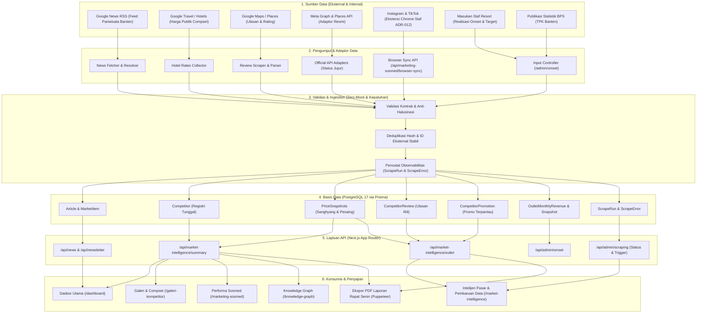

# Alur Data Sistem · Sanghyang News

Dokumen ini menjelaskan alur data menyeluruh sistem Sanghyang News dari tahap pengumpulan (sumber eksternal dan masukan staf), proses validasi dan ingestion, persistensi di basis data, hingga penyajian pada antarmuka pengguna dan berkas laporan rapat.

---

## 1. Diagram Arsitektur Alur Data

---

## 2. Rincian Tahapan Alur Data

### Tahap 1: Pengumpulan & Normalisasi
- **Otomasi Terjadwal**: GitHub Actions menjalankan workflow pengumpulan tarif setiap malam pukul 22:23 WIB.
- **Pemicuan Manual**: Tim internal dapat memicu pembaruan data melalui tombol **Perbarui Semua Data** di `/market-intelligence` (tautan lama `/admin/scraping` dialihkan otomatis ke `/market-intelligence`).
- **Sinkronisasi Media Sosial Staf (ADR-012)**: Data Instagram dan TikTok disinkronkan langsung dari sesi Chrome staf lewat Ekstensi Chrome **Sanghyang Market Sync** ke `POST /api/marketing-sosmed/browser-sync` dengan jeda manusia pada login atau CAPTCHA.
- **Adaptor Terisolasi**: Sumber data eksternal yang memerlukan token API resmi (Meta Graph, Google Places) diproses melalui adaptor berstandar yang secara transparan mengembalikan status ketersediaan kredensial.

### Tahap 2: Validasi Zero Mock & Deduplikasi
- Data yang masuk tidak boleh menyertakan nilai karangan (*mock data*).
- Setiap harga dan ulasan dipetakan ke ID stabil berbasis hash properti penting (`hotelId`, `date`, `price`, `author`, `textHash`) guna mencegah duplikasi observasi berulang.
- Seluruh metrik yang tidak memiliki data observasi nyata akan disimpan dan dirender sebagai `null` / *"Belum ada data"*.

### Tahap 3: Persistensi & Integritas Relasional
- Menggunakan Prisma ORM pada PostgreSQL 17 dengan skema bertipe aman.
- **Optimistic Concurrency Control (OCC)**: Tabel kritis mengimplementasikan kolom `version Int @default(1)` untuk mencegah konflik penulisan konkuren.
- **Isolasi Lingkungan**: Seluruh pengujian dan pengembangan lokal diarahkan ke basis data PostgreSQL Docker lokal. Operasi tulis terhadap Supabase produksi diblokir oleh pengaman `lib/db.ts`.

### Tahap 4: Penyajian Berjenjang & Laporan Eksekutif
- **Penyajian Cepat**: Endpoint `/api/market-intelligence/summary` menyajikan agregat metrik dengan pemfilteran periode dan seleksi kolom minimalis guna menjaga performa respons tetap di bawah 1,5 detik.
- **Penyajian 6 Unit Bisnis**: Data disajikan mengikuti 6 langkah membaca konsisten:
  1. *Tujuan*
  2. *Kata Tamu*
  3. *Pesaing*
  4. *Harga*
  5. *Promo & Event*
  6. *Langkah Minggu Ini*
- **Laporan Rapat Senin**: Modul generator PDF Puppeteer menyusun ringkasan mingguan berformat cetak A4 dengan tata letak bersih untuk evaluasi manajemen.
