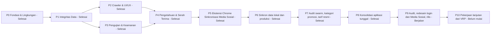

# Alur eksekusi utama: Sanghyang Analytics

Dibuat 2026-11-13. Disetujui pemilik lewat prompt swarm 13 Nov 2026. Satu-satunya peta kerja proyek: setiap pekerjaan berada di satu fase, setiap fase punya dokumen, kriteria keluar, dan bukti. Status yang dikenali hook: **Belum mulai**, **Berjalan**, **Selesai**, **Ditunda**.

## 1. Peta Phase ↔ dokumen

| Phase | Nama | Dokumen | Status |
| :---: | :--- | :--- | :--- |
| P0 | Fondasi, Isolasi Lingkungan & Tata Kelola | [01](01_phase_fondasi.md) | Selesai |
| P1 | Integritas Data & Sumber Kebenaran | [02](02_phase_data_kebenaran.md) | Selesai |
| P2 | Crawler Patuh & Perombakan UI/UX | [03](03_phase_crawler_ui_tes.md) | Selesai |
| P3 | Pengujian Otomatis & Keamanan Sesi | [04](04_phase_pengujian_keamanan.md) | Selesai |
| P4 | Pengetahuan, Graf & Serah Terima | [05](05_phase_integrasi_pengetahuan.md) | Selesai |
| P5 | Ekstensi Chrome Sinkronisasi Media Sosial | [06](06_phase_ekstensi_sosmed.md) | Selesai |
| P6 | Sinkron data lokal dan produksi saat push | [07](07_phase_sinkron_produksi.md) | Selesai |
| P7 | Audit swarm Insight Pasar, kategori promosi, dan tarif resmi | [08](08_phase_audit_swarm_insight.md) | Selesai |
| P8 | Konsolidasi penuh aplikasi tunggal Sanghyang Analytics | [09](09_phase_konsolidasi_sanghyang_analytics.md) | Selesai |
| P9 | Audit konsolidasi, redesain login dan Media Sosial, serta rilis produksi | [10](10_phase_audit_redesain_rilis.md) | Berjalan |
| P10 | Pekerjaan lanjutan dari VRP | [11](11_phase_lanjutan_dari_vrp.md) | Belum mulai |

## 2. Graf dependensi

## 3. Jadwal

| Phase | Mulai | Target selesai | Catatan |
| :---: | :--- | :--- | :--- |
| P0 | 2026-11-13 | 2026-11-13 | Selesai & Terverifikasi: DB lokal, pengaman produksi, ringkasan proyek, ADR, alur fase |
| P1 | 2026-11-13 | 2026-11-13 | Selesai & Terverifikasi: Registri D1/C5, Provenans D2-D5, Observabilitas C1/C2, Klasifikasi D7, Riset D6/D8 |
| P2 | 2026-11-13 | 2026-11-13 | Selesai & Terverifikasi: Adaptor C3/C4/C6, AppShell U1-U7, U10, Galeri D9, Sosmed D10, API U8 (board #65, #69, #74) |
| P3 | 2026-11-13 | 2026-11-13 | Selesai & Terverifikasi: K1–K4 (board #65) dan K5 CI workflow (board #83) |
| P4 | 2026-11-13 | 2026-11-13 | Selesai & Terverifikasi: Graf P4, dokumen P2/P3/P5 (board #83), E2E U9, dan seluruh 8 gerbang mutu akhir lulus 100% (board #89) |
| P5 | 2026-11-18 | 2026-11-19 | Selesai & Terverifikasi: Ekstensi MV3 ADR-012, pembersihan skrip/prototipe usang, commit `6c8a748` / `38b513b` / `2fef250`, CI `44368018678` (423/423 tes), Vercel `HdkhYMgVQ1R5AZFW4JsHD3qpCFp4` |
| P6 | 2026-11-19 | 2026-11-22 | Selesai & Terverifikasi: hook pre-push menyamakan DB produksi dan lokal; sinkron terakhir nol perubahan; ringkasan produksi = localhost (25/29 bagian identik, sisanya khusus lingkungan) |
| P7 | 2026-11-21 | 2026-11-22 | Selesai & Terverifikasi: kategori promosi, tarif resmi Exely, penilaian ulang kompetitor semua outlet, perbaikan tinjauan independen, pembersihan skrip; CI dan Vercel lulus sampai `3e3d7b4`; DB produksi = lokal |
| P8 | 2026-11-25 | 2026-11-26 | Selesai: rincian dan bukti di [09](09_phase_konsolidasi_sanghyang_analytics.md) |
| P9 | 2026-11-26 | Menunggu izin rilis pemilik | Berjalan: swarm audit konsolidasi, sinkron skema `0086..0088`, redesain login dan Media Sosial, rilis ke `analytics.sanghyang.com` |
| P10 | Belum ditentukan | Belum ditentukan | Belum mulai: butir bertanggal (28 Nov sampai 9 Des 2026) ada di [11](11_phase_lanjutan_dari_vrp.md) §5 |

## 4. Milestone

| Milestone | Isi | Bukti selesai |
| :--- | :--- | :--- |
| M0: Lingkungan Aman (P0) | DB lokal Docker aktif, snapshot masuk, pengaman tulis aktif, ringkasan proyek & ADR selesai | Status `lokal` pada `/api/health?ready`, `brain.py phase --check` 0 galat, verifier lulus |
| M1: Sumber Kebenaran Tunggal (P1) | Registri DB tunggal, pembersihan data karangan (Zero Mock), classifier berlabel, observabilitas run | `npm run audit:provenance` 0 pelanggaran (176/176 data sah), 43 unit test lulus, ScrapeRun aktif |
| M2: Desain & Crawler Patuh (P2) | Satu AppShell terpadu, token Tailwind v4, adaptor API resmi, logging scraping | Tangkapan layar desktop & ponsel, `ScrapeRun` tercatat di DB lokal |
| M3: Verifikasi Penuh & Serah Terima (P3 & P4) | 10 gerbang mutu lulus berturut-turut, memori & graf terbarui, serah terima siap | Laporan `docs/plans/SWARM_HANDOFF.md` terverifikasi oleh `@verifier` |
| M4: Ekstensi Chrome Sosmed & Rilis Produksi (P5) | Ekstensi MV3 unpacked (`.zip`), `browser-sync` OCC, pembersihan skrip usang, seed CI nyata, & deploy Vercel | Commit `6c8a748`, `38b513b`, `2fef250`; Vercel `HdkhYMgVQ1R5AZFW4JsHD3qpCFp4`; CI `44368018678` (`423/423` tes, `87/87` provenans, `14` pytest) |
| M5: Produksi sama dengan lokal (P6) | Sinkron dua arah DB, hook pre-push, urutan tampilan deterministik | Uji kering `sync-production-data.ts` nol perubahan; sidik kanonis API ringkasan produksi = localhost:3001 kecuali heartbeat |

## 5. Kriteria keluar

Fase hanya boleh berstatus **Selesai** bila semua kriteria keluarnya punya bukti (perintah + hasil, tangkapan layar, atau tanda tangan pemilik) di dokumen fasenya.

## 6. Dependensi eksternal terbuka

| Dependensi | Pemilik | Status | Dampak bila terlambat |
| :--- | :--- | :--- | :--- |
| Keputusan status Allisa Resort | Pemilik (Monauli) | Menunggu keputusan | Dicatat di dokumentasi compset, tidak memblokir perbaikan lain |
| Kredensial API resmi (Google/IG) | Pemilik (Monauli) | Menunggu keputusan | Adaptor berstatus "Belum tersambung", modul memakai data manual |
| Rollout ke Supabase produksi | Pemilik (Monauli) | Digantikan ADR-014 (hook pre-push lama dihapus); rollout ke `omuqbpxierdlfjascngz` dikerjakan di P9 lewat `apply_migration` sesuai `docs/plans/ROLLOUT_PRODUKSI.md` | Tanpa migrasi `0086..0088`, halaman `/data-sheets` dan unggah VHP gagal di produksi |
| Pendaftaran publik Supabase produksi | Pemilik (Monauli) | Belum diperiksa (P10 USR-1) | Akun baru apa pun menjadi staf aktif lewat trigger `handle_new_auth_user` |
| Tautan sheet FB dan ID sheet gudang | Pemilik dan tim gudang | Tautan FB belum ada; ID Main Store, Beverages, Engineering belum di env (P10 GS-1, GS-3) | Stok dan pemakaian makanan tidak tercakup; tiga gudang tidak tertarik |

## 7. RACI

| Kegiatan | R | A | C | I |
| :--- | :--- | :--- | :--- | :--- |
| Eksekusi tugas teknis swarm | Worker (@fondasi, @dokumen, dkk) | Koordinator | Verifier | Pemilik |
| Keputusan arsitektur (ADR) | Agen / Swarm | Pemilik | - | - |
| Rilis ke basis data produksi | Pemilik | Pemilik | Agen | Tim Resort |

## 8. Register risiko

| # | Risiko | Peluang | Dampak | Tingkat | Mitigasi | Pemilik |
| :---: | :--- | :---: | :---: | :---: | :--- | :--- |
| 1 | Penulisan tidak disengaja ke DB produksi | Rendah | Kritis | Kritis | Pengaman tulis di `lib/db.ts` menolak mutasi bila URL produksi aktif | @fondasi (Selesai) |
| 2 | RAM mesin 14 GiB kehabisan memori | Sedang | Tinggi | Tinggi | Maksimal 1 heavy command bersamaan dibungkus `resource_guard.py` | Seluruh tim |
| 3 | Kehabisan kuota Gemini API | Rendah | Sedang | Sedang | Dilarang pemanggilan LLM massal dan ekstraksi semantik graf otomatis | Seluruh tim |
| 4 | Ketidaksesuaian data mock tersembunyi | Rendah | Tinggi | Sedang | Skrip otomatis `npm run audit:provenance` (176/176 titik data sah) | @provenans (Selesai) |

## 9. Strategi rilis & rollback

- Urutan rilis:
  1. Validasi penuh di lingkungan Docker lokal (10 gerbang mutu lulus).
  2. Penyusunan berkas migrasi Prisma baru dan skrip seed idempotensi.
  3. Dokumentasi lengkap langkah demi langkah di `docs/plans/ROLLOUT_PRODUKSI.md`.
  4. Eksekusi manual oleh pemilik di lingkungan produksi terkontrol.
- Rollback hanya atas permintaan pemilik; langkah mitigasi: cadangan snapshot produksi sebelum migrasi selalu tersedia.

## 10. Daftar periksa progres

### P0: Fondasi, Isolasi Lingkungan & Tata Kelola (SELESAI)
- [x] Kontainer Docker PostgreSQL 17 lokal port 55432 aktif dan snapshot terisi (L1)
- [x] Pengaman tulis produksi aktif di `lib/db.ts` dan tes unit lulus (L2)
- [x] Server dev `sanghyang-news-dev` beralih ke DB lokal (L3)
- [x] Linting bebas galat dari folder eksternal `.agents` & `graphify-out` (L4)
- [x] Pengaturan `allowScripts` npm 12 rapi (L5)
- [x] Inisiasi dokumen proyek, register ADR Berlaku, dan alur fase (P1)
- [x] Pelacak kemajuan `SWARM_PROGRESS.md` siap dan tersinkronisasi

### P1: Integritas Data & Sumber Kebenaran (SELESAI)
- [x] Registri kompetitor tunggal di tabel DB dan migrasi skema (D1 - @registri)
- [x] Eliminasi data karangan, omset fiktif, peringkat & bukti palsu (D2, D3, D4, D5 - @provenans)
- [x] Normalisasi sumber ulasan dan klasifikasi teks riil (D6 - @riset)
- [x] Classifier berita Anyer-Carita dengan set evaluasi berlabel (D7 - @klasifikasi)
- [x] Karantina data sintesis di crawler/research (D8 - @riset)
- [x] Observabilitas scraping: enum `ScrapeJob` dan pencatatan galat (C1, C2, C5 - @observabilitas & @registri)

### P2: Crawler Patuh & Perombakan UI/UX (SELESAI)
- [x] Adaptor API resmi berstatus jujur dan penghentian scraping berlogin (C3)
- [x] Parser Google Travel stabil berbasis fixture HTML asli (C4)
- [x] Standarisasi pemeriksaan modul crawler Python (C6)
- [x] Panel pembaruan data terpadu (C7)
- [x] Galeri kompetitor & media sosial tersimpan di DB (D9, D10)
- [x] AppShell navigasi tunggal di route group (U1)
- [x] Metadata per halaman dan dekomposisi halaman raksasa (U2, U3)
- [x] Penerapan token desain Tailwind v4 dan prapembuangan warna hex tertanam (U4)
- [x] Penggantian emoji ikon dengan Lucide icons (U5)
- [x] Bahasa lugas non-jargon dan teks status jujur (U6, U7)
- [x] Optimasi respons kueri API p95 < 1,5 detik (U8)
- [x] Panduan desain visual di `docs/design/DESIGN.md` (U10)

### P3: Pengujian Otomatis & Keamanan Sesi (SELESAI)
- [x] Konfigurasi runner tes mandiri terpadu (K1)
- [x] Reorganisasi folder `scripts/` menjadi terstruktur (K2)
- [x] Penguatan token sesi HMAC, pembatas laju login, dan pembersihan sandi polos (K3)
- [x] Audit dan pembaruan dependensi aman (K4)
- [x] Draf pipeline CI GitHub Actions bebas eksekusi lokal (K5)

### P4: Pengetahuan, Graf & Serah Terima (SELESAI)
- [x] Pengujian responsif ponsel 390px, desktop 1440px, dan aksesibilitas (U9)
- [x] Pembaruan README.md UTF-8 dan konsolidasi dokumentasi ke `docs/` (P2)
- [x] Dokumentasi metodologi, alur data Mermaid, dan inventaris sumber data (P3)
- [x] Pembaruan graf pengetahuan Graphify dan sinkronisasi memori bersama (P4)
- [x] Dokumen roadmap kelanjutan proyek (P5)
- [x] Verifikasi menyeluruh seluruh gerbang mutu akhir oleh `@verifier`
- [x] Penyusunan laporan serah terima final `docs/plans/SWARM_HANDOFF.md`

### P5: Ekstensi Chrome Sinkronisasi Media Sosial (SELESAI)

- [x] Dokumentasi ADR-012 & rencana tervalidasi (P5)
- [x] Ekstensi Chrome MV3 lintas-platform (`extension/sanghyang-social-sync/`) & rute `.zip` / `browser-sync` (P5)
- [x] Integrasi UI `UpdateAllButton`, `StepKataTamu`, `StepPromo`, `SocialExtensionPanel`, dan `/marketing-sosmed` beserta jeda login/CAPTCHA manusia (P5)
- [x] Pembersihan skrip/prototipe usang, pembaruan dokumentasi aktif, perbaikan seed CI (`ci-fixture.ts`), deploy Vercel (`HdkhYMgVQ1R5AZFW4JsHD3qpCFp4`), & GitHub Actions CI hijau (`44368018678`, `423/423` tes) (P5)

### P6: Sinkron data lokal dan produksi saat push (BERJALAN)

- [x] Diagnosis selisih DB per tabel dan per blok API ringkasan (P6)
- [x] Skrip sinkron dua arah `scripts/ops/sync-production-data.ts` dengan tes dari data asli, diterapkan sampai uji kering nol perubahan (P6)
- [x] Hook pre-push terpasang di mesin kerja ini dan diuji di jalur `master` dan cabang lain (P6)
- [x] Urutan cadangan deterministik di ringkasan, perbandingan pesaing, dan kueri ringkasan (P6)
- [ ] Pemilik menarik 3 commit tarif kamar job malam (`git pull --ff-only origin master`) (P6)
- [ ] Pemilik commit dan push kode urutan deterministik, deploy Vercel READY, sidik API produksi = lokal (P6)

### P9: Audit konsolidasi, redesain login dan Media Sosial, serta rilis produksi (BERJALAN)

- [ ] Audit konsolidasi VRP ke `sanghyang-analytics`: celah kode, skema, data, dan dokumen tercatat (P9)
- [ ] Sinkron skema `0086..0088` di basis data lokal dan Supabase produksi lewat `apply_migration`, sebelum kode di-push (P9)
- [ ] Pemindahan dokumen: backlog VRP di P10, `docs/superpowers/` ke `docs/archive/`, rujukan VRP tersalin (P9)
- [ ] Redesain halaman login bertema sanghyang.com dengan slogan baru berbahasa Inggris (P9)
- [ ] Redesain tab Media Sosial di halaman Marketing (P9)
- [ ] Rilis produksi ke `analytics.sanghyang.com` atas izin pemilik (P9)

### P10: Pekerjaan lanjutan dari VRP (BELUM MULAI)

- [ ] Google Sheets gudang dan HK: GS-1 sampai GS-12 (P10)
- [ ] DML: DML-1 sampai DML-3 (P10)
- [ ] Google Ads: GA-1 sampai GA-8, termasuk pengingat 2 dan 9 Des 2026 (P10)
- [ ] Meta dan Instagram: MI-1 sampai MI-8 (P10)
- [ ] VHP: VHP-1 sampai VHP-10 (P10)
- [ ] Pendaftaran pengguna dan keamanan: USR-1 sampai USR-5 (P10)
- [ ] Lainnya: LN-1 sampai LN-6 (P10)
