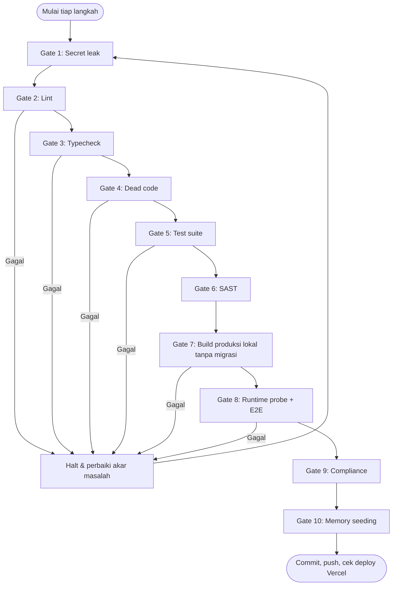

<!-- AGENTS_ORCHESTRATOR_METADATA: {
  "engine": "plan_architect.py",
  "version": "4.0.0",
  "mode": "feature",
  "domain": "web_service_microservices",
  "subsystems_executed": [
    "repo_auditor.audit_all",
    "requirements_decomposer.decompose",
    "audit_gap_extractor.extract",
    "compliance_matcher.match_compliance",
    "stack_detector.detect_stacks",
    "dynamic_quality_gates.resolve_gates",
    "database_schema_designer.generate_schema_blueprint",
    "devsecops_pipeline_generator.generate_pipeline_spec",
    "graph_bridge.grounding",
    "enterprise_plan_architect.assemble_gold_standard"
  ],
  "prompt_fingerprint": "-3897113564353831796",
  "provenance_verified": true
} -->

# Rencana: Dashboard mudah dibaca tim digital marketing + PDF Rapat Senin

Kerangka rencana dibuat dengan `python .agents/scripts/plan_architect.py --mode feature` (6 Nov 2026). Isinya kemudian ditulis ulang berdasarkan kode, data produksi, dan scan Google Maps yang benar-benar dijalankan.

## Context

Pemilik (6 Nov 2026):
- Aplikasi ini dipakai tim digital marketing. Semua isinya harus terbaca jelas dan lengkap dengan **bahasa yang sangat sederhana**, serta **urutan baca yang teratur** dan sama di setiap outlet, termasuk **apa tujuannya**. Tampilan sekarang dinilai berantakan.
- Pembagian pangsa pasar (market cap) dicek ulang.
- Setiap Senin ada rapat. Tombol PDF harus menghasilkan laporan ringkas yang berfokus pada tujuan. Isinya: analisa kompetitor, harga, tujuan sebelum dan sesudah dibanding bulan lalu, serta promo kompetitor per outlet beserta mana yang bisa ditiru.

Jawaban pemilik:

| Pertanyaan | Jawaban |
|---|---|
| Bentuk PDF | **Ganti PDF lama**: PDF Rapat Senin menggantikan laporan 4 halaman per outlet |
| Pembanding | **Bulan lalu** |
| Ukuran tujuan | **Pertumbuhan omset (%)** dan **rating & ulasan** |
| Pangsa pasar non-hotel | Tetap tampil dengan label **"perkiraan kasar"**, tidak dipakai sebagai tujuan |

Aturan yang tetap berlaku (dari `MEMORY.md` dan memori pemilik):
- Radius kompetitor ≤25 km jarak jalan; hotel dikelompokkan Resort vs Hotel.
- Omset rahasia: hanya persen yang tampil.
- Isi web dan PDF harus sama.
- Fakta diverifikasi ke sumbernya.
- Harga bersih setelah promo tetap di dalam pasar bintang 4.

### Temuan pemeriksaan pangsa pasar (6 Nov 2026)

**Hitungannya konsisten.** Di keenam outlet dan "Semua", persen = omset ÷ total pasar, dan kita + kompetitor = 100%.

**Tetapi pembagiannya belum bisa dipercaya:**
1. **Total pasar dibentuk dari tebakan.** Total pasar = omset kita + *tebakan* omset kompetitor (`estimatedRevenue` di `lib/market/pricing-benchmark.ts`). Hasilnya selalu tepat 100%, dan persen kita berubah hanya karena daftar kompetitornya berubah. Sumber tebakan seperti "PHRI Banten Hotel Aggregates 2026" atau "Brosur Tarif KTV" tidak bisa diverifikasi.
2. **Resort memasukkan Mutiara Carita** (34,4 km, di luar radius) dan belum memasukkan Allisa (1,4 km).
3. **D'Bar memasukkan "Anyer Family KTV"** (tebakan Rp 52 jt/bulan). Tempat ini tidak ada di Google Maps; pencariannya mengarah ke D'Bar milik Sanghyang sendiri.
4. **Baris agregat "... Lainnya"** menampung sisa angka tanpa dasar.
5. **Angkanya tetap.** Hanya ada data September, jadi belum ada perbandingan antarbulan.

### Temuan scan Google Maps radius 25 km (6 Nov 2026)

- **Rating outlet Sanghyang di Google Maps berbeda dengan yang tersimpan di aplikasi:**

  | Outlet | Google Maps | Aplikasi |
  |---|---|---|
  | d'Bar Karaoke | 3,7 | 4,3 |
  | Dragon Beach Club | 4,1 | 4,6 |
  | Sanghyang Spa And Massage | 4,2 | 4,7 |
  | Sunset Grill | 4,5 | 4,5 |
  | Resort | 4,4 | 4,4 |

  D'Bistro tidak punya listing sendiri.
- **Kualitas hasil scan otomatis "terdekat":**
  - Banyak hasil tidak sebanding: warung, tukang pijat, bahkan jasa setrika yang salah kategori. Google Maps tidak menampilkan jumlah ulasan tanpa login, sehingga tempat kecil tidak bisa disaring otomatis.
  - Kandidat yang masuk akal:
    - Sunset Grill: Pondok Cirebone, Way Muli, RM Muaro, Kamalika, Andalan, Ikan Bakar Tanjung Pinang 88 (semuanya ≤3,5 km).
    - D'Bar: Chrysoberil Lounge (19 km), Star Queen Karaoke Cilegon (21,1 km), ALPS Sky Lounge (22,9 km), Happy Puppy Karaoke (23,2 km).
    - Dragon dan D'Spa: pesaing yang sebanding tetap bar dan spa hotel (Upper Circle Novus, Lighthouse Mambruk, Sunset Bar ASTON, Bale-Bale Spa ASTON, Daiva Spa Novus).
- Hasil mentah: `scratchpad/compset/scan-radius.json`. Hasil ini diolah menjadi data repo pada Langkah 2.

---

## User Review Required

> [!IMPORTANT]
> **The 4 Zeros yang relevan di proyek ini**
> - **Zero Mock Data**: angka baru hanya dari data nyata (omset impor, BPS, crawl). Tebakan lama diberi label "perkiraan kasar" dan tidak dipakai sebagai tujuan.
> - **Zero Hardcode**: ambang warna, radius, dan target disimpan sebagai konstanta bernama atau di database, bukan angka lepas di komponen.
> - **Zero Fallback**: bila data bulan lalu belum ada, layar menulis "belum ada data bulan lalu", bukan menampilkan nol.
> - **Zero Timeout**: job malam yang sudah ada dipakai ulang; tidak ada loop tunggu baru.

> [!WARNING]
> **Perubahan yang perlu persetujuan:**
> - **PDF 4 halaman per outlet dihapus** dan diganti PDF Rapat Senin. Uji `scripts/test-export-outlet-pdf.ts` ikut ditulis ulang.
> - **Dua tabel baru** (migrasi aditif, RLS, OCC `version`): `OutletMonthlySnapshot` dan `MarketingGoal`. Migrasi berjalan lewat prebuild Vercel (`scripts/migrate-production.mjs`, satu migrasi tertunda), tidak dari lokal.
> - **Data kompetitor D'Bar dan Sunset Grill diganti** dengan tempat nyata hasil scan. Rating outlet Sanghyang di database disamakan dengan Google Maps.

---

## Open Questions

> [!NOTE]
> Tidak ada pertanyaan pemblokir untuk Langkah 1–4. Dua input masih ditunggu dari pemilik:
> 1. **Contoh laporan omset September (dan Oktober).** Tanpa dua bulan omset, kolom "vs bulan lalu" untuk pertumbuhan omset baru terisi setelah impor bulan kedua.
> 2. **Daftar kompetitor non-hotel.** Usulan ada di bagian "Temuan scan" di atas dan bisa dikoreksi pemilik sebelum Langkah 2 di-commit.

---

## Proposed Changes

Dikerjakan berurutan. Setiap langkah di-commit, di-push, dan dicek deploy-nya terpisah.

### Langkah 1 — Alur baca yang sama untuk setiap outlet (UI/UX)

Halaman outlet diganti dari 4 tab card menjadi **6 langkah berurutan** yang bisa dibaca dari atas ke bawah. Ada navigasi nomor langkah yang menempel di atas. Isi detail lama tidak dibuang; isinya dipindah ke bagian "Lihat detail" yang bisa dibuka di tiap langkah.

| No | Judul (bahasa sederhana) | Isi |
|---|---|---|
| 1 | **Tujuan bulan ini** | Target pertumbuhan omset (%) dan target rating. Ditampilkan: posisi sekarang, posisi bulan lalu, status (tercapai / hampir / belum), dan siapa yang mengisi strateginya |
| 2 | **Apa kata tamu** | 3 angka (rating Google, % ulasan positif, jumlah ulasan), 3 hal yang paling dipuji, 3 keluhan utama, filter tanggal |
| 3 | **Siapa pesaing kita** | Kompetitor ≤25 km dengan jarak, rating, dan (hotel) kelompok Resort/Hotel; head-to-head dalam satu kalimat per pesaing |
| 4 | **Harga kita vs pesaing** | Satu kalimat kesimpulan, misalnya "Harga kita 28% lebih murah dari rata-rata pesaing". Lalu tangga harga dan tabel |
| 5 | **Promo pesaing & yang bisa kita tiru** | Promo per pesaing dengan label **Bisa ditiru / Ubah dulu / Jangan ditiru** dan versi Sanghyang-nya |
| 6 | **Langkah minggu ini** | Paling banyak 3 tindakan dari temuan + strategi tim, dengan kotak centang |

Aturan bahasa:
- Kalimat pendek, satu ide per kalimat.
- Tanpa istilah teknis: "PPI" menjadi "indeks harga", "koridor" menjadi "rentang harga wajar", "klaster" dihapus.
- Setiap angka disertai artinya, misalnya "72 = harga kita 28% di bawah rata-rata pesaing".
- Istilah yang tetap dipakai dijelaskan di tooltip.

Berkas:
- `[NEW] app/market-intelligence/outlet-steps.tsx`: kerangka 6 langkah, navigasi nomor, dan komponen "Lihat detail".
- `[NEW] lib/market/plain-language.ts`: kalimat kesimpulan dan label dari angka, dipakai bersama oleh web dan PDF.
  - Contoh fungsi: `priceVerdict(ppi)`, `sentimentVerdict(pct, n)`, `goalStatus(target, actual)`, `imitationVerdict(promo)`.
- `[MODIFY] app/market-intelligence/page.tsx` (≈2.300 baris): susunan card diganti `OutletSteps`; isi card lama dipindah ke bagian detail. Dipanggil di 1 tempat (route `/market-intelligence`).
- `[MODIFY] app/market-intelligence/outlet-overview.tsx`: kolom "Tujuan" (pertumbuhan omset dan rating vs target) ditambahkan ke ringkasan Semua Outlet.
- Antislop UI/copy dan kontras dicek dengan skill `antislop-ui`, `antislop-copywriting`, dan `antislop-human`.

### Langkah 2 — Kompetitor non-hotel yang nyata (radius 25 km)

- `[MODIFY] lib/market/hotel-compset.data.json`: tempat hasil scan yang dipilih ditambahkan ke `venues` beserta kategori, rating, jarak jalan, dan URL Maps.
- `[MODIFY] lib/market/pricing-benchmark.ts`:
  - "Anyer Family KTV" dihapus. Estimasi pasarnya digabung ke baris agregat agar total tidak berubah, dan baris itu diberi label "perkiraan kasar".
  - Pembanding Sunset Grill dan D'Bar diganti dengan tempat nyata. Harga hanya diisi bila ada sumber; selain itu "belum ada data".
- `[MODIFY] lib/market/hotel-compset.ts`: matcher jarak untuk tempat baru.

### Langkah 3 — Pangsa pasar dan tujuan per bulan

- `[NEW] prisma/migrations/2026110700000_monthly_snapshot_and_goals/migration.sql` + `[MODIFY] prisma/schema.prisma`:
  - `OutletMonthlySnapshot { id, outletKey, month Date, googleRating, googleReviewCount, positivePct, reviewCount, pricePositioningIndex, lowestRate, activeCompetitorPromos, capturedAt, version }`, unik `(outletKey, month)`.
  - `MarketingGoal { id, outletKey, month Date, targetRevenueGrowthPct, targetRating, strategy, decisions, filledBy, evaluation, evaluatedAt, version }`, unik `(outletKey, month)`.
  - RLS aktif di kedua tabel (sama seperti tabel lain).
- `[MODIFY] scripts/migrate-production.mjs`: `pendingMigration` diperbarui.
- `[MODIFY] lib/market/full-refresh.ts`: job malam melakukan upsert potret bulan berjalan dengan OCC.
  - Rating dan jumlah ulasan diambil dari listing Google Maps outlet Sanghyang, karena data ulasan lama tercatat salah.
  - Bulan lalu diisi sekali dari data bertanggal yang sudah ada: ulasan (`reviewDate`), tarif (`observedAt`), dan promo (`startsAt`).
- **Pangsa pasar resort**: metode baru. Pasar = Σ hotel ≤25 km (jumlah kamar × hari × TPK hotel bintang BPS Banten × ADR rata-rata hasil crawl bulan itu).
  - Pangsa = omset impor ÷ (pasar kompetitor + omset kita).
  - Jumlah kamar tiap hotel diambil dari situs resmi atau OTA, beserta sumbernya.
  - TPK BPS diisi di form Import Data.
- **Non-hotel**: angka lama tetap tampil dengan label "perkiraan kasar · bukan dasar tujuan".
- `[NEW] app/api/market-intelligence/goals/route.ts`: GET/PUT tujuan per outlet per bulan dengan OCC (409 bila versi usang). Hanya bisa diakses pengguna yang login (cookie sesi yang sama).
- `[MODIFY]` tombol Import Data omset (Tahap 4 di TODO): menyimpan omset bulanan, lalu pertumbuhan dihitung otomatis. Parser dicocokkan setelah contoh September diterima.

### Langkah 4 — PDF Rapat Senin (menggantikan PDF lama)

- `[NEW] lib/market/meeting-report.ts`: data laporan dari summary API + `OutletMonthlySnapshot` + `MarketingGoal`, memakai `plain-language.ts` agar kalimatnya sama dengan web.
- `[NEW] templates/meeting-report.ts`, menggantikan `templates/outlet-report.ts`:
  - **Halaman 1 — Ringkasan semua outlet**: tabel 6 baris berisi tujuan (omset % dan rating), bulan ini vs bulan lalu, status, dan 1 keputusan yang perlu diambil rapat.
  - **Halaman 2–7 — satu halaman per outlet**, urutannya sama dengan 6 langkah di web:
    1. Tujuan vs hasil (vs bulan lalu)
    2. Apa kata tamu (3 angka + perubahan)
    3. Pesaing ≤25 km
    4. Harga vs pesaing (kesimpulan + tabel ringkas)
    5. Promo pesaing: bisa ditiru / ubah dulu / jangan
    6. Langkah minggu ini
  - Tombol per outlet mencetak halaman ringkasan + halaman outlet itu (2 halaman). "Semua Outlet" mencetak 7 halaman.
- `[MODIFY] app/api/market-intelligence/export-pdf/route.ts`: memakai template baru. Nama file `Rapat_Senin_Sanghyang_<Outlet>_<YYYY-MM-DD>.pdf`.
- `[DELETE] templates/outlet-report.ts`, `[DELETE] lib/market/outlet-report.ts`. Sebelum dihapus, perbarui referensi masuk (inbound) di setiap pemanggil: route export-pdf, `scripts/test-export-outlet-pdf.ts`, dan import `esc`/tipe `OutletReport`. Grep `outlet-report` harus 0 hasil sebelum penghapusan.
- `[MODIFY] scripts/test-export-outlet-pdf.ts` → `scripts/test-meeting-report.ts`:
  - Halaman: 7 untuk semua, 2 per outlet.
  - Tidak ada omset rupiah, emoji, atau klaim salah. Tidak ada isi terpotong.
  - Fakta web = PDF.
  - Kolom "vs bulan lalu" menulis "belum ada data" bila potret bulan lalu kosong.

### Lain-lain

- `[MOVE] .agent/TODO.md → .agents/TODO.md`: daftar tugas mengikuti folder `.agents/`. Folder `.agent/` yang salah dibuat dihapus.
- `[MODIFY] MEMORY.md` dan `LESSONS.md`: temuan pangsa pasar, rating outlet, dan kualitas scan.

---

## While-Loop Sequential Execution Architecture

### Protokol kegagalan
1. **Halt & root cause**: bila Gate N gagal, berhenti. Akar masalah diperbaiki di sumbernya, tanpa membungkam tes atau tipe.
2. **Mulai lagi dari Gate 1** setelah setiap perbaikan.
3. **Maksimal 5 siklus.** Lebih dari itu, berhenti dan laporkan ke pemilik.

---

## Verification Plan

### Automated Tests (Dynamic Quality Gates 1..10)

Perintah disesuaikan dengan proyek ini. Catatan: `npm run build` **tidak boleh** dijalankan lokal karena prebuild menjalankan migrasi produksi.

1. `gitleaks detect --no-git --verbose` (lewati bila gitleaks belum terpasang, dan catat di laporan)
2. `npm run lint`
3. `npm run typecheck`
4. `npx knip` (bila terpasang)
5. `npm test && npm run test:all && npm run test:admin-page`
6. `semgrep scan --config auto -j 1 --disable-version-check` (bila terpasang)
7. `npx next build`
8. `npx next start -p <port bebas>` + E2E puppeteer di `scratchpad/e2e` dengan password uji sekali pakai:
   - screenshot 6 langkah tiap outlet di desktop dan ponsel 390 px, tanpa scroll horizontal
   - unduh PDF Rapat Senin
   - cek omset tersamarkan
9. `python .agents/scripts/compliance_matcher.py`
10. `MEMORY.md` < 2.200 karakter; `LESSONS.md` diperbarui

### Manual / Runtime Verification
1. **OCC tujuan**: PUT `/api/market-intelligence/goals` dengan versi usang menghasilkan 409.
2. **PDF**: halaman 1 tabel 6 outlet; setiap halaman outlet memuat 6 bagian, "vs bulan lalu", dan label promo bisa ditiru.
3. **Deploy**: status Vercel per commit sukses; situs live diperiksa setelah migrasi.
4. **Bersih**: tidak ada berkas sementara di repo; `git status` hanya berisi berkas yang direncanakan.
