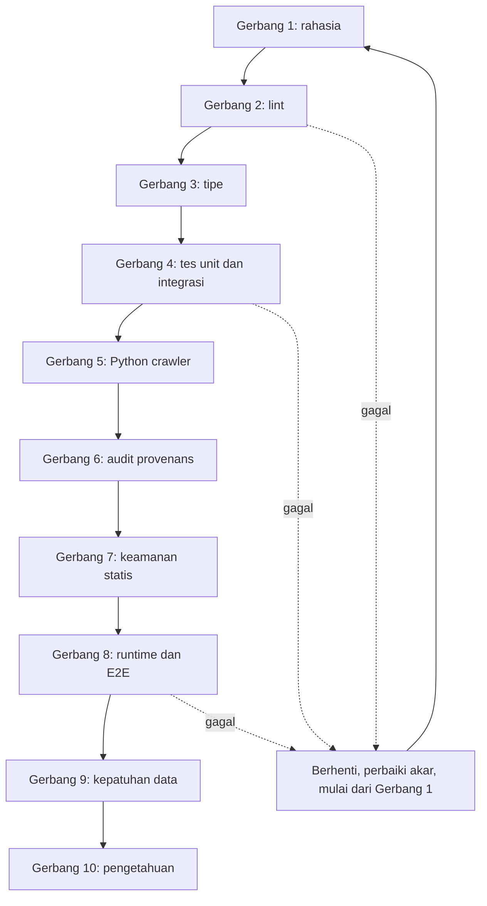

<!-- AGENTS_ORCHESTRATOR_METADATA: {
  "engine": "plan_architect.py",
  "version": "5.1.0",
  "mode": "feature",
  "subsystems_executed": [
    "repo_auditor.audit_all",
    "requirements_decomposer.decompose",
    "audit_gap_extractor.extract",
    "compliance_matcher.match_compliance",
    "stack_detector.detect_stacks",
    "dynamic_quality_gates.resolve_gates",
    "database_schema_designer.generate_schema_blueprint",
    "devsecops_pipeline_generator.generate_pipeline_spec",
    "graph_bridge.grounding",
    "enterprise_plan_architect.assemble_gold_standard"
  ],
  "prompt_fingerprint": "-2574712839443346671",
  "provenance_verified": true
} -->

# Rencana perombakan Insight Pasar, navigasi, Knowledge Graph, dan laporan PDF

Catatan 18 Nov 2026: jalur YouTube dihapus atas permintaan pemakai; bagian tentang YouTube di dokumen ini tidak berlaku lagi.

Disusun Claude Code, 13 Nov 2026, dari permintaan pemakai pada hari yang sama. Kerangka awal dari
`plan_architect.py --mode feature`; isi di bawah diturunkan dari kode, basis data lokal, Google Maps, dan sumber web
yang dicantumkan. Status: **disetujui pemakai 13 Nov 2026** dengan semua rekomendasi di bagian Pertanyaan terbuka.
Pelaksanaan: Fase 1–7 dikerjakan di DB lokal 13–14 Nov 2026 (ADR-008, ADR-009). Langkah produksi menunggu pemilik: `docs/plans/ROLLOUT_PRODUKSI.md`, bagian "Tambahan 14 Nov 2026".

## Permintaan

1. Satu tombol saja untuk memperbarui semua data. Tombol Crawl Sentimen, Segarkan, Panel Scraper, dan menu Pembaruan Data dihapus.
2. Menu Pembaruan Data diganti menjadi **Knowledge Graph**: graf 3D seperti `graphify-out/graph.html`, tetapi isinya relasi semua data pasar (outlet, pesaing, ulasan, promo, tarif, berita, sumber).
3. Bagian "Untuk direksi" menjadi menu baru di bawah Ringkasan. Label "(IT AI)" dihapus.
4. Pembanding harus setara (bintang 4–5 untuk Kamar & Resort) dan berada dalam 25 km dari Sanghyang. Allisa dikeluarkan.
5. Menu "Omset & Target" menjadi **Omset, Target dan Strategy**. "Tujuan bulan ini" pindah ke sana, dan langkah Insight Pasar dinomori ulang mulai "1 Apa kata tamu".
6. Kartu Market Cap, pangsa pasar, dan peta distribusi pesaing (Detail Langkah 4) kembali tampil di semua outlet.
7. Radar promo dan draf konten (Detail Langkah 5) dipertahankan dan dipindah ke Omset, Target dan Strategy.
8. PDF Rapat Senin per outlet mengikuti format `Laporan_Komprehensif_Gabungan_8_Hotel_Anyer.pdf`: metodologi, struktur dokumen, ringkasan eksekutif, lalu satu bagian per properti.
9. Tampilan mengikuti tema `sanghyang_web`.
10. Crawl yang gagal diperbaiki supaya data internet benar-benar terambil, termasuk angka Market Cap yang hilang di lokal.

## Temuan riset

### Langkah 4 dan 5 tidak terhapus, tetapi tersembunyi dan terpotong

- Di lokal, isi Langkah 4 dan 5 ada di balik "Lihat detail lengkap" yang tertutup. Swarm menulis ulang
  `components/market-intelligence/step-harga.tsx` tanpa empat kartu KPI dan peta distribusi pangsa pasar.
- Radar promo untuk Kamar & Resort memuat 71 kartu dengan 33 judul ganda. Di DB lokal ada 29 pasangan promo
  (pesaing, judul) yang ganda. Radar juga masih memuat Allisa, Anyer Wonderland, dan The West Cove.

### Angka Market Cap dan omset di produksi ditanam di kode

- Produksi menampilkan "Revenue Outlet (Aktual) IDR 262.410.000" dan "Total Market Cap Segmen IDR 4.600.000.000".
  Tabel `OutletMonthlyRevenue` di salinan produksi 13 Nov berisi 0 baris, jadi kedua angka itu berasal dari kode,
  bukan dari impor pembukuan.
- Swarm mengosongkan angka tersebut sesuai aturan Zero Mock. Ia tidak menyambungkan halaman ke data omset di DB dan tidak
  menghitung Market Cap dari data. Akibatnya `summary/route.ts` mengirim `OUTLET_MARKET_SHARE_DATA` statis dengan
  `revenueActual: null`, dan TAM konsolidasi di Metodologi menjadi "Belum ada data".
- Harga menu F&B pembanding di `lib/market/pricing-benchmark.ts` juga masih tertanam tanpa tautan sumber.

### Registri pembanding Kamar & Resort

Jarak diukur di Google Maps (mobil, dari Sanghyang Indah Spa Resort) pada 13 Nov 2026. Garis lurus dihitung dari
koordinat tempat di Google Maps. Jarak di DB lokal ditulis swarm dan banyak yang keliru.

| Properti | Bintang (sumber) | Jalan | Garis lurus | Nilai di DB lokal | Usulan |
| :-- | :-- | --: | --: | --: | :-- |
| Mambruk Hotel & Convention | 4 | 2,2 km · 3 mnt | 2,1 km | 2,3 km | Inti |
| Marbella Place Anyer by Jayakarta | 4 | 6,1 km · 8 mnt | 5,3 km | 8,4 km | Inti |
| The Jayakarta Anyer | 4 | 6,7 km · 9 mnt | 5,8 km | 8,6 km | Inti |
| Aston Anyer Beach Hotel | 4 (Traveloka, Trip.com), 3,5 (Expedia, Hotels.com) | 11,8 km · 15 mnt | 10,3 km | 12,0 km | Inti |
| Hawaii Resort Family Suites | 3 dengan 73 kamar (Orbitz, Wotif); PDF pemilik: 4 | 18,2 km · 24 mnt | 16,2 km | 18,2 km, 140 kamar | Keputusan pemilik |
| Novus Jiva Anyer Villa, Resort & Spa | 5 (PDF pemilik), 4 di DB | 21,4 km · 30 mnt | 18,8 km | 13,8 km | Inti |
| Mövenpick Resort Carita | 5 | 23,6 km · 32 mnt | 21,3 km | 20,3 km | Inti |
| Mutiara Carita Cottages | 4 (Expedia, Trip.com) | 34,3 km · 46 mnt | 29,4 km | 21,0 km | Keluarkan |
| Allisa Resort Anyer | 2 (Booking.com, ViaMichelin), 3 (Tiket.com) | 1,3 km · 2 mnt | 1,3 km | 1,4 km | Keluarkan |
| Resort Prima Anyer | 3 (Expedia) | belum diukur | | 5,2 km | Keluarkan |
| The West Cove Hotel Anyer | 3 (Hotels.com) | belum diukur | | 6,1 km | Keluarkan |
| MaxOne Anyer | 3 (Hotels.com) | belum diukur | | 7,5 km | Keluarkan |
| Anyer Wonderland | bukan hotel | belum diukur | | 4,5 km | Keluarkan dari kompset resort |

Kode memakai jarak jalan untuk batas 25 km (`competitor-repository.ts`, `maxRoadKm`), dan produksi dulu memberi label
"di luar 25 km" pada Mutiara berdasarkan jarak jalan. Jumlah kamar di DB juga perlu diverifikasi ulang: Hawaii 140
(sumber OTA: 73), Mövenpick 150 (PDF pemilik: 219), Novus Jiva 146 (PDF pemilik: 159 unit).

### Kegagalan crawl dan akar masalahnya

Diambil dari `ScrapeRun` dan `ScrapeError` di DB lokal, tiga hari terakhir:

| Gejala | Jumlah | Akar masalah di kode |
| :-- | --: | :-- |
| `HTTP 429 ... google.com/travel/hotels/test-hotel` | 40 run | Rangkaian `npm test` menulis run uji ke DB pengembangan |
| "halaman hotel Google Travel tidak ditemukan" | 6 | `resolveReviewsUrl` mencari ulang dengan nama mentah setiap kali; nama registri tidak sama dengan nama di Google, dan tempat non-hotel (Anyer Wonderland) ikut dicari di Google Travel |
| "Timed out after waiting 60000ms" | 4 | `waitUntil: "networkidle2"` di Google Travel; halaman Google tidak pernah benar-benar diam |
| Pembaruan ulasan butuh 2 jam | 1 | Satu peluncuran Chrome per hotel, berurutan |
| "unexpected end of hex escape" | 1 | Teks dipotong di tengah pasangan surrogate emoji sebelum disimpan Prisma |
| Gemini 503 | 1 | Tidak ada percobaan ulang berjeda untuk galat sementara |
| Target ulasan memakai daftar bawaan saat DB gagal | – | `getReviewTargets().catch(() => DEFAULT_REVIEW_TARGETS)` menelan galat |

Instagram tetap tidak dirayapi lewat DOM (ADR-004). Jalur yang sah adalah Instagram Graph API, dan itu keputusan pemilik.

### Tema sanghyang_web

Sumber: `sanghyang_web/app/styles/tokens.css` (Sanghyang Quiet Luxury Thermal Coast v1.4.0), `src/ui/fonts.ts`, dan
tampilan sanghyang.com. Ciri utamanya:

- Warna: hijau beludru `#22382D`, krem `#F3F3EC`, kanvas pasir `#FBF8F3`, teks tinta `#1F2B4D`, aksi sunset `#A94617`, palem `#375B49`, laguna `#0F5673`, dan emas `#B8923F`.
- Huruf: Noto Serif Display untuk judul (kapital, sempit), Archivo untuk teks, dan JetBrains Mono untuk angka.
- Detail: label kecil berhuruf kapital dengan jarak huruf 0,18em, garis tipis, dan bayangan bernuansa tinta.

## Tinjauan pemilik

- Semua perubahan hanya di lokal. Tidak ada commit, push, deploy, atau tulis ke basis data produksi.
  Langkah produksi ditulis di `docs/plans/ROLLOUT_PRODUKSI.md` untuk dijalankan pemilik.
- Halaman produksi hanya dibaca lewat Chrome setelah pemilik login sendiri. Agen tidak mengetik sandi di situs produksi.
- **Zero Mock Data**: angka yang belum punya sumber tampil "Belum ada data". Perkiraan diberi label "Perkiraan kasar" beserta rumus dan tanggal sumbernya.
- **Zero Hardcode**: omset, Market Cap, TPK, jumlah kamar, dan harga menu tidak ditanam di kode. Nilainya dibaca dari DB yang diisi crawl atau impor pemilik.
- **Zero Fallback**: `catch` yang menelan galat di target ulasan dihapus. Kegagalan crawl dicatat di `ScrapeError` dan dilaporkan dengan bahasa biasa, tidak disembunyikan.
- **Zero Timeout**: crawler menunggu elemen yang dibutuhkan, bukan jeda buta. Percobaan ulang Gemini dibatasi tiga kali dengan jeda eksponensial, dan progres tombol dikirim per langkah, bukan lewat polling buta.
- Gemini di server dev memakai kunci produksi milik staf. Pembuatan strategi promo dan draf konten saat uji akan memakai kuota itu, kecuali ada kunci terpisah.
- Tombol pembaruan di Vercel memicu GitHub Actions dan memakai menit CI.
- Situs pesaing dibaca dengan sopan: robots.txt dipatuhi dan identitas perayap jujur. Login, CAPTCHA, dan perlindungan bot tidak ditembus.

## Pertanyaan terbuka

Bila pemilik setuju dengan rekomendasi, pekerjaan dijalankan dengan pilihan itu.

1. **Hawaii Resort**: OTA mencatat bintang 3 dan 73 kamar, sedangkan PDF pemilik menulis bintang 4.
   Rekomendasi: tampil sebagai benchmark (tidak dihitung dalam pangsa pasar) sampai ada bukti klasifikasi bintang 4.
2. **Ukuran 25 km**: jarak jalan (aturan kode dan produksi sekarang) atau garis lurus.
   Rekomendasi: jarak jalan. Koreksi 13 Nov: Mövenpick berjarak 23,6 km di Google Maps (angka 28,5 km sebelumnya salah baca dari tangkapan layar), jadi tetap masuk kompset inti.
3. **Langkah promo di Insight Pasar**: rekomendasi tetap ada versi ringkas ("apa yang sedang dijalankan pesaing").
   Radar lengkap, strategi tanggapan, dan draf konten pindah ke Omset, Target dan Strategy.
4. **Market Cap outlet F&B**: belum ada data kapasitas kursi dan rata-rata belanja dari sumber publik.
   Rekomendasi: tampilkan "Belum ada data" untuk rupiah, ditambah pangsa ulasan Google sebagai proksi popularitas dengan label jelas.
5. **Pengisian profil pesaing untuk PDF** (operator, tipe kamar, fasilitas, kapasitas MICE).
   Rekomendasi: Claude membaca halaman resmi sekali jalan dan menyimpan fakta beserta tautannya. Kuota Gemini kunci produksi milik staf tidak terpakai.
6. **Omset September 2026 Rp 262.410.000**: angka ini dulu tertanam di kode.
   Rekomendasi: pemilik mengimpornya lewat halaman Omset bila memang angka pembukuan, atau memberi izin Claude memasukkannya ke DB lokal dengan sumber "angka dari pemilik".

## Perubahan yang diusulkan

### Fase 0: registri pembanding dan kebersihan data

#### [MODIFY] [`scripts/ops/seed-competitor-registry.ts`](../../scripts/ops/seed-competitor-registry.ts)
- Jarak jalan, garis lurus, koordinat, bintang, dan jumlah kamar diisi dari pengukuran yang bertanggal dan bersumber (tabel di atas).
- Allisa, Resort Prima, The West Cove, MaxOne, dan Mutiara Carita diarsipkan (`active=false`, `retiredReason` beserta sumber). Arsip, bukan hapus.

#### [NEW] Migrasi Prisma `competitor_compset_role`
- Kolom `compsetRole` (`inti` | `benchmark`) dan `travelEntityPath` pada `Competitor`.

#### [MODIFY] [`lib/market/competitor-repository.ts`](../../lib/market/competitor-repository.ts)
- Aturan kelayakan tunggal: kategori sama, bintang minimal 4 untuk hotel, jarak jalan paling jauh 25 km. Benchmark dipisah dari kompset inti.
- Pengecualian Mövenpick yang tertanam di `getReviewTargets` dihapus.

#### [NEW] `tests/unit/compset-eligibility.test.ts`
- Bintang 3 ditolak, 25,1 km ditolak, benchmark tidak masuk perhitungan pangsa.

#### Pembanding F&B, bar, dan spa
- Setiap pembanding diukur ulang di Google Maps (jarak, kategori, rating, jumlah ulasan).
- Kriteria setara per outlet:
  - Sunset Grill: restoran seafood atau grill tepi pantai.
  - Dragon Beach Club: beach club.
  - D'Bistro: restoran atau kafe kelas menengah-atas.
  - D'Bar & Karaoke: bar, lounge, atau karaoke.
  - D'Spa: spa hotel atau resort.
- Hasilnya disajikan sebagai tabel untuk disetujui pemilik sebelum ada yang diarsipkan.

#### Tes tidak lagi menulis ke DB pengembangan
- [NEW] basis data `sanghyang_news_test` di kontainer yang sama dan `.env.test.local`.
- [MODIFY] [`package.json`](../../package.json): skrip `test` memakai DB uji.
- 40 run uji "test-hotel" dihapus dari DB pengembangan.

#### Promo ganda
- [NEW] migrasi indeks unik promo per (pesaing, judul ternormalisasi, tanggal mulai).
- [MODIFY] [`lib/market/sync-social-promos.ts`](../../lib/market/sync-social-promos.ts) dan [`lib/market/website-promos.ts`](../../lib/market/website-promos.ts): simpan dengan upsert.
- [MODIFY] [`app/api/market-intelligence/summary/route.ts`](../../app/api/market-intelligence/summary/route.ts): gabungan radar promo dideduplikasi.

### Fase 1: tema Sanghyang

#### [NEW] `app/styles/tokens.css`
- Salinan token v1.4.0 yang dipakai, dengan catatan sumber dan versi.
- Nama token semantik lama (`surface-base`, `text-main`, `sidebar-bg`, dan lainnya) dipetakan ke palet Sanghyang supaya komponen yang sudah memakai token langsung berganti rupa.

#### [MODIFY] [`app/layout.tsx`](../../app/layout.tsx) dan [`app/globals.css`](../../app/globals.css)
- Archivo, Noto Serif Display, dan JetBrains Mono lewat `next/font` (di-host sendiri).

#### [MODIFY] [`components/sidebar/app-sidebar.tsx`](../../components/sidebar/app-sidebar.tsx) dan [`app/login/page.tsx`](../../app/login/page.tsx)
- Sidebar hijau beludru dengan teks krem dan logo resmi dari `sanghyang_web/public/assets/brand/`.

#### [NEW] `scripts/ops/hex-to-token.ts`
- Laporan hex tertanam (875 tersisa) dan penggantian ke token per folder, diperiksa visual per kelompok.

#### [MODIFY] [`docs/design/DESIGN.md`](../../docs/design/DESIGN.md)
- Prinsip, token, dan contoh komponen baru. ADR-005 diperbarui.

### Fase 2: navigasi, halaman, dan satu tombol

#### [MODIFY] [`lib/navigation.ts`](../../lib/navigation.ts)
Urutan menu: Ringkasan, Untuk Direksi, Newsletter, Insight Pasar, Galeri Pesaing, Media Sosial, Omset Target dan
Strategy, Knowledge Graph, Metodologi.

#### [NEW] `app/direksi/page.tsx`
- Evaluasi Pricing Room dan Evaluasi Pricing F&B dipindah dari Langkah Harga. Di Insight Pasar tersisa tautan ke halaman ini.

#### [MODIFY] Label "(IT AI)" dihapus
- [`app/market-intelligence/room-pricing-executive-view.tsx`](../../app/market-intelligence/room-pricing-executive-view.tsx)
- [`app/market-intelligence/fnb-pricing-view.tsx`](../../app/market-intelligence/fnb-pricing-view.tsx)
- [`lib/market/room-pricing-executive.ts`](../../lib/market/room-pricing-executive.ts)
- [`lib/market/fnb-pricing.ts`](../../lib/market/fnb-pricing.ts)

#### [MODIFY] [`app/admin/omset/page.tsx`](../../app/admin/omset/page.tsx)
Menjadi "Omset, Target dan Strategy" dengan pemilih outlet dan tiga bagian:
1. Tujuan bulan ini, dipindah dari Insight Pasar.
2. Omset, yang sudah ada.
3. Strategi promo dan draf konten.

#### [NEW] `components/strategy/promo-radar.tsx`
- Pindahan Detail Langkah 5 dengan tata letak produksi: tanggal, status, tarif promo, strategi tanggapan, Salin Strategi, Draf Konten AI, dan Buka Situs Resmi.
- Hanya pesaing kompset, tanpa duplikat.

#### [MODIFY] Langkah Insight Pasar
- [`app/market-intelligence/outlet-steps.tsx`](../../app/market-intelligence/outlet-steps.tsx), [`app/market-intelligence/page.tsx`](../../app/market-intelligence/page.tsx), dan `components/market-intelligence/step-*.tsx`.
- Lima langkah: 1 Apa kata tamu, 2 Siapa pesaing kita, 3 Harga kita vs pesaing, 4 Promo pesaing (ringkas), 5 Langkah minggu ini.

#### [NEW] `components/market-intelligence/update-all-button.tsx`
- Satu tombol "Perbarui Semua Data" di kepala Insight Pasar.
- Di komputer lokal tombol menjalankan pembaruan penuh. Di Vercel tombol mengirim workflow GitHub Actions, sama seperti panel lama.
- Status tampil sebagai satu baris ramah, misalnya "6 dari 8 langkah berhasil", dengan rincian per sumber. Galat teknis mentah tidak lagi tampil.

#### [MODIFY] [`components/market-intelligence/market-header.tsx`](../../components/market-intelligence/market-header.tsx)
- Crawl Sentimen, Segarkan, Panel Scraper, dan spanduk galat mentah dihapus.

#### [MODIFY] [`lib/market/full-refresh.ts`](../../lib/market/full-refresh.ts)
- Crawl sentimen outlet sendiri dan penandaan ulasan masuk sebagai langkah pembaruan penuh, sehingga semua sumber memakai satu jalur.
- Progres dikirim per langkah.

#### [MODIFY] [`app/admin/scraping/page.tsx`](../../app/admin/scraping/page.tsx)
- Dialihkan ke `/market-intelligence`. API `/api/admin/scraping` tetap dipakai tombol. `components/scraping/*` yang tidak terpakai dihapus.

### Fase 3: perbaikan crawl dan sumber data

#### [MODIFY] [`lib/market/scrape-new-reviews.ts`](../../lib/market/scrape-new-reviews.ts)
- Entity Google Travel dicari sekali dengan beberapa varian nama, dicocokkan kemiripan namanya, lalu disimpan di `travelEntityPath`.
- Menunggu selektor daftar ulasan, bukan `networkidle2`. Batas waktunya diukur dulu.
- Satu Chrome untuk semua target.
- Tempat non-hotel dibaca dari ulasan Google Maps (parser outlet sendiri sudah ada).
- `catch` yang menelan galat dihapus.

#### [NEW] `lib/market/bps-tpk.ts`, tabel `MarketMacroStat`
- TPK hotel bintang Banten per bulan dari Berita Resmi Statistik BPS Banten, beserta tautan dan tanggal ambil. Robots.txt diperiksa dulu.
- Menggantikan konstanta 48,5%.

#### Jumlah kamar
- Diverifikasi dari situs resmi atau OTA dan disimpan dengan sumber. Kamar yang tidak terverifikasi tidak dipakai dalam perhitungan.

#### [NEW] `lib/text/safe-truncate.ts`
- Pemotongan teks yang tidak memutus emoji. Tesnya memakai teks berpasangan surrogate.

#### [MODIFY] [`lib/gemini.ts`](../../lib/gemini.ts)
- Galat 503 dan 429 diulang paling banyak tiga kali dengan jeda eksponensial dan jitter. Galat 400 tidak diulang.

#### Harga menu F&B
- Dipindah ke DB beserta tautan sumber. Butir tanpa sumber diberi label, bukan ditampilkan sebagai fakta.

### Fase 4: Langkah Harga dan Market Cap dari data

#### [NEW] `lib/market/market-size.ts`
- Perkiraan pendapatan kamar per properti: kamar × hari dalam bulan × TPK BPS × ADR. ADR adalah median tarif hasil crawl bulan itu dengan bobot 5 hari biasa banding 2 hari akhir pekan.
- TAM adalah jumlah properti kompset inti. Benchmark tidak dihitung.
- Pangsa perkiraan dihitung dengan rumus yang sama untuk Sanghyang. Bila omset aktual sudah diimpor, pangsa aktual tampil berdampingan.
- Properti dengan input kosong ditandai "Belum ada data" dan tidak dihitung sebagai nol.

#### [MODIFY] [`lib/market/pricing-benchmark.ts`](../../lib/market/pricing-benchmark.ts) dan [`lib/market/hotel-compset.ts`](../../lib/market/hotel-compset.ts)
- Angka tertanam yang tersisa dihapus. Nilai dibaca dari `market-size.ts` dan DB, termasuk omset dari `OutletMonthlyRevenue`.

#### [NEW] `components/market-intelligence/market-share-panel.tsx`
- Empat kartu (omset aktual, Market Cap segmen, pangsa pasar, indeks posisi harga) dan peta distribusi pesaing seperti produksi.
- Tampil tanpa perlu membuka "Lihat detail". Setiap angka membawa label "Perkiraan kasar", rumus, dan tanggal sumber.

#### [MODIFY] [`app/market-intelligence/methodology-view.tsx`](../../app/market-intelligence/methodology-view.tsx)
- TAM konsolidasi, rumus, dan daftar sumber.

### Fase 5: Knowledge Graph 3D

#### [NEW] `lib/knowledge-graph/build.ts`
Membangun simpul dan relasi dari DB:
- Simpul: 6 outlet, pesaing inti dan benchmark, platform sumber, promo, tema ulasan per pesaing (jumlah dan sentimen), ringkasan tarif per pesaing, berita terbaru yang menyebut pesaing atau kata kunci, insight, omset bulanan, dan statistik BPS.
- Setiap simpul membawa tautan sumber dan waktu pengamatan.

#### [NEW] `app/api/knowledge-graph/route.ts`
- Dilindungi login yang sama.

#### [NEW] `app/knowledge-graph/page.tsx` dan `components/knowledge-graph/graph-3d.tsx`
- Memakai `3d-force-graph` 1.73.4, versi yang sama dengan graph.html, dipasang sebagai dependensi npm dengan versi dipatok.
- Latar tinta gelap dan warna simpul dari palet merek per jenis.
- Pencarian, filter jenis, fokus per outlet, dan panel detail berisi tautan sumber.
- Rotasi otomatis berhenti bila pengaturan kurangi-gerak aktif. Ada daftar tabel sebagai alternatif papan ketik.

#### [NEW] `tests/unit/knowledge-graph.test.ts`
- Tidak ada relasi yatim, dan setiap simpul data punya sumber.

### Fase 6: PDF Rapat Senin format laporan riset

#### [NEW] Model Prisma `CompetitorFact`
- Kolom: `id`, `competitorId`, `section`, `key`, `value` jsonb, `sourceUrl`, `observedAt`, `verifiedAt`, `version`.
- Satu fakta satu sumber. Pembaruan memakai OCC.

#### [NEW] `scripts/ops/collect-competitor-profiles.ts`
- Membaca halaman resmi tiap pesaing lewat crawler lokal dan menyimpan fakta beserta tautannya.
- Tautan pencarian (Google Maps, TripAdvisor, YouTube) di PDF contoh tidak dipakai sebagai sumber.

#### [MODIFY] [`lib/market/meeting-report.ts`](../../lib/market/meeting-report.ts) dan [`templates/meeting-report.ts`](../../templates/meeting-report.ts)
Laporan per outlet mengikuti struktur PDF contoh:
1. Sampul: objek riset, kategori dokumen, tanggal terbit, cakupan properti.
2. Metodologi dan sumber data, disusun dari sumber yang benar-benar dipakai.
3. Struktur dokumen.
4. Matriks ringkasan eksekutif.
5. Bagian 1 untuk outlet Sanghyang, Bagian 2 dan seterusnya untuk tiap pesaing. Setiap bagian berisi profil operator, klasifikasi dan tipe kamar atau kapasitas, lokasi, rentang tarif atau harga menu, ulasan dan keluhan tamu (dari ulasan di DB), fasilitas dan segmentasi, serta tautan sumber.

Data yang belum ada ditulis "Belum ada data". Untuk "Semua Outlet", PDF berisi ringkasan keenam outlet tanpa rincian
per pesaing.

#### [MODIFY] [`app/api/market-intelligence/export-pdf/route.ts`](../../app/api/market-intelligence/export-pdf/route.ts)
- Nama berkas dan pemanggilan laporan baru. Tes memastikan setiap outlet menghasilkan bagian yang lengkap.

### Fase 7: verifikasi, dokumen, dan pengetahuan

- ADR-008 aturan kompset dan benchmark, ADR-009 Knowledge Graph data. `DESIGN.md` dan `ROLLOUT_PRODUKSI.md` diperbarui dengan migrasi baru, SQL registri, dan variabel lingkungan.
- Memori Hermes, `MEMORY.md`, dan graf proyek diperbarui setelah gerbang lulus.

## Cuplikan presisi

Aturan kelayakan kompset (dipakai di repositori, tes, dan Knowledge Graph):

```ts
export const COMPSET_MAX_ROAD_KM = 25;
export function compsetRole(c: { category: string; starRating: number | null; roadKm: number | null }, own: { category: string }) {
  if (c.category !== own.category || c.roadKm === null) return null;
  if (c.category === "hotel" || c.category === "resort") {
    if (c.starRating === null || c.starRating < 4) return null;
  }
  return c.roadKm <= COMPSET_MAX_ROAD_KM ? "inti" : "benchmark";
}
```

Pembaruan fakta pesaing dengan OCC dua lapis (galat 409 bila versi usang):

```ts
const res = await db.competitorFact.updateMany({
  where: { id, version: expectedVersion },
  data: { value, sourceUrl, observedAt, version: { increment: 1 } },
});
if (res.count === 0) throw new ConflictError("Fakta pesaing sudah diubah orang lain; muat ulang lalu coba lagi.");
```

## Arsitektur While-Loop: eksekusi berurutan 10 gerbang mutu

Sepuluh gerbang dijalankan berurutan, dari Gerbang 1 (Gate 1) sampai Gerbang 10. Lulus berarti kesepuluhnya lolos
berturut-turut dalam satu putaran.



### Bila sebuah gerbang gagal

1. **Berhenti dan cari akar masalahnya.** Gerbang berikutnya tidak dijalankan. Keluaran kegagalan dibaca sampai habis,
   lalu sebabnya diperbaiki di hulu, tanpa membungkam tipe, melewati tes, atau menelan galat.
2. **Ulangi dari Gerbang 1 (Gate 1).** Perbaikan bisa berdampak ke lapisan sebelumnya, jadi verifikasi dimulai lagi dari awal.
3. **Paling banyak lima putaran.** Bila setelah lima putaran masih ada gerbang yang gagal, pekerjaan berhenti dan
   diagnosisnya dilaporkan ke pemilik. Setelah tiga perbaikan gagal pada masalah yang sama, desainnya dibahas dulu dengan pemilik.

## Rencana verifikasi

### Pengujian otomatis (gerbang 1..10)

| Gerbang | Perintah (non-interaktif) | Lulus bila |
| :-- | :-- | :-- |
| 1 Rahasia | `gitleaks detect --no-git --no-banner --redact` | 0 temuan baru |
| 2 Lint | `npm run lint` dan `uv run ruff check` di `crawler` dan `crawler/research` | 0 galat, 0 peringatan baru |
| 3 Tipe | `npm run typecheck` | 0 galat |
| 4 Tes | `npm test` (DB uji terpisah) | semua lulus, 0 dilewati |
| 5 Python | `uv run pytest -q` di `crawler` dan `crawler/research` | semua lulus |
| 6 Provenans | `npm run audit:provenance` | 0 pelanggaran |
| 7 Keamanan statis | `semgrep scan --config auto --error` pada berkas yang diubah | 0 temuan tinggi |
| 8 Runtime | `/api/health?ready`, E2E 9 rute × desktop 1440 dan ponsel 390, PDF keenam outlet, render WebGL Knowledge Graph | 0 galat konsol, 0 HTTP ≥ 400, tanpa gulir horizontal |
| 9 Data | Tes kompset, audit angka tertanam, robots.txt sumber baru, migrasi produksi tidak berubah | semua lulus |
| 10 Pengetahuan | `graph_bridge.py --action update --strict`, `--action verify-artifacts`, `brain.py memory check` | cakupan penuh, 0 catatan |

`next build` tidak dijalankan di mesin ini karena RAM terbatas (pernah macet tiga kali). Build berjalan di Vercel atau
CI saat pemilik men-deploy. Pekerjaan berat lokal dijalankan lewat `resource_guard.py`, satu per satu.

### Verifikasi manual dan runtime

1. Setiap halaman yang berubah dibuka di Chrome pada desktop dan ponsel, lalu dibandingkan dengan tangkapan layar produksi untuk Langkah Harga dan radar promo.
2. Tombol "Perbarui Semua Data" dijalankan sekali penuh ke DB lokal. Hasilnya dibaca dari `ScrapeRun` dan `ScrapeError`, dan setiap kegagalan yang tersisa dicatat beserta sebabnya.
3. PDF keenam outlet dibuka dan dicocokkan dengan struktur PDF contoh, halaman demi halaman.
4. Knowledge Graph diuji fokus papan ketik, kontras, dan pengaturan kurangi-gerak.
5. Statistik agregat dan migrasi terbaru produksi dibandingkan dengan sebelum pekerjaan, untuk memastikan produksi tidak tersentuh.

## Urutan kerja dan perkiraan

Fase 0 → 1 → 2 → 3 → 4 → 5 → 6 → 7. Setiap fase ditutup dengan gerbang 1–4 dan pemeriksaan visual. Gerbang lengkap
dijalankan di Fase 7. Claude mengerjakannya sendiri secara berurutan, tanpa swarm, dan paling banyak memakai satu
subagen ringan untuk pengukuran pembanding F&B. Ini pekerjaan besar: perkiraannya beberapa sesi kerja panjang.
Laporan kemajuan diberikan di akhir setiap fase.
