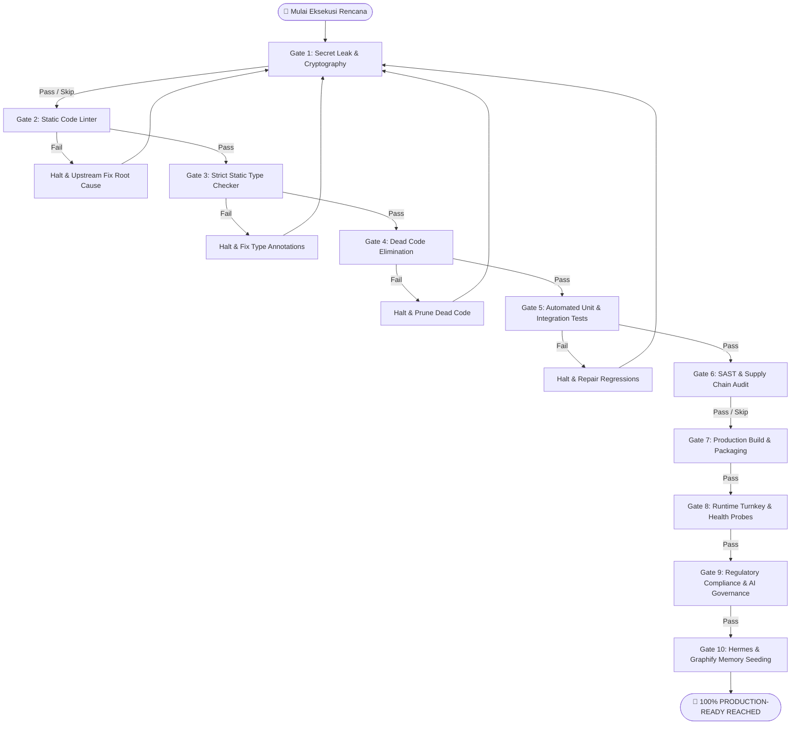

<!-- AGENTS_ORCHESTRATOR_METADATA: {
  "engine": "plan_architect.py",
  "version": "5.1.0",
  "mode": "feature",
  "domain": "general_software",
  "subsystems_executed": [
    "repo_auditor.audit_all",
    "requirements_decomposer.decompose",
    "audit_gap_extractor.extract",
    "compliance_matcher.match_compliance",
    "stack_detector.detect_stacks",
    "dynamic_quality_gates.resolve_gates",
    "database_schema_designer.generate_schema_blueprint",
    "devsecops_pipeline_generator.generate_pipeline_spec",
    "graph_bridge.grounding",
    "enterprise_plan_architect.assemble_gold_standard"
  ],
  "prompt_fingerprint": "5316025785489480363",
  "provenance_verified": true
} -->

# Perbaikan ADR-004 dan jalur komentar sosmed tanpa login akun Sanghyang, penambahan Nemuru Grand...

Catatan 18 Nov 2026: jalur YouTube dihapus atas permintaan pemakai; bagian tentang YouTube di dokumen ini tidak berlaku lagi.

Rencana ini disusun `plan_architect.py` di [`.agents/`](file:///home/user/Documents/SANGHYANG-NEWS/.agents) dari hasil alat: `stack_detector`, `compliance_matcher`, perancang skema basis data, penyusun pipeline DevSecOps, dan gerbang mutu dinamis. Isinya berpijak pada isi repositori dan bisa dieksekusi langkah demi langkah.

---

## Tinjauan pemilik

> [!IMPORTANT]
> **1. Empat Nol, batas yang tidak ditawar**:
> - **Zero Mock Data**: tidak ada data tiruan; aliran data berpijak pada skema dan sumber yang sebenarnya.
> - **Zero Hardcode**: kredensial, endpoint, dan kuota dibaca dari variabel lingkungan atau konfigurasi tervalidasi, tidak ditanam di kode.
> - **Zero Fallback**: galat tidak ditelan dan tidak ditutupi nilai bawaan; kegagalan dilaporkan dengan galat yang sah.
> - **Zero Timeout**: pekerjaan panjang dijalankan lewat alur kerja tahan-gagal atau antrean latar (Restate 1.7, Temporal, Dapr 1.18, atau tugas latar FastMCP), bukan jeda buta.

> [!WARNING]
> **2. Kontrol konkurensi optimistis (OCC) dan keutuhan data**:
> - Setiap entitas yang bisa diubah bersamaan punya atribut versi (`version integer DEFAULT 1 NOT NULL` atau token berurutan), supaya kondisi balapan dan pembaruan yang hilang tercegah.
> - OCC dua lapis: lapis pertama melacak keadaan (versi usang ditolak dengan galat pada keadaan lokal), lapis kedua memperbarui secara atomik dengan syarat `version == expected_version`.
> - Keutuhan dan isolasi data dijaga di mesin basis data lewat otorisasi berlapis, termasuk Row-Level Security bila sistemnya multi-penyewa.

---

## Pertanyaan terbuka

> [!NOTE]
> Tidak ada pertanyaan yang menahan pekerjaan. Parameter arsitektur di rencana ini diturunkan dari isi repositori dan hasil alat.

---

## Perubahan yang diusulkan

Dikelompokkan ke dalam 4 lapisan dependensi arsitektur terstruktur:

---

### Lapisan 2: Layanan Inti & Pengetikan Bedah (Type Safety)

#### [MODIFY] [`docs/architecture/ARCHITECTURE.md`](file:///home/user/Documents/SANGHYANG-NEWS/docs/architecture/ARCHITECTURE.md)
- Modul layanan inti yang memenuhi kebutuhan fitur.

#### [MODIFY] [`lib/market/social-sources.ts`](file:///home/user/Documents/SANGHYANG-NEWS/lib/market/social-sources.ts)
- Modul layanan inti yang memenuhi kebutuhan fitur.

#### [MODIFY] [`lib/market/scrape-social-buzz.ts`](file:///home/user/Documents/SANGHYANG-NEWS/lib/market/scrape-social-buzz.ts)
- Modul layanan inti yang memenuhi kebutuhan fitur.

#### [MODIFY] [`lib/market/adapters/youtube-data.ts`](file:///home/user/Documents/SANGHYANG-NEWS/lib/market/adapters/youtube-data.ts)
- Modul layanan inti yang memenuhi kebutuhan fitur.

#### [MODIFY] [`lib/market/competitor-repository.ts`](file:///home/user/Documents/SANGHYANG-NEWS/lib/market/competitor-repository.ts)
- Modul layanan inti yang memenuhi kebutuhan fitur.

#### [MODIFY] [`scripts/ops/sync-hotel-venues.ts`](file:///home/user/Documents/SANGHYANG-NEWS/scripts/ops/sync-hotel-venues.ts)
- Modul layanan inti yang memenuhi kebutuhan fitur.

#### [MODIFY] [`lib/market/website-promos.ts`](file:///home/user/Documents/SANGHYANG-NEWS/lib/market/website-promos.ts)
- Modul layanan inti yang memenuhi kebutuhan fitur.

#### [MODIFY] [`lib/market/gallery-outlets.ts`](file:///home/user/Documents/SANGHYANG-NEWS/lib/market/gallery-outlets.ts)
- Modul layanan inti yang memenuhi kebutuhan fitur.

#### [MODIFY] [`lib/market/outlet-filters.ts`](file:///home/user/Documents/SANGHYANG-NEWS/lib/market/outlet-filters.ts)
- Modul layanan inti yang memenuhi kebutuhan fitur.

#### [MODIFY] [`lib/market/competitor-comparison.ts`](file:///home/user/Documents/SANGHYANG-NEWS/lib/market/competitor-comparison.ts)
- Modul layanan inti yang memenuhi kebutuhan fitur.

#### [MODIFY] [`lib/market/pricing-benchmark.ts`](file:///home/user/Documents/SANGHYANG-NEWS/lib/market/pricing-benchmark.ts)
- Modul layanan inti yang memenuhi kebutuhan fitur.

#### [MODIFY] [`lib/market/hotel-compset.data.json`](file:///home/user/Documents/SANGHYANG-NEWS/lib/market/hotel-compset.data.json)
- Modul layanan inti yang memenuhi kebutuhan fitur.

#### [MODIFY] [`lib/market/competitor-menu.data.json`](file:///home/user/Documents/SANGHYANG-NEWS/lib/market/competitor-menu.data.json)
- Modul layanan inti yang memenuhi kebutuhan fitur.

#### [MODIFY] [`lib/market/competitor-gallery.data.json`](file:///home/user/Documents/SANGHYANG-NEWS/lib/market/competitor-gallery.data.json)
- Modul layanan inti yang memenuhi kebutuhan fitur.

#### [MODIFY] [`scripts/ops/seed-competitor-registry.ts`](file:///home/user/Documents/SANGHYANG-NEWS/scripts/ops/seed-competitor-registry.ts)
- Modul layanan inti yang memenuhi kebutuhan fitur.

- **Protokol Pengetikan Bedah (Surgical Type Safety)**:
  - Gunakan pengetikan statis ketat (strict typing, null-safety, discriminating unions) dan stubs/tipe eksplisit sesuai ekosistem bahasa target alih-alih menggunakan broad `Any` atau mengabaikan type errors.

### Lapisan 3: Invarian The 4 Zeros, Probes & Dinamisasi UI

#### [MODIFY] [`components/market-intelligence/social-channel-status.tsx`](file:///home/user/Documents/SANGHYANG-NEWS/components/market-intelligence/social-channel-status.tsx)
- Komponen antarmuka yang memakai endpoint fitur baru.

- **Dinamisasi Konfigurasi & Parameter Runtime (Zero Hardcode)**:
  - Ganti seluruh konstanta konfigurasi statis hardcoded dengan pemanggilan query API dinamis (`GET /api/v1/config/parameters` atau konfigurasi environment sejenis).

### Lapisan 4: Konfigurasi Tooling, Clean Code & Rangkaian Pengujian

#### [NEW] [`tests/test_regression.py`](file:///home/user/Documents/SANGHYANG-NEWS/tests/test_regression.py)
- Rangkaian tes regresi yang menjaga kompatibilitas mundur.

- **Rangkaian Pengujian Unit Otomatis Terisolasi**:
  - Pengujian unit otomatis OCC: verifikasi inisialisasi version=1, simulasi mutasi state/data konkuren paralel, dan pembuktian HTTP 409 Conflict pada benturan versi.
  - Pengujian unit otomatis /health/ready: verifikasi HTTP 200 saat DB + Redis terhubung, dan HTTP 503 saat simulasi kegagalan koneksi.


---

### 3. Kepatuhan dan regulasi ([`compliance_matcher.py`](file:///home/user/Documents/SANGHYANG-NEWS/.agents/scripts/compliance_matcher.py))
Domain Terdeteksi: `general_software` (AI & Agentic Governance: `Non-Aktif`).

| Standar Kepatuhan | Klausul / Regulasi | Kontrol Teknis yang Wajib Diterapkan |
| :--- | :--- | :--- |
| **ISO/IEC 25010:2023** | `Product Quality Model` | Kesesuaian fungsional, keandalan, efisiensi kinerja, kebergunaan, keamanan, kompatibilitas, kemudahan pemeliharaan, dan portabilitas. |
| **OWASP Top 10 / ASVS** | `Defensive Architecture` | Sanitasi masukan menyeluruh, validasi batas, eksekusi dengan hak akses minimum, dan penanganan exception yang aman. |
| **CycloneDX 1.7 & SPDX 3.0.1** | `Supply Chain Security` | Pembuatan Software Bill of Materials (SBOM) otomatis dan pemindaian kerentanan dependensi (0 temuan High/Critical). |
| **ISO/IEC 25010:2023** | `Product Quality Model (SQRE)` | Kesesuaian fungsional, keandalan, efisiensi kinerja, kebergunaan, keamanan, kompatibilitas, kemudahan pemeliharaan, dan portabilitas. |
| **OWASP Top 10 / ASVS 4.0.3** | `Defensive Architecture` | Sanitasi masukan menyeluruh, validasi batas, eksekusi dengan hak akses minimum, dan penanganan exception yang aman. |
| **Post-Quantum Cryptography** | `NIST FIPS 203/204/205 (Final) & FIPS 206 (Draft FN-DSA) / CycloneDX 1.7 CBOM` | Inventaris Cryptographic Bill of Materials (CBOM) yang melacak transisi ke algoritma tahan-kuantum (ML-KEM, ML-DSA, SLH-DSA, dan draf FN-DSA) serta hybrid TLS 1.3. |
| **ISO/IEC 25010:2023** | `Maintainability & SQRE` | Zero Dead Code (Knip / Vulture / Cargo udeps) dan kompleksitas siklomatik <= 10 di semua modul. |
| **SOC-2 Type II** | `CC7.2 Audit Trail` | Pencatatan terstruktur yang tidak bisa diubah, merekam aktor, IP, timestamp, aksi, dan payload sebelum/sesudah. |
| **CycloneDX 1.7 & SPDX 3.0.1** | `ECMA-424 2nd Edition Supply Chain` | Software Bill of Materials (SBOM) dan Cryptographic Bill of Materials (CBOM) terbaca mesin, lengkap dengan CBOM/OBOM/SaaSBOM/HBOM. |


---

### 4. DevSecOps dan keamanan rantai pasok ([`devsecops-pipeline-generator`](file:///home/user/Documents/SANGHYANG-NEWS/.agents/skills/devsecops-pipeline-generator/SKILL.md))
- **Platform**: `GitHub Actions Multi-Stage 2026`.
- **Standar Kontainer / Runtime Packaging**: `Native Systems / Standalone Executable Packaging`.
- **Gerbang Keamanan CI/CD**:
  - **Secret Detection**: alat `TruffleHog / Gitleaks` (ambang batas: 0 verified secrets)
  - **SAST**: alat `Semgrep / CodeQL` (ambang batas: 0 High/Critical findings)
  - **SCA**: alat `Trivy / OSV-Scanner` (ambang batas: 0 Vulnerable CVEs)
  - **Supply Chain SBOM/CBOM**: alat `Syft / CycloneDX 1.7 (ECMA-424)` (ambang batas: Valid CBOM/SBOM JSON specification)

---

## Arsitektur While-Loop: eksekusi berurutan 10 gerbang mutu

Sepuluh gerbang mutu dijalankan berurutan. Gerbang yang gagal menghentikan eksekusi, dan setelah perbaikan verifikasi mulai lagi dari Gate 1:



### Bila sebuah gerbang gagal
1. **Berhenti dan cari akar masalahnya.** Bila Gate $N$ gagal, Gate $N+1$ tidak dijalankan dan gejalanya tidak disamarkan, misalnya dengan membungkam tipe atau melewati tes. Baca keluaran kegagalannya, lalu perbaiki sebabnya di berkas sumber.
2. **Ulangi dari Gate 1.** Setiap perbaikan bisa berdampak ke lapisan sebelumnya, jadi verifikasi dimulai lagi dari awal.
3. **Paling banyak lima putaran.** Bila setelah lima putaran masih ada gerbang yang gagal, eksekusi berhenti dan agen melaporkan diagnosisnya kepada pemilik.

---

## Rencana verifikasi

### Pengujian otomatis (gerbang mutu dinamis 1..10)
Sepuluh gerbang mutu berikut diturunkan dari stack yang terdeteksi (`typescript-nextjs16-turbopack, python-fastapi`):

1. **Secret Leak Detection & Cryptographic Integrity**:
   ```bash
   gitleaks detect --no-git --verbose
   ```
2. **Static Code Linter (0 Error, 0 Warning)**:
   ```bash
   npm run lint && (cd crawler && uv run ruff check --extend-ignore=I001 .) && (cd crawler/research && uv run ruff check --extend-ignore=I001 .)
   ```
3. **Strict Static Type Checker**:
   ```bash
   npm run typecheck && (cd crawler && uv run basedpyright) && (cd crawler/research && uv run basedpyright)
   ```
4. **Dead Code & Unused Dependency Elimination**:
   ```bash
   npx --yes knip && (cd crawler && uv run vulture . --min-confidence 80) && (cd crawler/research && uv run vulture . --min-confidence 80)
   ```
5. **Automated Unit & Integration Test Suite**:
   ```bash
   npm test && (cd crawler && uv run pytest) && (cd crawler/research && uv run pytest)
   ```
6. **SAST, SCA & Supply Chain Vulnerability Audit**:
   ```bash
   EIO_BACKEND=posix semgrep scan --config auto -j 1 --disable-version-check
   ```
7. **Production Build & Packaging Compilation**:
   ```bash
   npm run build && (cd crawler && uv build) && (cd crawler/research && uv build)
   ```
8. **Turnkey Runtime & Health Probes (HTTP / Smoke / Container)**:
   ```bash
   node -e "console.log('Runtime probe: Node OK')" && python3 -c "print('Runtime probe: Python OK')"
   ```
9. **Candidate Compliance & AI Governance Audit**:
   ```bash
   python3 .agents/scripts/compliance_matcher.py
   ```
10. **Hermes & Graphify Memory Seeding**:
   ```bash
   python3 .agents/scripts/while_loop_runner.py --verify-hermes
   ```

### Verifikasi manual dan runtime
1. **Keadaan dan memori.** Periksa isolasi keadaan, alokasi memori, dan penanganan perubahan bersamaan di mesin lokal.
2. **Program berjalan.** Jalankan programnya dengan `--help` dan `--version`, dan pastikan tidak ada yang macet di stdin, stdout, maupun stderr.
3. **Tanpa sisa.** Pastikan tidak ada berkas sementara yang tertinggal di repositori.
