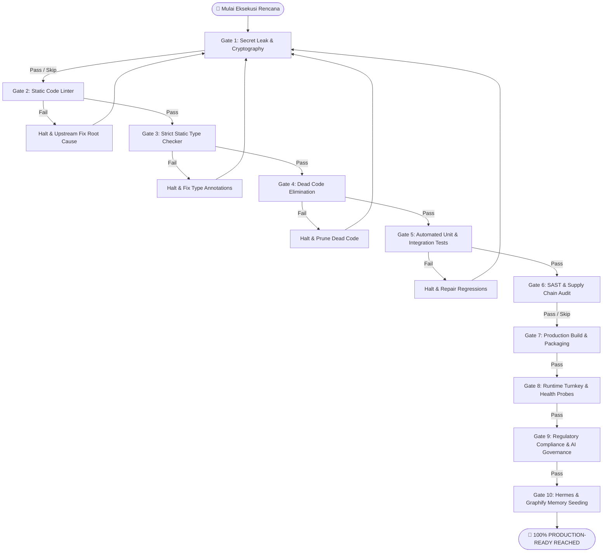

<!-- AGENTS_ORCHESTRATOR_METADATA: {
  "engine": "plan_architect.py",
  "version": "5.1.0",
  "mode": "feature",
  "domain": "web_service_microservices",
  "subsystems_executed": [
    "repo_auditor.audit_all",
    "requirements_decomposer.decompose",
    "audit_gap_extractor.extract",
    "compliance_matcher.match_compliance",
    "stack_detector.detect_stacks",
    "dynamic_quality_gates.resolve_gates",
    "database_schema_designer.generate_schema_blueprint",
    "devsecops_pipeline_generator.generate_pipeline_spec",
    "graph_bridge.grounding",
    "enterprise_plan_architect.assemble_gold_standard"
  ],
  "prompt_fingerprint": "5612424938785272461",
  "provenance_verified": true
} -->

# Membangun Ekstensi Chrome MV3 unpacked lintas-platform (Ubuntu/Windows, biaya $0) dan endpoint...

Rencana ini disusun `plan_architect.py` di [`.agents/`](file:///home/user/Documents/SANGHYANG-NEWS/.agents) dari hasil alat: `stack_detector`, `compliance_matcher`, perancang skema basis data, penyusun pipeline DevSecOps, dan gerbang mutu dinamis. Isinya berpijak pada isi repositori dan bisa dieksekusi langkah demi langkah.

---

## Tinjauan pemilik

> [!IMPORTANT]
> **1. Empat Nol, batas yang tidak ditawar**:
> - **Zero Mock Data**: tidak ada data tiruan; aliran data berpijak pada skema dan sumber yang sebenarnya.
> - **Zero Hardcode**: kredensial, endpoint, dan kuota dibaca dari variabel lingkungan atau konfigurasi tervalidasi, tidak ditanam di kode.
> - **Zero Fallback**: galat tidak ditelan dan tidak ditutupi nilai bawaan; kegagalan dilaporkan dengan galat yang sah.
> - **Zero Timeout**: pekerjaan panjang dijalankan lewat alur kerja tahan-gagal atau antrean latar (Restate 1.7, Temporal, Dapr 1.18, atau tugas latar FastMCP), bukan jeda buta.

> [!WARNING]
> **2. Kontrol konkurensi optimistis (OCC) dan keutuhan data**:
> - Setiap entitas yang bisa diubah bersamaan punya atribut versi (`version integer DEFAULT 1 NOT NULL` atau token berurutan), supaya kondisi balapan dan pembaruan yang hilang tercegah.
> - OCC dua lapis: lapis pertama melacak keadaan (versi usang dijawab `HTTP 409 Conflict` atau galat penolakan), lapis kedua memperbarui secara atomik dengan syarat `version == expected_version`.
> - Keutuhan dan isolasi data dijaga di mesin basis data lewat otorisasi berlapis, termasuk Row-Level Security bila sistemnya multi-penyewa.

> [!NOTE]
> Memakai basis data PostgreSQL lokal (`sanghyang-news-db` via `.env.development.local`) sesuai ADR-001; `.env.example` di akar sudah tersedia dan tidak perlu dibuat ulang.

---

## Pertanyaan terbuka

> [!NOTE]
> Tidak ada pertanyaan yang menahan pekerjaan; parameter berikut sudah ditetapkan dari keputusan pemilik dan hasil alat:
> - **Biaya `$0` tanpa kartu kredit / tanpa komputer menyala 24 jam**: Ekstensi Chrome Manifest V3 unpacked (`chrome://extensions -> Developer mode -> Load unpacked`) berjalan pada Chrome staf (Ubuntu Linux & Windows), tanpa biaya `$5` Chrome Web Store dan tanpa server VPS/Docker.
> - **Tanpa `git commit`, `git push`, atau deploy otomatis**: Seluruh pengembangan dan pengujian pada fase ini berjalan lokal; prompt `/swarm` untuk pembersihan skrip non-aktif dan push-deploy ke Vercel disusun setelah verifikasi lokal tuntas.

---

## Perubahan yang diusulkan

Dikelompokkan ke dalam 4 lapisan dependensi arsitektur terstruktur:

### Lapisan 1: Ekstensi Chrome Manifest V3 Lintas-Platform (`extension/sanghyang-social-sync/`)

- #### [NEW] [`extension/sanghyang-social-sync/manifest.json`](file:///home/user/Documents/SANGHYANG-NEWS/extension/sanghyang-social-sync/manifest.json)
  - Manifest V3 dengan public `"key"` terpin (`kabomdcpiamnnncoifohknncamcddahl`) agar Extension ID identik di Ubuntu Linux & Windows, tanpa izin global `tabs` maupun `cookies` (hanya `storage` & `scripting`), `host_permissions` terbatas pada `https://sanghyang-news.vercel.app/*`, `http://localhost/*`, `http://127.0.0.1/*`, `https://www.instagram.com/*`, `https://www.tiktok.com/*`, `externally_connectable` terbatas origin aplikasi, serta tanpa `web_accessible_resources`.
  - Ikon ekstensi PNG bersih di [`extension/sanghyang-social-sync/icons/`](file:///home/user/Documents/SANGHYANG-NEWS/extension/sanghyang-social-sync/icons/) (tanpa emoji).
- #### [NEW] [`extension/sanghyang-social-sync/parsers.js`](file:///home/user/Documents/SANGHYANG-NEWS/extension/sanghyang-social-sync/parsers.js)
  - Fungsi murni ekstraksi DOM & deteksi login/CAPTCHA (`SlardarWAF`, slider teka-teki, form `/accounts/login`) untuk Instagram dan TikTok beserta parser angka (`K`/`rb`/`jt`/`M`), pelestarian pasangan emoji surrogate valid, dan anonimisasi komentar di sisi klien (dual export browser + CommonJS agar dapat diuji di `node --test`).
- #### [NEW] [`extension/sanghyang-social-sync/content-social.js`](file:///home/user/Documents/SANGHYANG-NEWS/extension/sanghyang-social-sync/content-social.js) & [`background.js`](file:///home/user/Documents/SANGHYANG-NEWS/extension/sanghyang-social-sync/background.js)
  - Pekerja antrean satu tab terkendali yang menyuntikkan skrip ekstraksi hanya ke tab kerja (`chrome.scripting.executeScript`), memvalidasi `sender.origin` pada `onMessageExternal`, mengunjungi daftar target dinamis dari basis data (akun pembanding + akun resmi Sanghyang), berhenti seketika (*fail-closed*) dan memfokuskan tab Chrome saat menemukan login atau CAPTCHA agar ditangani langsung oleh staf, lalu menyerahkan hasil batch ke dasbor untuk dikirim `POST` *same-origin*.
- #### [NEW] [`extension/sanghyang-social-sync/popup.html`](file:///home/user/Documents/SANGHYANG-NEWS/extension/sanghyang-social-sync/popup.html) & [`popup.js`](file:///home/user/Documents/SANGHYANG-NEWS/extension/sanghyang-social-sync/popup.js)
  - Panel status berbahasa Indonesia menampilkan progres target, panduan singkat, dan tombol aksi saat jeda login/CAPTCHA.

### Lapisan 2: API Backend, Kemasan `.zip` & Keutuhan OCC

- #### [NEW] [`lib/market/extension-zip.ts`](file:///home/user/Documents/SANGHYANG-NEWS/lib/market/extension-zip.ts) & [`app/api/admin/social-extension/download/route.ts`](file:///home/user/Documents/SANGHYANG-NEWS/app/api/admin/social-extension/download/route.ts)
  - Builder arsip PKZIP standar memakai `node:zlib` (`zlib.crc32`) dengan validasi traversal jalur, menghasilkan unduhan `sanghyang-social-sync-extension.zip` terotentikasi (`tokenSah`).
- #### [MODIFY] [`next.config.ts`](file:///home/user/Documents/SANGHYANG-NEWS/next.config.ts)
  - Menambahkan `./extension/sanghyang-social-sync/**` ke `outputFileTracingIncludes` untuk rute `/api/admin/social-extension/download`.
- #### [NEW] [`lib/market/browser-social-sync.ts`](file:///home/user/Documents/SANGHYANG-NEWS/lib/market/browser-social-sync.ts) & [`app/api/marketing-sosmed/browser-sync/route.ts`](file:///home/user/Documents/SANGHYANG-NEWS/app/api/marketing-sosmed/browser-sync/route.ts)
  - `GET`: menyusun daftar target sinkronisasi secara dinamis dari tabel `Competitor` (`active: true`) + `OFFICIAL_SOCIAL_ACCOUNTS` + ringkasan run terakhir (`ScrapeJob.social`).
  - `POST`: validasi URL permalink terverifikasi (`/p/`, `/reel/`, `/video/`), sanitasi & anonimisasi `@handle` komentar (`CompetitorReview`), deduplikasi idempoten dan pembaruan OCC bertumpu versi pada `CompetitorPromotion` (`Postingan Sosmed Tayang` untuk akun sendiri dengan `inquiriesWa: null` saat belum diisi manual; `Postingan Sosmed Baru` / ekstraksi caption untuk pesaing), penulisan `ScrapeRun` & `ScrapeError` (`job: "social"`), dan penanganan `ProductionWriteBlockedError` menjadi `HTTP 403`.
- #### [MODIFY] [`lib/market/marketing-sosmed.ts`](file:///home/user/Documents/SANGHYANG-NEWS/lib/market/marketing-sosmed.ts), [`lib/market/marketing-sosmed-outlets.ts`](file:///home/user/Documents/SANGHYANG-NEWS/lib/market/marketing-sosmed-outlets.ts), [`app/api/marketing-sosmed/route.ts`](file:///home/user/Documents/SANGHYANG-NEWS/app/api/marketing-sosmed/route.ts)
  - Mengubah `inquiriesWa` pada `SocialPostMetrics` menjadi `number | null` (Zero Mock: angka WA yang tidak diisi tidak dipaksa menjadi `0`) serta memperketat pembaruan OCC `version` dan pelestarian `inquiriesWa` yang sudah diisi tim.
- #### [MODIFY] [`app/api/market-intelligence/summary/route.ts`](file:///home/user/Documents/SANGHYANG-NEWS/app/api/market-intelligence/summary/route.ts), [`lib/knowledge-graph/assemble.ts`](file:///home/user/Documents/SANGHYANG-NEWS/lib/knowledge-graph/assemble.ts), [`lib/market/social-sources.ts`](file:///home/user/Documents/SANGHYANG-NEWS/lib/market/social-sources.ts), [`lib/market/resort-strategy.ts`](file:///home/user/Documents/SANGHYANG-NEWS/lib/market/resort-strategy.ts), [`lib/meeting-report/build.ts`](file:///home/user/Documents/SANGHYANG-NEWS/lib/meeting-report/build.ts), [`lib/meeting-report/sections.ts`](file:///home/user/Documents/SANGHYANG-NEWS/lib/meeting-report/sections.ts)
  - Memperbaiki pelabelan platform `discoveredSocialPosts` memakai `platformOf(p.sourceUrl) ?? "instagram"` dan pengenalan sumber TikTok di `assemble.ts`, memperketat `isVerifiedReviewSource` untuk permalink IG/TikTok terjangkar, serta memperbaiki `lib/meeting-report/build.ts` + `sections.ts` agar komentar media sosial berating `0` dipilah lewat `sentiment` (bukan "Keluhan 0/5").

### Lapisan 3: Antarmuka Dasbor (`/market-intelligence` & `/marketing-sosmed`)

- #### [NEW] [`lib/market/social-extension-client.ts`](file:///home/user/Documents/SANGHYANG-NEWS/lib/market/social-extension-client.ts), [`components/market-intelligence/use-social-extension-sync.ts`](file:///home/user/Documents/SANGHYANG-NEWS/components/market-intelligence/use-social-extension-sync.ts), [`components/market-intelligence/social-extension-panel.tsx`](file:///home/user/Documents/SANGHYANG-NEWS/components/market-intelligence/social-extension-panel.tsx) & [`components/market-intelligence/refresh-progress-modal.tsx`](file:///home/user/Documents/SANGHYANG-NEWS/components/market-intelligence/refresh-progress-modal.tsx)
  - Deteksi ekstensi lewat `externally_connectable`, pemicu sinkronisasi, unduh `.zip` sekali klik, panel progres, serta penanda kuning interaktif saat terjeda login/CAPTCHA dengan tombol **Sudah Selesai Login / CAPTCHA · Lanjutkan**.
- #### [MODIFY] [`components/market-intelligence/update-all-button.tsx`](file:///home/user/Documents/SANGHYANG-NEWS/components/market-intelligence/update-all-button.tsx), [`components/market-intelligence/step-kata-tamu.tsx`](file:///home/user/Documents/SANGHYANG-NEWS/components/market-intelligence/step-kata-tamu.tsx), [`components/market-intelligence/step-promo.tsx`](file:///home/user/Documents/SANGHYANG-NEWS/components/market-intelligence/step-promo.tsx), [`app/market-intelligence/page.tsx`](file:///home/user/Documents/SANGHYANG-NEWS/app/market-intelligence/page.tsx), [`app/marketing-sosmed/page.tsx`](file:///home/user/Documents/SANGHYANG-NEWS/app/marketing-sosmed/page.tsx), [`components/marketing-sosmed/post-card.tsx`](file:///home/user/Documents/SANGHYANG-NEWS/components/marketing-sosmed/post-card.tsx)
  - Menghubungkan **Perbarui Semua Data**, Langkah 1 (`Kata Tamu`), Langkah 4 (`Promo & Event`), dan halaman `/marketing-sosmed` ke panel ekstensi sambil menjaga seluruh komponen `components/market-intelligence/` tetap `<= 300` baris dan hanya 1 tombol pembaruan utama di `MarketHeader`.

### Lapisan 4: Rangkaian Pengujian TDD (`test-first-development`)

- #### [NEW] [`tests/unit/browser-social-sync.test.ts`](file:///home/user/Documents/SANGHYANG-NEWS/tests/unit/browser-social-sync.test.ts)
  - Pengujian PKZIP & proteksi path traversal, anonimisasi komentar + validasi domain/permalink, parser DOM Instagram & TikTok (postingan, tayangan, komentar, deteksi CAPTCHA/login), API `GET/POST /api/marketing-sosmed/browser-sync` (401, 403, 422, OCC `version`, idempoten), `inquiriesWa: null`, serta pelabelan platform TikTok di summary & Knowledge Graph.


---

### 3. Kepatuhan dan regulasi ([`compliance_matcher.py`](file:///home/user/Documents/SANGHYANG-NEWS/.agents/scripts/compliance_matcher.py))
Domain Terdeteksi: `web_service_microservices` (AI & Agentic Governance: `Non-Aktif`).

| Standar Kepatuhan | Klausul / Regulasi | Kontrol Teknis yang Wajib Diterapkan |
| :--- | :--- | :--- |
| **Compliance Standard: ISO 22301:2019 Business Continuity Management (BCM) (Clause 8.4)** | `Business Continuity Procedures` | Endpoint pemeriksaan kesehatan otomatis (`/health/live` dan `/health/ready`) di setiap layanan mikro. |
| **Compliance Standard: ISO 22301:2019 Business Continuity Management (BCM) (Clause 8.5)** | `Exercise and Testing` | Menjalankan Docker compose siap pakai wajib mencapai status sehat pada semua kontainer dalam 30 detik. |
| **Compliance Standard: ISO 22301:2019 Business Continuity Management (BCM) (Clause 8.6)** | `Evaluation of Documentation` | Hook penghentian tertib yang menangani sinyal `SIGTERM`/`SIGINT` dengan pengosongan koneksi $\le 10$ detik. |
| **ISO/IEC 25010:2023** | `Product Quality Model (SQRE)` | Kesesuaian fungsional, keandalan, efisiensi kinerja, kebergunaan, keamanan, kompatibilitas, kemudahan pemeliharaan, dan portabilitas. |
| **OWASP Top 10 / ASVS 4.0.3** | `Defensive Architecture` | Sanitasi masukan menyeluruh, validasi batas, eksekusi dengan hak akses minimum, dan penanganan exception yang aman. |
| **Post-Quantum Cryptography** | `NIST FIPS 203/204/205 (Final) & FIPS 206 (Draft FN-DSA) / CycloneDX 1.7 CBOM` | Inventaris Cryptographic Bill of Materials (CBOM) yang melacak transisi ke algoritma tahan-kuantum (ML-KEM, ML-DSA, SLH-DSA, dan draf FN-DSA) serta hybrid TLS 1.3. |
| **ISO/IEC 25010:2023** | `Maintainability & SQRE` | Zero Dead Code (Knip / Vulture / Cargo udeps) dan kompleksitas siklomatik <= 10 di semua modul. |
| **SOC-2 Type II** | `CC7.2 Audit Trail` | Pencatatan terstruktur yang tidak bisa diubah, merekam aktor, IP, timestamp, aksi, dan payload sebelum/sesudah. |
| **CycloneDX 1.7 & SPDX 3.0.1** | `ECMA-424 2nd Edition Supply Chain` | Software Bill of Materials (SBOM) dan Cryptographic Bill of Materials (CBOM) terbaca mesin, lengkap dengan CBOM/OBOM/SaaSBOM/HBOM. |


---

### 4. DevSecOps dan keamanan rantai pasok ([`devsecops-pipeline-generator`](file:///home/user/Documents/SANGHYANG-NEWS/.agents/skills/devsecops-pipeline-generator/SKILL.md))
- **Platform**: `GitHub Actions Multi-Stage 2026`.
- **Standar Kontainer / Runtime Packaging**: `Distroless / Wolfi Non-Root container image with non-privileged UID 10001`.
- **Gerbang Keamanan CI/CD**:
  - **Secret Detection**: alat `TruffleHog / Gitleaks` (ambang batas: 0 verified secrets)
  - **SAST**: alat `Semgrep / CodeQL` (ambang batas: 0 High/Critical findings)
  - **SCA**: alat `Trivy / OSV-Scanner` (ambang batas: 0 Vulnerable CVEs)
  - **Supply Chain SBOM/CBOM**: alat `Syft / CycloneDX 1.7 (ECMA-424)` (ambang batas: Valid CBOM/SBOM JSON specification)

---

## Arsitektur While-Loop: eksekusi berurutan 10 gerbang mutu

Sepuluh gerbang mutu dijalankan berurutan. Gerbang yang gagal menghentikan eksekusi, dan setelah perbaikan verifikasi mulai lagi dari Gate 1:



### Bila sebuah gerbang gagal
1. **Berhenti dan cari akar masalahnya.** Bila Gate $N$ gagal, Gate $N+1$ tidak dijalankan dan gejalanya tidak disamarkan, misalnya dengan membungkam tipe atau melewati tes. Baca keluaran kegagalannya, lalu perbaiki sebabnya di berkas sumber.
2. **Ulangi dari Gate 1.** Setiap perbaikan bisa berdampak ke lapisan sebelumnya, jadi verifikasi dimulai lagi dari awal.
3. **Paling banyak lima putaran.** Bila setelah lima putaran masih ada gerbang yang gagal, eksekusi berhenti dan agen melaporkan diagnosisnya kepada pemilik.

---

## Rencana verifikasi

### Pengujian otomatis (gerbang mutu dinamis 1..10)
Sepuluh gerbang mutu berikut diturunkan dari stack yang terdeteksi (`typescript-nextjs16-turbopack, python-fastapi`):

1. **Secret Leak Detection & Cryptographic Integrity**:
   ```bash
   gitleaks detect --no-git --verbose
   ```
2. **Static Code Linter (0 Error, 0 Warning)**:
   ```bash
   npm run lint && (cd crawler && uv run ruff check --extend-ignore=I001 .) && (cd crawler/research && uv run ruff check --extend-ignore=I001 .)
   ```
3. **Strict Static Type Checker**:
   ```bash
   npm run typecheck && (cd crawler && uv run basedpyright) && (cd crawler/research && uv run basedpyright)
   ```
4. **Dead Code & Unused Dependency Elimination**:
   ```bash
   npx --yes knip && (cd crawler && uv run vulture . --min-confidence 80) && (cd crawler/research && uv run vulture . --min-confidence 80)
   ```
5. **Automated Unit & Integration Test Suite**:
   ```bash
   npm test && (cd crawler && uv run pytest) && (cd crawler/research && uv run pytest)
   ```
6. **SAST, SCA & Supply Chain Vulnerability Audit**:
   ```bash
   EIO_BACKEND=posix semgrep scan --config auto -j 1 --disable-version-check
   ```
7. **Production Build & Packaging Compilation**:
   ```bash
   npm run build && (cd crawler && uv build) && (cd crawler/research && uv build)
   ```
8. **Turnkey Runtime & Health Probes (HTTP / Smoke / Container)**:
   ```bash
   node -e "console.log('Runtime probe: Node OK')" && python3 -c "print('Runtime probe: Python OK')"
   ```
9. **Candidate Compliance & AI Governance Audit**:
   ```bash
   python3 .agents/scripts/compliance_matcher.py
   ```
10. **Hermes & Graphify Memory Seeding**:
   ```bash
   python3 .agents/scripts/while_loop_runner.py --verify-hermes
   ```

### Verifikasi manual dan runtime
1. **Konflik versi.** Kirim permintaan dengan `version` yang sudah usang dan pastikan jawabannya `HTTP 409 Conflict`.
2. **Kesiapan layanan.** Panggil endpoint readiness dan pastikan sambungan ke basis data dan cache dilaporkan sehat.
3. **Tanpa sisa.** Pastikan tidak ada berkas sementara yang tertinggal di repositori.
