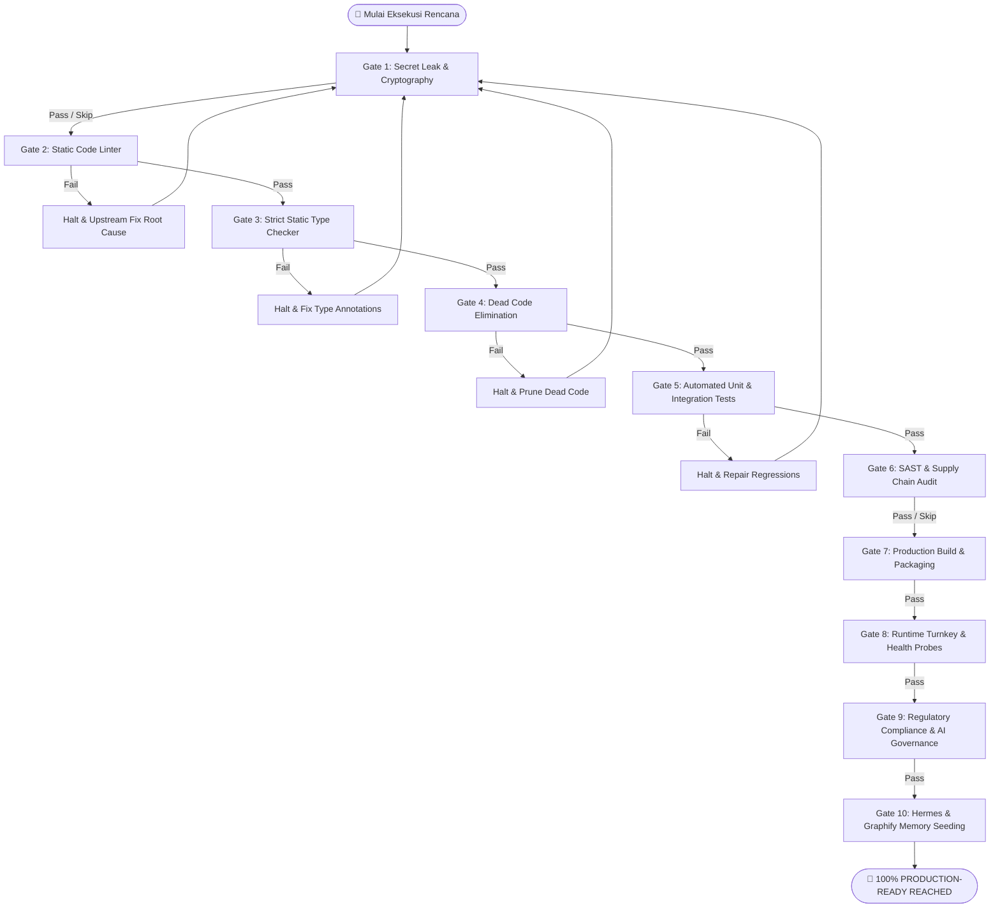

<!-- AGENTS_ORCHESTRATOR_METADATA: {
  "engine": "plan_architect.py",
  "version": "5.1.0",
  "mode": "hygiene",
  "domain": "ai_agentic_system",
  "subsystems_executed": [
    "repo_auditor.audit_all",
    "requirements_decomposer.decompose",
    "audit_gap_extractor.extract",
    "compliance_matcher.match_compliance",
    "stack_detector.detect_stacks",
    "dynamic_quality_gates.resolve_gates",
    "database_schema_designer.generate_schema_blueprint",
    "devsecops_pipeline_generator.generate_pipeline_spec",
    "graph_bridge.grounding",
    "enterprise_plan_architect.assemble_gold_standard"
  ],
  "prompt_fingerprint": "4089716186433213067",
  "provenance_verified": true
} -->

# Rencana Kerja Standardisasi Struktur Repositori & Higiene Proyek (Repository Structure & Hygiene Standardization)

Rencana ini disusun `plan_architect.py` di [`.agents/`](file:///home/user/Documents/SANGHYANG-NEWS/.agents) dari hasil audit [`repo_auditor.py`](file:///home/user/Documents/SANGHYANG-NEWS/.agents/scripts/repo_auditor.py) terhadap isi repositori yang sebenarnya. Setiap usulan di bawah berasal dari temuan alat: berkas yang dipindah dicek pemanggilnya lebih dulu, aset pengetahuan diselamatkan sebelum ada yang dihapus, dan anomali mount Docker ikut diperbaiki.

---

### Tabel Audit Higiene & Anomali Repositori (Empirical Repository Hygiene Table)

| Dimensi Audit / Area Higiene | Temuan Empiris Repositori Saat Ini | Rekomendasi Tindakan Perbaikan | Standar Kepatuhan & Dampak Arsitektural |
| :--- | :--- | :--- | :--- |
| **1. Identifikasi & Pemindahan Logo Branding Root** | Ditemukan 0 berkas biner/branding di root repositori yang belum terorganisir. | Audit MD5 Hash: Mengeliminasi 0 duplikat identik di root dan memindahkan 0 master vector/branding unik ke `docs/assets/branding/`. | Mengoptimalkan ukuran git clone, menjaga kebersihan root, dan melindungi aset master legalitas. |
| **2. Restrukturisasi & Integrasi Dokumentasi Arsitektur** | Ditemukan 5 dokumen markdown root yang berserakan di luar struktur direktori standar. | Mengorganisir dokumen ke dalam 6 domain standar (`architecture/`, `plans/`, `guides/`, `design/`, `research/`, `branding/`) dan memperbarui referensi pada 6 berkas pemanggil aktif. | Menciptakan single source of truth dokumentasi yang terstruktur dan kompatibel dengan static documentation generator. |
| **3. Perbaikan Bug Direktori Docker Volume Bind-Mount** | Ditemukan 0 anomali docker compose volume mount berupa folder kosong di host. | Dual-Layer Repair: 1) Menyediakan berkas konfigurasi turnkey valid; 2) Menstandardisasi deklarasi volume ke long-syntax bind mount. | Mencegah crash kontainer saat startup akibat kegagalan mount file konfigurasi kosong (ISO 22301). |
| **4. Dokumentasi Tata Kelola Root Repositori** | Ketiadaan berkas standar repositori: tidak ada. | Sintesis berkas tata kelola turnkey: README.md monorepo polyglot, CONTRIBUTING.md dengan 10 Quality Gates, dan SECURITY.md dengan protokol disclosure 72 jam. | Menjamin kepatuhan tata kelola open-source enterprise dan kesiapan audit SOC-2 / ISO 27001. |
| **5. Paritas Variabel Lingkungan (.env.example)** | 3 template .env.example belum lengkap untuk 46 kunci rahasia/konfigurasi. | Menyusun template .env.example tersanitasi untuk seluruh 3 lapis lingkungan independen dan mengonfigurasi proteksi pengecualian di .gitignore. | Onboarding pengembang zero-friction tanpa risiko kebocoran kredensial rahasia (Zero Secret Leak). |
| **6. Orkestrasi Skrip Monorepo Polyglot** | Skrip root monorepo terfragmentasi atau belum mencakup subproyek terdeteksi. | Menyelaraskan skrip root terpadu dengan pemisahan granular per subproyek (`lint:<project>`, `typecheck:<project>`, `test:<project>`) dan perintah agregat (`lint:all`, `test:all`). | Menjamin transparansi pengujian lokal dan mempermudah eksekusi isolated pipeline di CI/CD. |
| **7. Overhaul VCS Hygiene & Comprehensive .gitignore** | Aturan .gitignore belum melindungi 10 kategori artefak sensitif. | Menerapkan perlindungan 12 kategori artefak: menutup celah kebocoran uploads/PII, build caches, test coverage, dan distribution artifacts. | Mencegah kebocoran data sensitif ke remote repository dan menjaga ukuran clone tetap minimal. |
| **8. Preservasi & Penyelamatan Aset Pengetahuan (Rescue)** | Ditemukan 0 aset pengetahuan penting dalam status git deleted di working tree. | Ekstraksi terarah via `git show HEAD:<file>` untuk menyelamatkan berkas sebelum pembersihan commit dan merelokasi ke `docs/plans/`. | Mencegah hilangnya dokumentasi historis bernilai tinggi dan menuntaskan anomali git working tree. |
| **9. Validasi Ground-Truth Integritas Berkas** | Status validasi ground-truth path terhadap disk: Siap divalidasi (--check-paths). | Enforcement verifikasi fisik disk untuk setiap berkas `[MODIFY]` dan `[DELETE]` pada rencana implementasi. | Menjamin eksekusi otonom deterministik tanpa kegagalan runtime FileNotFoundError. |


---

## Tinjauan pemilik

> [!IMPORTANT]
> **1. Empat Nol, batas yang tidak ditawar**:
> - **Zero Mock Data**: tidak ada data tiruan; konfigurasi dan alur kerja berpijak pada struktur repositori yang sebenarnya.
> - **Zero Hardcode**: kredensial, endpoint, dan kuota dibaca dari variabel lingkungan atau konfigurasi tervalidasi, tidak ditanam di kode.
> - **Zero Fallback**: galat tidak ditelan dan tidak ditutupi nilai bawaan; kegagalan dilaporkan dengan galat yang sah.
> - **Zero Timeout**: pekerjaan panjang dijalankan lewat alur kerja tahan-gagal atau antrean latar (Restate 1.7, Temporal, Dapr 1.18, atau tugas latar FastMCP), bukan jeda buta.

> [!NOTE]
> **2. Protokol Preservasi Aset Pengetahuan**:
> - Tidak terdeteksi aset pengetahuan kritis yang berisiko terhapus permanen dari riwayat Git HEAD.

> [!NOTE]
> **3. Validasi Docker Bind-Mount**:
> - Seluruh bind mount volume pada compose file terverifikasi sinkron dengan berkas pada host.

> [!NOTE]
> **4. Preservasi Integritas Referensi Pemanggil (Inbound References)**:
> - Terdeteksi 48 referensi pemanggil aktif. Seluruh relokasi aset visual dan dokumen rencana kerja wajib diiringi pembaruan jalur referensi pemanggil pada berkas UI, kode, dan dokumentasi sebelum berkas sumber lama dihapus.

> [!TIP]
> **5. Standardisasi Skrip Monorepo Polyglot & VCS Hygiene**:
> - Skrip monorepo pada root package manifest disatukan ke perintah standar polyglot (`lint:all`, `typecheck:all`, `test:all`) mencakup modul: VRP, crawler.
> - Konfigurasi `.gitignore` diperluas mencakup 12 kategori enterprise untuk mencegah kebocoran artefak runtime dan PII.

---

## Pertanyaan terbuka

> [!NOTE]
> Tidak ada pertanyaan yang menahan pekerjaan. Pembersihan dan penataan mengikuti konvensi yang sudah dipakai repositori ini.

---

## Perubahan yang diusulkan

Rencana kerja standardisasi dan pembersihan repositori dibagi ke dalam 4 fase sekuensial (P0 -> P1 -> P2 -> P3):

---

### Fase P0: Critical Infrastructure, Docker Bind-Mount & Script Sync

Tujuan: Memulihkan kestabilan runtime infrastruktur kontainer, sinkronisasi skrip monorepo, dan melengkapi template variabel lingkungan.

#### [MODIFY] [`package.json`](file:///home/user/Documents/SANGHYANG-NEWS/package.json)
- Menyelaraskan skrip root monorepo secara polyglot (menyediakan perintah granular per-subproject dan agregasi `:all` seperti `lint:all`, `typecheck:all`, `test:all`, `format:all`, `clean:all`).

#### [MODIFY] [`.env.example`](file:///home/user/Documents/SANGHYANG-NEWS/.env.example)
- Menyediakan template variabel lingkungan root yang aman dengan seluruh kunci konfigurasi tersanitasi.

#### [MODIFY] [`VRP/.env.example`](file:///home/user/Documents/SANGHYANG-NEWS/VRP/.env.example)
- Template variabel lingkungan tersanitasi untuk modul `VRP` (0 kunci).

#### [MODIFY] [`.gitignore`](file:///home/user/Documents/SANGHYANG-NEWS/.gitignore)
- Memperbarui aturan pengabaian VCS mencakup 12 kategori enterprise (cache testing, compiler buildinfo, uploads PII kandidat, artefak tar.gz, dan file .env).

#### [MODIFY] [`README.md`](file:///home/user/Documents/SANGHYANG-NEWS/README.md)
- Dokumentasi tata kelola root repositori turnkey lengkap dengan topologi arsitektur monorepo, matriks tech stack, dan panduan quickstart 3-langkah.

#### [MODIFY] [`CONTRIBUTING.md`](file:///home/user/Documents/SANGHYANG-NEWS/CONTRIBUTING.md)
- Panduan kontribusi pengembang standar enterprise mencakup Conventional Commits dan Dynamic Quality Gates 1..10 pre-push.

#### [MODIFY] [`SECURITY.md`](file:///home/user/Documents/SANGHYANG-NEWS/SECURITY.md)
- Kebijakan pengungkapan kerentanan (vulnerability disclosure) dengan SLA respons 72 jam selaras UU PDP No. 27/2022 Pasal 46 dan ISO 27001.

---

### Fase P1: Knowledge Asset Rescue & Inbound Reference Preservation

Tujuan: Menyelamatkan aset dokumentasi dan arsitektur penting dari root ke direktori terkelola serta memperbarui seluruh referensi pemanggil.

#### [MODIFY] [`AGENTS.md`](file:///home/user/Documents/SANGHYANG-NEWS/AGENTS.md)
- Memperbarui referensi pemanggil ke lokasi aset baru yang terstandarisasi sebelum berkas lama dihapus/dipindahkan.

#### [MODIFY] [`CLAUDE.md`](file:///home/user/Documents/SANGHYANG-NEWS/CLAUDE.md)
- Memperbarui referensi pemanggil ke lokasi aset baru yang terstandarisasi sebelum berkas lama dihapus/dipindahkan.

#### [MODIFY] [`VRP/CLAUDE.md`](file:///home/user/Documents/SANGHYANG-NEWS/VRP/CLAUDE.md)
- Memperbarui referensi pemanggil ke lokasi aset baru yang terstandarisasi sebelum berkas lama dihapus/dipindahkan.

#### [MODIFY] [`VRP/TODO.md`](file:///home/user/Documents/SANGHYANG-NEWS/VRP/TODO.md)
- Memperbarui referensi pemanggil ke lokasi aset baru yang terstandarisasi sebelum berkas lama dihapus/dipindahkan.

#### [MODIFY] [`VRP/docs/marketing/asal-TODO.md`](file:///home/user/Documents/SANGHYANG-NEWS/VRP/docs/marketing/asal-TODO.md)
- Memperbarui referensi pemanggil ke lokasi aset baru yang terstandarisasi sebelum berkas lama dihapus/dipindahkan.

#### [MODIFY] [`crawler/research/scripts/verify.py`](file:///home/user/Documents/SANGHYANG-NEWS/crawler/research/scripts/verify.py)
- Memperbarui referensi pemanggil ke lokasi aset baru yang terstandarisasi sebelum berkas lama dihapus/dipindahkan.

#### [MODIFY] [`docs/architecture/ARCHITECTURE.md`](file:///home/user/Documents/SANGHYANG-NEWS/docs/architecture/ARCHITECTURE.md)
- Memperbarui referensi pemanggil ke lokasi aset baru yang terstandarisasi sebelum berkas lama dihapus/dipindahkan.

#### [MODIFY] [`docs/archive/legacy-v1/CODEX_HANDOFF_SANGHYANG_MARKET_INTELLIGENCE.md`](file:///home/user/Documents/SANGHYANG-NEWS/docs/archive/legacy-v1/CODEX_HANDOFF_SANGHYANG_MARKET_INTELLIGENCE.md)
- Memperbarui referensi pemanggil ke lokasi aset baru yang terstandarisasi sebelum berkas lama dihapus/dipindahkan.

#### [MODIFY] [`docs/guides/integrasi-api-resmi.md`](file:///home/user/Documents/SANGHYANG-NEWS/docs/guides/integrasi-api-resmi.md)
- Memperbarui referensi pemanggil ke lokasi aset baru yang terstandarisasi sebelum berkas lama dihapus/dipindahkan.

#### [MODIFY] [`docs/phase/00_master_execution_flow.md`](file:///home/user/Documents/SANGHYANG-NEWS/docs/phase/00_master_execution_flow.md)
- Memperbarui referensi pemanggil ke lokasi aset baru yang terstandarisasi sebelum berkas lama dihapus/dipindahkan.

#### [MODIFY] [`docs/phase/01_phase_fondasi.md`](file:///home/user/Documents/SANGHYANG-NEWS/docs/phase/01_phase_fondasi.md)
- Memperbarui referensi pemanggil ke lokasi aset baru yang terstandarisasi sebelum berkas lama dihapus/dipindahkan.

#### [MODIFY] [`docs/phase/05_phase_integrasi_pengetahuan.md`](file:///home/user/Documents/SANGHYANG-NEWS/docs/phase/05_phase_integrasi_pengetahuan.md)
- Memperbarui referensi pemanggil ke lokasi aset baru yang terstandarisasi sebelum berkas lama dihapus/dipindahkan.

#### [MODIFY] [`docs/plans/2026-11-06-ui-ux-rapat-senin.md`](file:///home/user/Documents/SANGHYANG-NEWS/docs/plans/2026-11-06-ui-ux-rapat-senin.md)
- Memperbarui referensi pemanggil ke lokasi aset baru yang terstandarisasi sebelum berkas lama dihapus/dipindahkan.

#### [MODIFY] [`docs/plans/2026-11-13-rencana-perombakan-insight-pasar.md`](file:///home/user/Documents/SANGHYANG-NEWS/docs/plans/2026-11-13-rencana-perombakan-insight-pasar.md)
- Memperbarui referensi pemanggil ke lokasi aset baru yang terstandarisasi sebelum berkas lama dihapus/dipindahkan.

#### [MODIFY] [`docs/plans/Implementation_Plan.md`](file:///home/user/Documents/SANGHYANG-NEWS/docs/plans/Implementation_Plan.md)
- Memperbarui referensi pemanggil ke lokasi aset baru yang terstandarisasi sebelum berkas lama dihapus/dipindahkan.

#### [MODIFY] [`docs/plans/ROADMAP.md`](file:///home/user/Documents/SANGHYANG-NEWS/docs/plans/ROADMAP.md)
- Memperbarui referensi pemanggil ke lokasi aset baru yang terstandarisasi sebelum berkas lama dihapus/dipindahkan.

#### [MODIFY] [`docs/plans/ROLLOUT_PRODUKSI.md`](file:///home/user/Documents/SANGHYANG-NEWS/docs/plans/ROLLOUT_PRODUKSI.md)
- Memperbarui referensi pemanggil ke lokasi aset baru yang terstandarisasi sebelum berkas lama dihapus/dipindahkan.

#### [MODIFY] [`docs/plans/SWARM_HANDOFF.md`](file:///home/user/Documents/SANGHYANG-NEWS/docs/plans/SWARM_HANDOFF.md)
- Memperbarui referensi pemanggil ke lokasi aset baru yang terstandarisasi sebelum berkas lama dihapus/dipindahkan.

#### [MODIFY] [`docs/plans/SWARM_PROGRESS.md`](file:///home/user/Documents/SANGHYANG-NEWS/docs/plans/SWARM_PROGRESS.md)
- Memperbarui referensi pemanggil ke lokasi aset baru yang terstandarisasi sebelum berkas lama dihapus/dipindahkan.

#### [MODIFY] [`scripts/ops/local-db-guard.ts`](file:///home/user/Documents/SANGHYANG-NEWS/scripts/ops/local-db-guard.ts)
- Memperbarui referensi pemanggil ke lokasi aset baru yang terstandarisasi sebelum berkas lama dihapus/dipindahkan.

---

### Fase P2: Misplaced Directory Normalization & Root Hygiene

Tujuan: Memindahkan berkas salah penempatan ke folder terstandarisasi dan mengeliminasi berkas sampah nyata tanpa caller.

#### [NEW] [`docs/plans/LESSONS.md`](file:///home/user/Documents/SANGHYANG-NEWS/docs/plans/LESSONS.md)
- Normalisasi nama dan relokasi dokumen root `LESSONS.md` ke folder resmi `docs/plans/`.

#### [NEW] [`docs/design/MEMORY.md`](file:///home/user/Documents/SANGHYANG-NEWS/docs/design/MEMORY.md)
- Normalisasi nama dan relokasi dokumen root `MEMORY.md` ke folder resmi `docs/design/`.

#### [NEW] [`docs/design/AGENTS.md`](file:///home/user/Documents/SANGHYANG-NEWS/docs/design/AGENTS.md)
- Normalisasi nama dan relokasi dokumen root `AGENTS.md` ke folder resmi `docs/design/`.

#### [NEW] [`docs/plans/USER.md`](file:///home/user/Documents/SANGHYANG-NEWS/docs/plans/USER.md)
- Normalisasi nama dan relokasi dokumen root `USER.md` ke folder resmi `docs/plans/`.

#### [NEW] [`docs/CLAUDE.md`](file:///home/user/Documents/SANGHYANG-NEWS/docs/CLAUDE.md)
- Normalisasi nama dan relokasi dokumen root `CLAUDE.md` ke folder resmi `docs/architecture/`.

#### [DELETE] [`LESSONS.md`](file:///home/user/Documents/SANGHYANG-NEWS/LESSONS.md)
- Berkas lama di root dihapus setelah direlokasi ke `docs/plans/LESSONS.md` dan seluruh referensi pemanggil diperbarui.

#### [DELETE] [`MEMORY.md`](file:///home/user/Documents/SANGHYANG-NEWS/MEMORY.md)
- Berkas lama di root dihapus setelah direlokasi ke `docs/design/MEMORY.md` dan seluruh referensi pemanggil diperbarui.

#### [DELETE] [`AGENTS.md`](file:///home/user/Documents/SANGHYANG-NEWS/AGENTS.md)
- Berkas lama di root dihapus setelah direlokasi ke `docs/design/AGENTS.md` dan seluruh referensi pemanggil diperbarui.

#### [DELETE] [`USER.md`](file:///home/user/Documents/SANGHYANG-NEWS/USER.md)
- Berkas lama di root dihapus setelah direlokasi ke `docs/plans/USER.md` dan seluruh referensi pemanggil diperbarui.

#### [DELETE] [`CLAUDE.md`](file:///home/user/Documents/SANGHYANG-NEWS/CLAUDE.md)
- Berkas lama di root dihapus setelah direlokasi ke `docs/CLAUDE.md` dan seluruh referensi pemanggil diperbarui.

#### [DELETE] [`VRP/graphify-out`](file:///home/user/Documents/SANGHYANG-NEWS/VRP/graphify-out)
- Eliminasi berkas sampah yatim piatu / log kosong / cache usang (scratch).

---

### Fase P3: Verification & Dynamic Quality Gates

Tujuan: Memvalidasi integritas struktur, konfigurasi docker compose, serta ketiadaan broken links.
- Eksekusi 10 Gerbang Kualitas dinamis secara berurutan.
- Validasi sintaks `docker compose config`.
- Validasi integritas tautan markdown via grep search.

---

### Kepatuhan dan regulasi ([`compliance_matcher.py`](file:///home/user/Documents/SANGHYANG-NEWS/.agents/scripts/compliance_matcher.py))
Domain Terdeteksi: `ai_agentic_system`.

| Standar Kepatuhan | Klausul / Regulasi | Kontrol Teknis yang Wajib Diterapkan |
| :--- | :--- | :--- |
| **Compliance Standard: ISO/IEC 42001:2023 & EU AI Act (2026 Standards) (Control 6.2)** | `AI Risk Management` | Batasan risiko: OWASP Top 10 for LLM (LLM01-LLM10), pagar pengaman halusinasi (*guardrails*), batas keyakinan. |
| **Compliance Standard: ISO/IEC 42001:2023 & EU AI Act (2026 Standards) (Control 8.2)** | `AI Data Quality & Sanitization` | Sanitasi data pribadi pra-inferensi: Tidak ada NIK mentah atau data keuangan yang diteruskan ke LLM eksternal. |
| **Compliance Standard: ISO/IEC 42001:2023 & EU AI Act (2026 Standards) (Control 8.4)** | `Model Provenance & AI-BOM` | Pencatatan asal-usul model & pelacakan AI-BOM CycloneDX 1.7 mencakup bobot model, hash dataset pelatihan, dan parameter. |
| **Compliance Standard: ISO/IEC 42001:2023 & EU AI Act (2026 Standards) (Control 9.2)** | `Human-in-the-Loop Oversight` | Tindakan otonom memerlukan keyakinan $\ge 0.85$. Keyakinan rendah atau risiko injeksi memicu eskalasi ke operator manusia. |
| **Compliance Standard: ISO/IEC 42001:2023 & EU AI Act (2026 Standards) (EU AI Act Art 50)** | `Synthetic Content Transparency` | Tanda air terbaca mesin dan pelabelan metadata wajib untuk semua teks dan media hasil generasi AI. |
| **Compliance Standard: ISO/IEC 42001:2023 & EU AI Act (2026 Standards) (EU AI Act Art 53)** | `GPAI Technical Documentation` | Pemeliharaan dokumentasi teknis, kepatuhan kebijakan hak cipta, dan ringkasan data pelatihan untuk penyebar hilir. |
| **Compliance Standard: ISO/IEC 42001:2023 & EU AI Act (2026 Standards) (EU AI Act Art 55)** | `GPAI Systemic Risk Evaluation` | Pengujian red-teaming berkelanjutan, evaluasi model adversarial, dan mitigasi risiko keamanan siber untuk GPAI berdampak tinggi. |
| **Compliance Standard: ISO/IEC 42001:2023 & EU AI Act (2026 Standards) (MCP Audit)** | `Streamable HTTP Stateless Tool Access` | Eksekusi alat diarahkan melalui gateway MCP Stateless Streamable HTTP (Model Context Protocol Official Stable Spec 2026-07-28 & FastMCP 4.0) dengan CIMD, Sandboxed MCP Apps, MRTR (`input_required`), dan header `Mcp-Method`/`Mcp-Name`. |
| **Compliance Standard: ISO/IEC 42001:2023 & EU AI Act (2026 Standards) (2025-02-02)** | `Praktik AI Terlarang` | Larangan langsung manipulasi subliminal, penilaian sosial, scraping wajah tanpa izin, dan kategorisasi biometrik sensitif (Pasal 5). |
| **Compliance Standard: ISO/IEC 42001:2023 & EU AI Act (2026 Standards) (2025-08-02)** | `Tata Kelola Model GPAI` | Kewajiban transparansi penyedia GPAI, kepatuhan hak cipta, dan dimulainya Kode Etik Kantor AI (Pasal 51-55). |
| **Compliance Standard: ISO/IEC 42001:2023 & EU AI Act (2026 Standards) (2026-08-02)** | `Penerapan Umum & Transparansi Pasal 50` | Tanda air wajib terbaca mesin, provenans metadata, penandaan teks/media sintetis, dan keterbukaan deepfake (Pasal 50). Sistem yang dirilis sejak tanggal ini wajib patuh seketika. |
| **Compliance Standard: ISO/IEC 42001:2023 & EU AI Act (2026 Standards) (2026-12-02)** | `Masa Tenggang Penandaan Pasal 50(2)` | Batas masa tenggang kewajiban penandaan dan tanda air terbaca mesin khusus untuk sistem AI generatif yang beredar sebelum 2 Agustus 2026 (Pasal 50(2)). Sistem baru setelah 2 Agustus 2026 tidak mendapat masa tenggang. |
| **Compliance Standard: ISO/IEC 42001:2023 & EU AI Act (2026 Standards) (2027-08-02)** | `Transisi Warisan GPAI (Pasal 111(3))` | Tenggat kepatuhan untuk model GPAI yang dirilis sebelum 2 Agustus 2025 agar memenuhi seluruh kewajiban Bab V GPAI (Pasal 111(3)). |
| **Compliance Standard: ISO/IEC 42001:2023 & EU AI Act (2026 Standards) (2027-12-02)** | `Sistem AI Berisiko Tinggi Lampiran III` | Tenggat kepatuhan penuh untuk sistem AI berisiko tinggi mandiri Lampiran III (ditunda 16 bulan di bawah EU Digital Omnibus, persetujuan final Dewan 29 Juni 2026). |
| **Compliance Standard: ISO/IEC 42001:2023 & EU AI Act (2026 Standards) (2028-08-02)** | `AI Produk Teregulasi Lampiran I` | Tenggat kepatuhan untuk sistem AI berisiko tinggi yang tertanam sebagai komponen keselamatan produk selaras Uni Eropa (alat medis, penerbangan, permesinan, otomotif). |
| **Compliance Standard: OWASP Agent Control Standard (ACS v0.1 Public Preview) & Agentic Top 10 (2026 Standards) (ACS-01)** | `Middleware Pre-Tool Hooks (`steps/toolCallRequest`)` | Runtime mencegat eksekusi alat sebelum dijalankan melalui hook `PreToolUse` (metode kanonikal ACS `steps/toolCallRequest`) untuk memvalidasi daftar izin perintah, batasan argumen, dan menolak perintah berbahaya. |
| **Compliance Standard: OWASP Agent Control Standard (ACS v0.1 Public Preview) & Agentic Top 10 (2026 Standards) (ACS-02)** | `Middleware Post-Tool Hooks (`steps/toolCallResult`)` | Runtime mencegat keluaran eksekusi alat melalui hook `PostToolUse` (metode kanonikal ACS `steps/toolCallResult`) untuk memverifikasi pembersihan keluaran, integritas data, dan memicu gerbang mutu statis. |
| **Compliance Standard: OWASP Agent Control Standard (ACS v0.1 Public Preview) & Agentic Top 10 (2026 Standards) (ACS-03)** | `Penahanan Eksekusi Bertingkat` | Batasan hierarkis eksekusi ketat: Tingkat 1 (Observasi baca-saja), Tingkat 2 (Modifikasi berlingkup lokal), Tingkat 3 (Mutasi destruktif sensitif yang memerlukan izin/flag eksplisit). |
| **Compliance Standard: OWASP Agent Control Standard (ACS v0.1 Public Preview) & Agentic Top 10 (2026 Standards) (ACS-04)** | `Portabilitas Lintas Kerangka Kerja` | Kebijakan deklaratif wajib dieksekusi secara seragam di seluruh runner agen heterogen tanpa keterikatan vendor (*vendor lock-in*). |
| **Compliance Standard: OWASP Agent Control Standard (ACS v0.1 Public Preview) & Agentic Top 10 (2026 Standards) (ASI01)** | `Pembajakan Tujuan Agen (*Agent Goal Hijack*)` | Enkapsulasi batas ketat antara instruksi sistem abadi dan masukan eksternal yang tidak tepercaya; penjangkaran tujuan waktu proses. |
| **Compliance Standard: OWASP Agent Control Standard (ACS v0.1 Public Preview) & Agentic Top 10 (2026 Standards) (ASI02)** | `Penyalahgunaan Alat & Pelanggaran Skema` | Argumen alat wajib divalidasi terhadap skema ketat Pydantic V2 / Zod; penegakan tipe JSON-RPC 2.0 sebelum eksekusi. |
| **Compliance Standard: OWASP Agent Control Standard (ACS v0.1 Public Preview) & Agentic Top 10 (2026 Standards) (ASI03)** | `Kewenangan & Izin Berlebihan` | Menegakkan set alat hak terendah; pembatasan ReBAC melalui OpenFGA 1.20; loop persetujuan interaktif FastMCP 4.0 (`status: input_required`) untuk operasi sensitif. |
| **Compliance Standard: OWASP Agent Control Standard (ACS v0.1 Public Preview) & Agentic Top 10 (2026 Standards) (ASI04)** | `Konsumsi Tak Terbatas` | Batas token konteks ketat (`max_input_tokens`, `max_output_tokens`), rekursi berbatas (`max_turns <= 10`), dan isolasi tugas asinkron (`@mcp.tool(task=True)`). |
| **Compliance Standard: OWASP Agent Control Standard (ACS v0.1 Public Preview) & Agentic Top 10 (2026 Standards) (ASI05)** | `Keracunan Memori (*Memory Poisoning*)` | Asal-usul SHA-256 kriptografis pada memori percakapan; memori vektor terpartisi per penyewa; privasi diferensial pada embedding RAG. |
| **Compliance Standard: OWASP Agent Control Standard (ACS v0.1 Public Preview) & Agentic Top 10 (2026 Standards) (ASI06)** | `Mitigasi Agen Liar (*Rogue Agent*)` | Graf keadaan asiklik deterministik LangGraph 1.2; pemutus sirkuit deteksi loop; sakelar pemutus darurat dan serah terima operator (`confidence < 0.85`). |
| **Compliance Standard: OWASP Agent Control Standard (ACS v0.1 Public Preview) & Agentic Top 10 (2026 Standards) (ASI07)** | `Penyalahgunaan Identitas & Kredensial` | Sewa kredensial efemeral; Dokumen Metadata ID Klien (CIMD); nol kunci API tertanam atau kredensial statis dalam prompt. |
| **Compliance Standard: OWASP Agent Control Standard (ACS v0.1 Public Preview) & Agentic Top 10 (2026 Standards) (ASI08)** | `Komunikasi Antar-Agen Tidak Aman` | Transpor mTLS terotentikasi antar-agen; validasi tanda tangan stempel waktu HMAC-SHA256 pada bus peristiwa antar-agen. |
| **Compliance Standard: OWASP Agent Control Standard (ACS v0.1 Public Preview) & Agentic Top 10 (2026 Standards) (ASI09)** | `Keamanan Rantai Pasok Agen` | Pembuatan CBOM / AI-BOM CycloneDX 1.7; verifikasi asal-usul SLSA v1.2 Source & Build Tracks pada semua paket agen. |
| **Compliance Standard: OWASP Agent Control Standard (ACS v0.1 Public Preview) & Agentic Top 10 (2026 Standards) (ASI10)** | `Ketertelusuran & Pencatatan Audit` | Konvensi semantik OpenTelemetry GenAI (`gen_ai.provider.name`, `gen_ai.operation.name`, rentang alat) dengan jejak audit abadi di bawah SOC-2 Tipe II. |
| **Compliance Standard: OWASP Agent Control Standard (ACS v0.1 Public Preview) & Agentic Top 10 (2026 Standards) (Hook Middleware Deklaratif)** | `[`.agents/hooks.json`](../../hooks.json) mengonfigurasi `PreToolUse` (`steps/toolCallRequest`) dan `PostToolUse` (`steps/toolCallResult`) untuk Antigravity IDE dan Claude Code.` | IMPLEMENTED (self-declared) |
| **Compliance Standard: OWASP Agent Control Standard (ACS v0.1 Public Preview) & Agentic Top 10 (2026 Standards) (Batasan Eksekusi Bertingkat)** | `[`.agents/graphify-capabilities.json`](../../graphify-capabilities.json) membagi kapabilitas menjadi Tingkat 1 (Baca-saja), Tingkat 2 (Tulis berlingkup), dan Tingkat 3 (Modifikasi penuh).` | IMPLEMENTED (self-declared) |
| **Compliance Standard: OWASP Agent Control Standard (ACS v0.1 Public Preview) & Agentic Top 10 (2026 Standards) (Provenans Kriptografis)** | `Blok `<!-- AGENTS_ORCHESTRATOR_METADATA: ... -->` di setiap rencana mencatat engine, versi, tanggal audit, riwayat skor, dan sidik jari prompt.` | IMPLEMENTED (self-declared) |
| **Compliance Standard: OWASP Agent Control Standard (ACS v0.1 Public Preview) & Agentic Top 10 (2026 Standards) (Eksekusi Berbatas Ketat)** | `Eksekusi berurutan While-Loop berhenti pada kegagalan gerbang mana pun; nol loop tak terbatas yang tidak tertangani; kode keluar deterministik di seluruh 9 mesin eksekusi.` | IMPLEMENTED (self-declared) |
| **Compliance Standard: OWASP Agent Control Standard (ACS v0.1 Public Preview) & Agentic Top 10 (2026 Standards) (Transparansi Rantai Pasok)** | `CycloneDX 1.7 CBOM / SBOM dihasilkan oleh `bundle_blueprint.py` yang memvalidasi hash SHA-256 dari semua aset blueprint yang dilacak.` | IMPLEMENTED (self-declared) |
| **ISO/IEC 42001:2023** | `Control 6.2, 8.4, 9.2` | AIMS: pencatatan provenans model AI, pertahanan terhadap prompt injection, pelacakan tingkat keyakinan, dan penjaga serah terima ke manusia. |
| **NIST SP 800-218A** | `Secure Software Development Practices for Generative AI and Dual-Use Foundation Models (AI SSDF Community Profile)` | Mitigasi untuk prompt injection, training-data poisoning, model extraction, model inversion, membership inference, penyalahgunaan alat dalam loop agen, dan adversarial resource exhaustion. |
| **EU AI Act** | `Articles 50, 52, 53, 55, 99(4) (Regulation 2024/1689)` | Dokumentasi teknis GPAI, penilaian risiko sistemik, pembuatan AI-BOM, penandaan air konten sintetis Article 50 (berlaku sejak 2 Agustus 2026; masa tenggang penandaan terbaca mesin Art 50(2) berakhir 2 Desember 2026 untuk model yang sudah di pasar sebelum 2 Agustus 2026; transisi GPAI lama Art 111(3) 2 Agustus 2027; risiko tinggi Annex III 2 Desember 2027, ditunda oleh Digital Omnibus), dan paparan denda Article 99(4) sampai €15 juta / 3% omzet. |
| **OWASP Top 10 for LLM (2026 Edition)** | `LLM01-LLM10 (2026)` | Mitigasi Prompt Injection (LLM01), Sensitive Information Disclosure (LLM02), Excessive Agency (LLM03, direvisi ke peringkat 3), Unbounded Consumption (LLM06, direvisi ke peringkat 6), dan Hidden Context Exposure (LLM07). |
| **OWASP Top 10 for Agentic Applications (2026)** | `ASI01-ASI10 (Published 2025-12-09)` | Mitigasi risiko agentik tingkat aktor: Agent Goal Hijack (ASI01), Tool Misuse (ASI02), Excessive Agency & Identity Abuse (ASI03), Unbounded Consumption (ASI04), Memory Poisoning (ASI05), Rogue Agents (ASI06), dan Inadequate Logging/Traceability (ASI10). |
| **OWASP Agent Control Standard (ACS v1)** | `Declarative Runtime Controls & Middleware Hooks (Released 2026-09-02)` | Kontrol runtime yang portabel lintas framework: agen bisa diinspeksi, dilacak, dan diinstrumentasi lewat hook pra/pasca alat (hooks.json) dan pembatasan bertingkat (graphify-capabilities.json). |
| **Model Context Protocol** | `Model Context Protocol Official Stable Spec (2026-07-28) & FastMCP 4.0 GA (Stateless Core Streamable HTTP)` | Transport Stateless Streamable HTTP, Client ID Metadata Documents (CIMD), MCP Apps dalam sandbox, Multi Round-Trip Requests (MRTR input_required), dan header perutean Mcp-Method/Mcp-Name. |
| **FastMCP 4.0 Framework Standards** | `FastMCP 4.0.0+ Spec` | Alat interaktif FastMCP 4.0 dengan loop persetujuan input_required, isolasi tugas latar @mcp.tool(task=True), dan namespace grup klien. |
| **LangGraph 1.2 LTS & State Graphs** | `Deterministic Agentic Checkpointing` | Checkpoint keadaan LangGraph dengan pemulihan setelah crash, jeda/lanjut human-in-the-loop, dan debugging time-travel asiklik. |
| **OpenTelemetry GenAI** | `Semantic Conventions 2026 (semantic-conventions-genai)` | Atribut GenAI terstandar gen_ai.provider.name (menggantikan gen_ai.system), gen_ai.operation.name, dan metrik pemakaian token. |
| **Temporal / Restate 1.7 / Dapr 1.18 / Durable Execution** | `Crash-Proof Agent Workflows` | Eksekusi tahan-gagal untuk alur kerja agentik multi-giliran (PydanticAI 2.27.0 GA / LangGraph), rantai alat, dan persetujuan manusia tanpa timeout. |
| **UU PDP No. 27/2022** | `Pasal 8 & 40` | Hak Pemusnahan: anonimisasi pseudonim SHA-256 untuk subjek data pelanggan. |
| **UU PDP No. 27/2022** | `Pasal 26` | Hak Portabilitas Data: format ekspor JSON untuk riwayat tiket dan profil pelanggan. |
| **UU PDP No. 27/2022** | `Pasal 35-39` | Perlindungan Data Spesifik: redaksi NIK 16 digit, nomor telepon Indonesia (+62/08), dan rincian perbankan. |
| **UU PDP No. 27/2022** | `Pasal 46` | Notifikasi Kegagalan Pelindungan Data: Wajib mengirim pemberitahuan tertulis maksimal 72 jam ke Lembaga PDP dan Subjek Data. |
| **ISO/IEC 25010:2023** | `Maintainability & SQRE` | Zero Dead Code (Knip / Vulture / Cargo udeps) dan kompleksitas siklomatik <= 10 di semua modul. |
| **SOC-2 Type II** | `CC7.2 Audit Trail` | Pencatatan terstruktur yang tidak bisa diubah, merekam aktor, IP, timestamp, aksi, dan payload sebelum/sesudah. |
| **CycloneDX 1.7 & SPDX 3.0.1** | `ECMA-424 2nd Edition Supply Chain` | Software Bill of Materials (SBOM) dan Cryptographic Bill of Materials (CBOM) terbaca mesin, lengkap dengan CBOM/OBOM/SaaSBOM/HBOM. |


---

### DevSecOps dan keamanan rantai pasok ([`devsecops-pipeline-generator`](file:///home/user/Documents/SANGHYANG-NEWS/.agents/skills/devsecops-pipeline-generator/SKILL.md))
- **Platform**: `GitHub Actions Multi-Stage 2026`.
- **Standar Kontainer**: `Distroless / Wolfi Non-Root container image with non-privileged UID 10001`.
- **Gerbang Keamanan CI/CD**:
  - **Secret Detection**: alat `TruffleHog / Gitleaks` (ambang batas: 0 verified secrets)
  - **SAST**: alat `Semgrep / CodeQL` (ambang batas: 0 High/Critical findings)
  - **SCA**: alat `Trivy / OSV-Scanner` (ambang batas: 0 Vulnerable CVEs)
  - **Supply Chain SBOM/CBOM**: alat `Syft / CycloneDX 1.7 (ECMA-424)` (ambang batas: Valid CBOM/SBOM JSON specification)

---

## Arsitektur While-Loop: eksekusi berurutan 10 gerbang mutu

Sepuluh gerbang mutu dijalankan berurutan. Gerbang yang gagal menghentikan eksekusi, dan setelah perbaikan verifikasi mulai lagi dari Gate 1:



### Bila sebuah gerbang gagal
1. **Berhenti dan cari akar masalahnya.** Bila Gate $N$ gagal, Gate $N+1$ tidak dijalankan dan gejalanya tidak disamarkan, misalnya dengan membungkam tipe atau melewati tes. Baca keluaran kegagalannya, lalu perbaiki sebabnya di berkas sumber.
2. **Ulangi dari Gate 1.** Setiap perbaikan bisa berdampak ke lapisan sebelumnya, jadi verifikasi dimulai lagi dari awal.
3. **Paling banyak lima putaran.** Bila setelah lima putaran masih ada gerbang yang gagal, eksekusi berhenti dan agen melaporkan diagnosisnya kepada pemilik.

---

## Rencana verifikasi

### Pengujian otomatis (gerbang mutu dinamis 1..10)
Sepuluh gerbang mutu berikut diturunkan dari stack yang terdeteksi (`typescript-nextjs16-turbopack, python-fastapi`):

1. **Secret Leak Detection & Cryptographic Integrity**:
   ```bash
   gitleaks detect --no-git --verbose
   ```
2. **Static Code Linter (0 Error, 0 Warning)**:
   ```bash
   npm run lint && (cd crawler && uv run ruff check --extend-ignore=I001 .) && (cd crawler/research && uv run ruff check --extend-ignore=I001 .)
   ```
3. **Strict Static Type Checker**:
   ```bash
   npm run typecheck && (cd crawler && uv run basedpyright) && (cd crawler/research && uv run basedpyright)
   ```
4. **Dead Code & Unused Dependency Elimination**:
   ```bash
   npx --yes knip && (cd crawler && uv run vulture . --min-confidence 80) && (cd crawler/research && uv run vulture . --min-confidence 80)
   ```
5. **Automated Unit & Integration Test Suite**:
   ```bash
   npm test && (cd crawler && uv run pytest) && (cd crawler/research && uv run pytest)
   ```
6. **SAST, SCA & Supply Chain Vulnerability Audit**:
   ```bash
   EIO_BACKEND=posix semgrep scan --config auto -j 1 --disable-version-check
   ```
7. **Production Build & Packaging Compilation**:
   ```bash
   npm run build && (cd crawler && uv build) && (cd crawler/research && uv build)
   ```
8. **Turnkey Runtime & Health Probes (HTTP / Smoke / Container)**:
   ```bash
   node -e "console.log('Runtime probe: Node OK')" && python3 -c "print('Runtime probe: Python OK')"
   ```
9. **Candidate Compliance & AI Governance Audit**:
   ```bash
   python3 .agents/scripts/compliance_matcher.py
   ```
10. **Hermes & Graphify Memory Seeding**:
   ```bash
   python3 .agents/scripts/while_loop_runner.py --verify-hermes
   ```

### Verifikasi manual dan runtime
1. **Mount Docker.** Jalankan `docker compose config` dan pastikan setiap volume menunjuk berkas yang ada, bukan direktori kosong.
2. **Tautan dan pemanggil.** Cari rujukan ke berkas yang dipindah dan pastikan tidak ada yang putus.
3. **Tanpa sisa.** Pastikan akar repositori bersih dari berkas biner mentah, log kosong, dan sisa prompt.
4. **Paritas variabel lingkungan.** Pastikan setiap kunci di `.env` terdokumentasi di `.env.example` tanpa nilainya.
