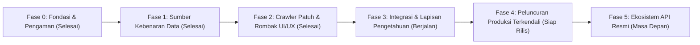

# Peta Jalan Pengembangan (ROADMAP) · Sanghyang News

Dokumen peta jalan resmi ini menggantikan `TODO.md` sebelumnya. Peta jalan disusun berdasarkan fase arsitektur terstruktur, audit sistem 13 November 2026, prinsip **Invarian Empat Nol**, dan integrasi operasional Rapat Senin manajemen Sanghyang Indah Spa Resort.

---

## Ringkasan Status Fase

| Fase | Nama Fase | Status | Target / Keterangan |
|---|---|---|---|
| **Fase 0** | Fondasi Lingkungan & Pengaman Produksi | **Selesai (100%)** | Basis data lokal Docker, pengaman tulis produksi, ESLint bersih, Node 24. |
| **Fase 1** | Integritas Data & Sumber Kebenaran | **Selesai (100%)** | Registri compset tunggal di DB, eliminasi data karangan (Zero Mock), observabilitas ScrapeRun. |
| **Fase 2** | Crawler Patuh, UI/UX Rapat Senin, & Keamanan | **Selesai (100%)** | AppShell tunggal, token Tailwind v4, dekomposisi komponen < 300 baris, parser Google Travel berbasis fixture, sesi HMAC. |
| **Fase 3** | Integrasi, Pengujian E2E, & Lapisan Pengetahuan | **Berjalan (90%)** | Dokumentasi P2-P5, draft CI quality-ci.yml, update graf ketat Graphify, pengujian visual E2E Puppeteer. |
| **Fase 4** | Peluncuran Produksi Terkendali (Rollout) | **Siap Rilis** | Panduan eksekusi migrasi Supabase produksi untuk pemilik sistem via `ROLLOUT_PRODUKSI.md`. |
| **Fase 5** | Integrasi Ekosistem API Resmi | **Rencana Masa Depan** | Pendaftaran kredensial resmi Google Business Profile, Instagram Graph API, dan Google Places API. |

---

## Rincian Per Fase

### Fase 0: Fondasi Lingkungan & Pengaman Produksi (Selesai)
- [x] **L1**: Penyediaan kontainer PostgreSQL 17 Docker lokal (`sanghyang-news-db` di port `55432`) dengan snapshot baca-saja produksi.
- [x] **L2**: Pembuatan mekanisme pengaman tulis produksi di `lib/db.ts` berbasis penanda environment.
- [x] **L3**: Konfigurasi server dev lokal systemd `sanghyang-news-dev` pada port `3001` tersambung ke basis data lokal.
- [x] **L4**: Isolasi konfigurasi ESLint (`eslint.config.mjs`) untuk folder blueprint `.agents/` dan `graphify-out/` (0 galat, 0 peringatan).
- [x] **L5**: Konfigurasi aman `allowScripts` pada `package.json` untuk Node 24 & npm 12.

### Fase 1: Integritas Data & Sumber Kebenaran (Selesai)
- [x] **D1**: Penyatuan registri pembanding tunggal ke model `Competitor` Prisma dengan migrasi lokal dan seed berprovenans (radius 25 km, Klaster I & II).
- [x] **D2**: Eliminasi seluruh angka omset pesaing karangan, peringkat fiktif, dan sumber palsu dari kode sumber (penegakan Zero Mock Data).
- [x] **D3**: Transformasi promo kompetitor dari daftar statis menjadi data observasi berstempel waktu dinamis.
- [x] **D4**: Rekonstruksi generator insight berbasis ulasan riil dan keyakinan terhitung.
- [x] **D5**: Normalisasi modul omset dan target bulanan outlet resort.
- [x] **D7**: Klasifikasi berita pasar koridor Anyer berpresisi tinggi (menghapus false-positive non-pariwisata).
- [x] **D8 & D6**: Karantina skrip sintetis crawler dan pembersihan ulasan tanpa tanggal/bukti.
- [x] **C1 & C2**: Observabilitas menyeluruh pada tabel `ScrapeRun` dan `ScrapeError` serta filter pengecualian properti pensiun.
- [x] **C5**: Pelacakan cakupan pengumpulan tarif kamar compset.

### Fase 2: Crawler Patuh, UI/UX Rapat Senin, & Keamanan (Selesai)
- [x] **C3**: Penghentian penembusan login DOM Instagram/TikTok dan penyusunan modul adaptor API resmi dengan status jujur *"Belum tersambung"*.
- [x] **C4**: Penulisan parser Google Travel/Hotels yang stabil berbasis rekaman fixture HTML offline dan ID deterministik.
- [x] **C6**: Konfigurasi rangkaian tes Python (`pytest` dan `ruff check`) pada `crawler/` dan `crawler/research/`.
- [x] **D9**: Penyambungan galeri kompetitor ke registri basis data lokal dengan status jujur *"Belum dikumpulkan"*.
- [x] **U1 & U2**: Penerapan satu AppShell dan metadata tab konsisten di seluruh rute.
- [x] **U4 & U5**: Standarisasi token desain Tailwind v4 dan penggantian emoji ikonik dengan teks/ikon standar.
- [x] **U3 & U6**: Dekomposisi halaman Market Intelligence menjadi komponen modular (< 300 baris) dengan 6 langkah membaca seragam serta pembersihan jargon teknis internal.
- [x] **U7**: Pembersihan teks status yang menyesatkan pada antarmuka.
- [x] **U8**: Optimasi kueri ringkasan data pasar (`/api/market-intelligence/summary`) dengan latensi terukur di bawah 1,5 detik.
- [x] **K1 & K2**: Penataan kerangka pengujian Vitest dan perapian direktori `scripts/` menjadi skrip operasional, arsip, dan pengujian.
- [x] **K3**: Penguatan keamanan sesi masuk berbasis HMAC dan pembatas laju percobaan login (*rate limiter*).

### Fase 3: Integrasi & Lapisan Pengetahuan (Sedang Berjalan)
- [x] **P2**: Penulisan ulang `README.md` dengan UTF-8 bersih, pemindahan berkas legacy v1 ke `docs/archive/legacy-v1/`, dan penyusunan panduan operasional di `docs/guides/`.
- [x] **P3**: Penyusunan dokumentasi riset sumber data (`sumber-data.md`), diagram alur data Mermaid (`alur-data.md`), dan metodologi pasar beserta glosarium (`metodologi.md`).
- [x] **P5**: Perumusan dokumen peta jalan `ROADMAP.md`.
- [ ] **K5**: Penyusunan draf berkas workflow CI GitHub Actions (`.github/workflows/quality-ci.yml`).
- [ ] **P4**: Pembaruan menyeluruh Graf Pengetahuan Graphify ketat (`--strict`), penyimpanan 15 Q&A penting, refleksi `LESSONS.md`, dan verifikasi fase `brain.py`.
- [ ] **U9**: Pengujian visual E2E Puppeteer pada 10 rute dalam 2 resolusi (Desktop & Ponsel) tanpa galat konsol dan tanpa horizontal overflow.

### Fase 4: Peluncuran Produksi Terkendali (Siap Rilis)
Fase ini dijalankan oleh pemilik repositori setelah seluruh verifikasi swarm dinyatakan lulus:
- [ ] Peninjauan berkas `docs/plans/ROLLOUT_PRODUKSI.md`.
- [ ] Eksekusi migrasi skema Prisma ke basis data Supabase produksi:
  `npx prisma migrate deploy`
- [ ] Eksekusi pembaruan data registri compset (D1) dan penonaktifan data promosi fiktif lama di produksi.
- [ ] Verifikasi ketersediaan layanan dan validasi kesehatan sistem (`/api/health?ready`).

### Fase 5: Integrasi Ekosistem API Resmi (Rencana Masa Depan - C3)
Fase ini mengaktifkan adaptor API resmi untuk data yang membutuhkan kredensial pihak ketiga. Keputusan pendaftaran akun dan anggaran API berada di tangan pemilik sistem:

1. **Google Business Profile API**:
   - Menghubungkan akun Google Bisnis resmi Sanghyang Indah Spa Resort.
   - Mengambil ulasan tamu dan rating bintang secara langsung via API resmi tanpa web scraping.
   - Memungkinkan notifikasi langsung bila ada keluhan tamu baru di outlet.
2. **Meta / Instagram Graph API (Business Discovery)**:
   - Menggunakan akun Instagram Profesional Facebook Developers.
   - Mengambil postingan promosi, media, dan caption dari akun Instagram publik kompetitor resmi (Aston, Mambruk, Novus Jiva, dll) secara legal dan terjadwal.
   - Menghilangkan ketergantungan pada scraping DOM Instagram yang dilarang.
3. **Google Places API**:
   - Memantau perubahan rating agregat, total jumlah ulasan, jam operasional, dan foto resmi properti compset.
   - Pemanfaatan cache mingguan untuk menghemat kuota dan anggaran API.
4. **Dasbor Pemantauan Kuota & Biaya API**:
   - Menyediakan tampilan visual sisa kuota dan perkiraan tagihan API di halaman Pusat Pembaruan Data (`/admin/scraping`).
